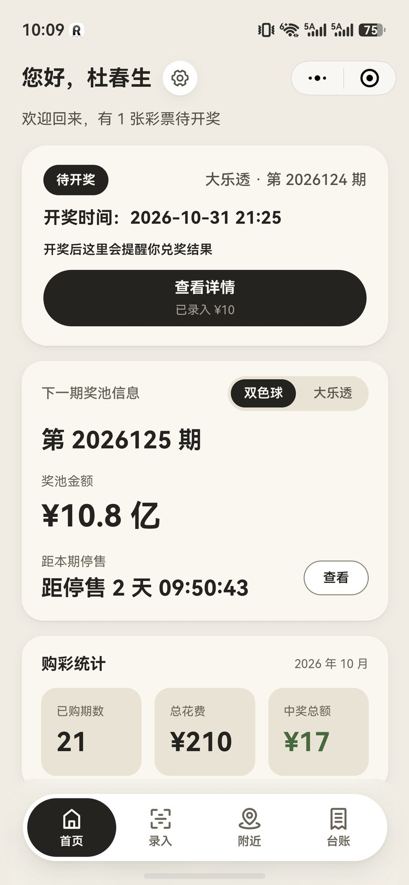
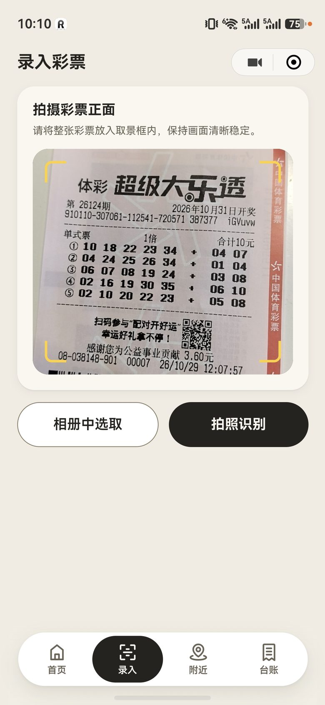
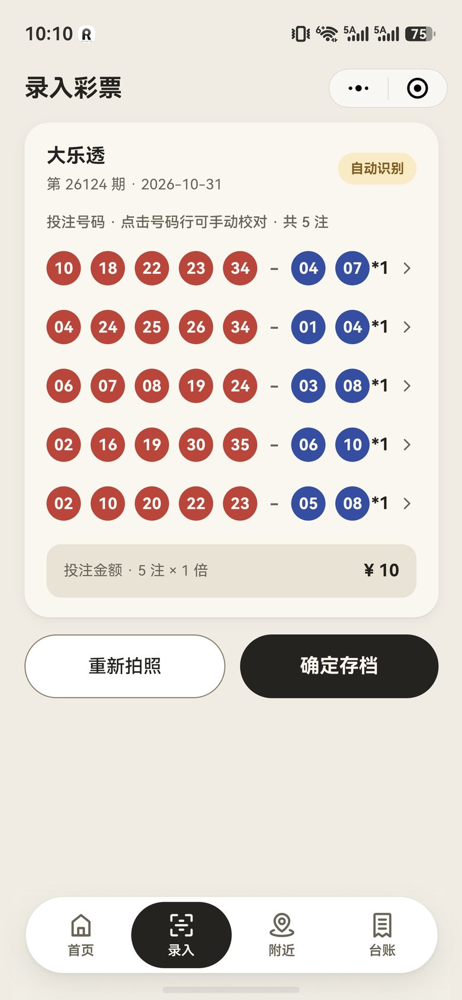
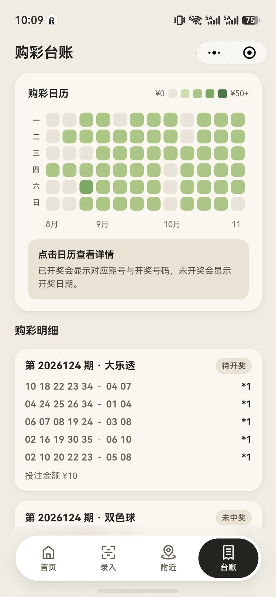

# 好运夹 goodluck+

> 把彩票这件事，收进一个夹子里。拍一张票自动认号，开奖后自动比对，临近兑奖主动提醒。

微信小程序 + NestJS 服务端 + Rokid 智能眼镜端三端同源的个人彩票记录管理工具。
不卖票、不代购、不预测输赢 —— 只负责让你**买得明白、记得清楚、该兑就兑**。

官网介绍页：<https://lottery.memorymap.cn>

<p>
  
  
  
  
</p>

> 上图为真实运行界面（非设计稿）。完整演示见 [官网介绍页](https://lottery.memorymap.cn)。

---

## 目录

- [这是什么](#这是什么)
- [功能一览](#功能一览)
- [仓库结构](#仓库结构)
- [技术栈](#技术栈)
- [快速开始](#快速开始)
- [环境变量](#环境变量)
- [接口一览](#接口一览)
- [关键业务规则](#关键业务规则)
- [几个踩过的坑](#几个踩过的坑)
- [设计体系](#设计体系)
- [安全说明](#安全说明)
- [许可证与免责](#许可证与免责)

---

## 这是什么

纸质票散在钱包和相册里，中没中奖靠自己翻；等到想起去兑，60 天期限已经过了。
这个项目要解决的就是**买完之后**这段时间：

| 原来的麻烦 | 现在的做法 |
|---|---|
| 纸质票、截图散落，期号号码只能手抄 | 取景框对准整张票，期号/号码/倍数/金额一次读全 |
| 开奖后自己搜号码，一注一注对着看 | 存档即触发比对，命中的球逐个高亮 |
| 60 天期限没有提醒，小额票夹在书里就忘 | 待兑奖置顶首页，显示剩余天数与兑奖渠道 |
| 买过多少、中了多少算不清 | 12 周热力图 + 明细列表，一格一期点开即筛 |

三种形态共用同一份数据：

- **微信小程序**：主力端，6 个页面走完「配置 → 拍票 → 校对 → 存档 → 比对 → 兑奖」
- **Rokid 智能眼镜**：抬手唤醒、语音提问，查最近开奖 / 今天买了哪些票 / 听一段号码推演，单绿 AR 界面
- **服务端**：识别、开奖同步、期号推算、兑奖判定，全部在这里兜住

---

## 功能一览

| 模块 | 页面 | 说明 |
|---|---|---|
| 初始化 | `pages/init` | 默认彩种、推演方式、姓名生日，一次配置长期生效 |
| 首页 | `pages/home` | 主状态卡按「待兑奖 > 待开奖 > 去录入」自动排序；奖池卡含停售倒计时 |
| 录入 | `pages/record` | 拍照 / 相册双通道，四角引导线提示取景；识别结果按单个小球呈现，可改号调倍数 |
| 附近 | `pages/nearby` | 腾讯位置服务检索周边网点，后端统一代理 + 网格缓存 + 配额闸门 |
| 推荐 | `pages/recommend` | 星座占星 / 五行推命两套确定性推演，附分析摘要与娱乐免责 |
| 台账 | `pages/ledger` | 12 周热力图（金额 5 阶）+ 明细倒序，点格子即筛选；抽屉展示逐球高亮 |

**彩种支持**：双色球（6 红 + 1 蓝）、大乐透（5 前区 + 2 后区），期号 / 开奖日 / 兑奖规则各自适配。

---

## 仓库结构

```
goodluck-plus/
├── miniprogram/          微信小程序（前端）
│   ├── pages/            6 个页面：home / init / record / nearby / recommend / ledger
│   ├── components/       icon（IconPark 图标，SVG 动态着色）
│   ├── custom-tab-bar/   自定义底部导航（跟随主题令牌）
│   ├── config/index.js   全局配置：接口地址、开奖日历、兑奖规则、附近参数
│   ├── styles/tokens.wxss  ★ 视觉令牌唯一真相源（浅/深两套）
│   ├── utils/            api / format / heatmap / mock / nearby / theme
│   └── theme.json        原生窗口层主题（app.json 的 @变量来源）
│
├── server/               NestJS 服务端
│   ├── src/api/v1/       控制器（11 个，21 条路由）
│   ├── src/modules/      业务模块：auth / user / ticket / lottery / redeem /
│   │                     recommend / statistics / heatmap / lunar / poi
│   ├── src/integrations/ 火山方舟（OCR + LLM）、豆包搜索（开奖）、腾讯位置服务
│   ├── src/jobs/         定时任务：开奖同步 / 兑奖计算 / 热力图聚合 / 清理
│   ├── src/common/       鉴权守卫、统一响应、异常过滤、期号与日期工具
│   ├── prisma/           schema + migrations + seed
│   └── scripts/          自检脚本（期号日历、火山连通性、附近代理断言）
│
├── glasses/              Rokid AIUI 眼镜端（.ink 单文件页面）
│   └── pages/            login / home / record / recommend / ledger
│
├── website/              产品官网介绍页（纯静态单文件 HTML）
└── docs/                 需求规格、技术文档、设计规范、部署指南
```

> `docs/` 内的历史文档写于不同阶段，文中出现的 `彩票小助手-小程序/` = 本仓库 `miniprogram/`，
> `backend/` = 本仓库 `server/`，路径引用以本仓库为准。

---

## 技术栈

| 层 | 选型 | 说明 |
|---|---|---|
| 小程序 | 原生 WXML / WXSS / JS（无框架） | 基础库 3.4.3，自定义 tabBar，`darkmode` 双主题 |
| 服务端 | NestJS 10 + TypeScript 5.7 | 全局守卫 + 拦截器 + 异常过滤器，`@nestjs/schedule` 跑定时任务 |
| 数据 | Prisma 6 + MySQL 8 | 13 张表；金额统一「分」，球号统一两位字符串 |
| 视觉识别 | 火山方舟（`ARK_VISION_MODEL`） | 整张票一次识别；无有效注数自动重试一次，仍失败转手动校对 |
| 号码推演 | 火山方舟 LLM + 本地确定性推演 | 有 Key 走 LLM，无 Key 走 `local-mock`，全流程可离线联调 |
| 开奖同步 | 火山 SearchInfinity（联网搜索） | 三道过滤剔除站点首页 / 彩评师页面 / 表头连号 |
| 位置服务 | 腾讯位置服务 · 地点搜索 | 仅服务端持有 Key，客户端不落库 |
| 眼镜端 | Rokid AIUI（Ink 模板 + 单绿规范） | 480×352 单色界面，亮度 6 级表达层级 |

---

## 快速开始

### 前置条件

- Node.js ≥ 22（服务端 `dev` 脚本用了 `--env-file`）
- MySQL 8（或用自带 `docker compose` 起一个）
- 微信开发者工具（调试小程序）
- 可选：火山引擎账号（OCR / 推荐 / 开奖同步）、腾讯位置服务 Key（附近）

### 1. 服务端

```bash
cd server
npm install

cp .env.example .env          # 按需填 Key，留空则自动降级到本地 mock
docker compose up -d mysql    # 或使用本机 MySQL，改 .env 的 DATABASE_URL

npx prisma migrate deploy     # 建表
npm run seed                  # 种子数据：用户 + 5 张各状态票据 + 开奖结果
npm run dev                   # http://localhost:3000
```

健康检查：`curl http://localhost:3000/health`

> **不需要任何外部 Key 也能跑通全流程。** `ARK_API_KEY` / `VOLC_SEARCH_API_KEY` / `TENCENT_LBS_KEY`
> 留空时：OCR 返回本地 mock 识别结果、推荐返回本地 mock 号码、附近接口返回 `status=199`、开奖同步任务跳过。
> 种子数据已含开奖结果，拍照 → 存档 → 比对 → 兑奖整条链路都能走。

### 2. 小程序

1. 微信开发者工具 → 导入项目 → 选择 `miniprogram/` 目录
2. 把 `project.config.json` 的 `appid` 改成你自己的小程序 AppID
3. 编辑 `miniprogram/config/index.js`：

   ```js
   USE_MOCK: false,
   apiBaseUrl: 'http://localhost:3000/api',   // 末尾必须带 /api，接口路径不带前缀
   TENCENT_LBS_KEY: 'YOUR_TENCENT_LBS_KEY',   // 走后端代理时可留空
   ```

4. 详情 → 本地设置 → 勾选「不校验合法域名」（本地 HTTP 联调必须）
5. 想让前端完全脱离后端独立调样式：`USE_MOCK: true`

> 首次打开会自动 `wx.login` → `POST /api/auth/login` 换 deviceToken；
> 未配置 `WECHAT_APPID` / `WECHAT_APPSECRET` 时自动降级匿名注册，界面照常可用。

### 3. 眼镜端（可选）

用 Rokid 官方 Web IDE（Craft）新建工程后导入 `glasses/` 内容。
`glasses/app.js` 顶部的 `API_BASE` 指向服务端地址。

> 眼镜端只能在真机或官方 IDE 里跑，无法在浏览器预览。
> Ink 模板有一套硬约束（单绿单色、无 `@keyframes`、`ink:elif` 真机不可靠等），详见 `docs/04-product-requirements-glasses.md`。

### 4. 官网介绍页（可选）

`website/index.html` 是零依赖单文件页面，直接双击打开或丢到任意静态托管即可。

---

## 环境变量

完整清单见 [`server/.env.example`](./server/.env.example)。几个要点：

| 变量 | 必填 | 留空时的行为 |
|---|---|---|
| `DATABASE_URL` | ✅ | 无法启动 |
| `WECHAT_APPID` / `WECHAT_APPSECRET` | 建议 | 微信登录报错，前端降级匿名注册 |
| `ARK_API_KEY` | 否 | OCR 与号码推演走本地 mock |
| `ARK_VISION_MODEL` | 否 | 默认 `deepseek-v4-1-flash-261017` |
| `ARK_LLM_ENDPOINT_ID` | 否 | 推演走 mock；用推理接入点时必须填 `ep-xxx` |
| `VOLC_SEARCH_API_KEY` | 否 | 开奖同步任务跳过 |
| `TENCENT_LBS_KEY` | 否 | `/api/poi/nearby` 返回 `status=199`，其余接口不受影响 |
| `SEED_DEVICE_TOKEN` | 否 | 本地种子令牌，**生产必须改** |
| `PAIRING_SALT` | 否 | 眼镜端口令哈希盐，**生产必须改** |

业务参数（兑奖天数、兑奖渠道门槛、附近检索半径与配额）也在同一份文件里，均有注释。

---

## 接口一览

统一响应体 `{ code, message, data }`，业务异常返回 HTTP 200 + 业务码
（`40001` 参数校验 / `40100` 身份失效 / `50000` 未知）。鉴权走请求头 `X-Device-Token`。

| 接口 | 方法 | 鉴权 | 说明 |
|---|---|:--:|---|
| `/health` | GET | - | 健康检查 |
| `/api/auth/register` | POST | - | 匿名注册，返回 deviceToken |
| `/api/auth/login` | POST | - | 微信登录（code → openid，多端同账号） |
| `/api/auth/rokid/passcode` | POST | ✅ | 生成/更新眼镜端口令验证码 |
| `/api/auth/rokid/bind` | POST | - | 眼镜端口令换 token |
| `/api/user/config` | GET / POST | ✅ | 用户配置读写 |
| `/api/ticket/ocr` | POST | ✅ | 票据识别（multipart，字段名 `file`，≤2MB） |
| `/api/ticket` | GET / POST | ✅ | 票据列表 / 存档（存档即触发比对） |
| `/api/ticket/:id` | DELETE | ✅ | 删除票据（连带注与兑奖记录） |
| `/api/lottery/status` | GET | ✅ | 彩种状态（倒计时、已购金额实时算） |
| `/api/lottery/draw` | GET | ✅ | 开奖结果（可按期号精确反查） |
| `/api/lottery/sync` | POST | ✅ | 按开奖日期补同步某期 |
| `/api/redeem/pending` | GET | ✅ | 待兑奖列表（含剩余天数、兑奖渠道） |
| `/api/redeem/confirm` | POST | ✅ | 兑奖确认 |
| `/api/statistics` | GET | ✅ | 首页统计 |
| `/api/heatmap` | GET | ✅ | 12 周热力图（含 5 阶等级） |
| `/api/lunar` | GET | ✅ | 农历干支（推演输入） |
| `/api/recommend` | POST | ✅ | 号码推演（LLM + 日级缓存） |
| `/api/poi/nearby` | GET | ✅ | 附近网点（腾讯位置服务代理，GCJ-02） |

---

## 关键业务规则

| 规则 | 值 | 说明 |
|---|---|---|
| 兑奖期限 | 开奖日起 **60 个自然日** | 逾期视为弃奖 |
| 兑奖渠道 | 单注 **< ¥1 万** 彩票店 / **≥ ¥1 万** 彩票中心 | 前端按金额提示渠道 |
| 大乐透奖级 | **7 档**（第 26014 期 / 2026-02-02 起由 9 档调整） | 固定奖随奖池浮动：摇奖前奖池 ≥ 8 亿按高档计 |
| 开奖日 | 双色球 周二/四/日，大乐透 周一/三/六 | 周五不开奖 |
| 期号推算 | 官方锚点 + 增量，**只数开奖日** | 内建休市日历（春节、国庆等），漏扣会导致期号领先 1~2 期 |

`docs/01-product-requirements-miniprogram.md` 有完整的页面级规格与状态机。

---

## 几个踩过的坑

这些是在真机和线上反复验证后才定下来的，改代码前值得先看一眼：

1. **期号必须扣休市日。** 只按星期几递增，遇到春节/国庆会领先 1~2 期，结果是"未开奖先结算"并写入脏号码。
   每年财政部公告后更新 `MARKET_CLOSED_RANGES`，再跑 `npx tsx scripts/check-issue-calendar.ts` 核对。
2. **号码解析只许"期号锚定向后扫描"。** 回看期号之前的内容会把上一期号码读进来；遇到其他期号必须截断。
3. **`camera` 组件不能在上传完成前被 `wx:if` 销毁。** 真机上表现为 `takePhoto` 永久挂起（"拍照超时"）。
   状态切换用遮罩层叠加，媒体组件常驻。
4. **图片压缩 `wx.compressImage` 在安卓只支持 jpg。** HEIC 必失败，需要 8 秒看门狗回退原图。
5. **深色模式下原生 `map` 不跟随主题。** iOS 会自动变暗、安卓不会，**IDE 模拟器一律不变暗，不能当真机看**。
   要 100% 可控只能用「地图个性化样式」，而该能力自 2023-06 起需付费购买 ——
   所以 `config.mapCustomStyle` 默认 `enabled: false`（等价于不传该属性）。
6. **3 位小数网格 ≈ 100 米是格边长，不是容差半径。** 当成容差用会导致缓存穿透、把位置服务配额烧穿。
7. **`radius` 不是有效旋钮。** 接口硬上限 1000 米且开了 `auto_extend`，想让"屏幕里看到"只能动视野。
8. **自定义 tabBar 是 page 的兄弟节点，拿不到 `page{}` 上的 CSS 变量**，`var()` 会被静默丢弃（不报错）。
   新增脱离 page 的组件时，要把根类名加进 `styles/tokens.wxss` 的选择器列表，并让它自己的 wxss 单独 `@import`。

---

## 设计体系

视觉令牌唯一真相源是 [`miniprogram/styles/tokens.wxss`](./miniprogram/styles/tokens.wxss)，改色只改这一个文件。

- **浅色「暖纸」**：画布 `#F1ECE2` / 卡片 `#FAF7F0` / 浮层 `#FFFFFF` / 凹陷 `#EAE3D4`
- **深色「暖炭」**：画布 `#14110D` / 卡片 `#211D17` / 浮层 `#2B2620` / 凹陷 `#1A1712`
- **品牌**：炭黑 `#242320` · 杏橙 `#ED945F`（仅关键节点、平涂不渐变）
- **号码**：红 `#C93A34` / 蓝 `#2F4FA8`；热力图 5 阶暖绿
- **轮廓靠明度台阶 + 投影，不靠描边**（浅色下画布与卡片仅 1.00:1，描边几乎不可见）
- **字体层级**：标题 20/B、区块 15/B、主按钮 16/B、正文 14、二级 12、微文字 11
- **图标**：IconPark（Apache-2.0，见 `docs/08-brand-identity.md`）

深色模式三层缺一不可：原生窗口层 `theme.json` + `app.json` 的 `@变量`、自绘层 `tokens.wxss`、JS 层 `utils/theme.js`。
眼镜端遵循 AIUI 单绿规范：只用 `#40FF5E`，靠 6 档透明度（100/72/48/24/12/6%）表达层级。

---

## 安全说明

- **仓库内不含任何真实凭据。** 所有 Key / Token / 口令 / 服务器地址均为占位符（`YOUR_*`、`CHANGE_ME_*`），
  真实值只存在于部署机上的 `.env`。
- `.env` 已在 `.gitignore` 中屏蔽，只提交 `.env.example`。
- 服务端所有第三方调用（OCR、LLM、开奖搜索、位置服务）的 Key 都只在服务端；
  小程序包内**不存放任何服务端 Key**，位置服务走 `GET /api/poi/nearby` 代理。
- 同一套工程里做过的运维脚本（部署、证书续期、生产探针）**未随本仓库开源**，因为它们绑定具体云账号与实例。
- 发现安全问题请开 Issue，不要提交含凭据的 PR。

---

## 许可证与免责

[MIT](./LICENSE) © 2026 杜春生

本产品为个人使用的**彩票记录管理工具**：不销售、不代购彩票，不提供任何形式的投注服务或中奖预测。
号码推演基于姓名、生日与所选推演方式做确定性生成，**仅供娱乐，不构成任何购彩建议，也不会提高中奖概率**。

彩票业务规则以中国财政部、国家体育总局彩票管理中心、中国福利彩票发行管理中心的最新公告为准。
请理性购彩；未满 18 周岁不得购买彩票或兑奖。
