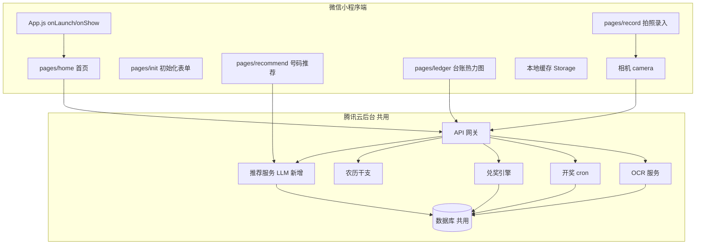
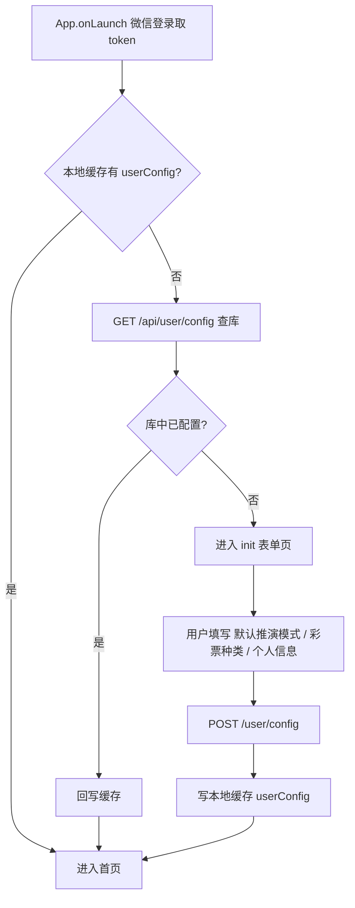
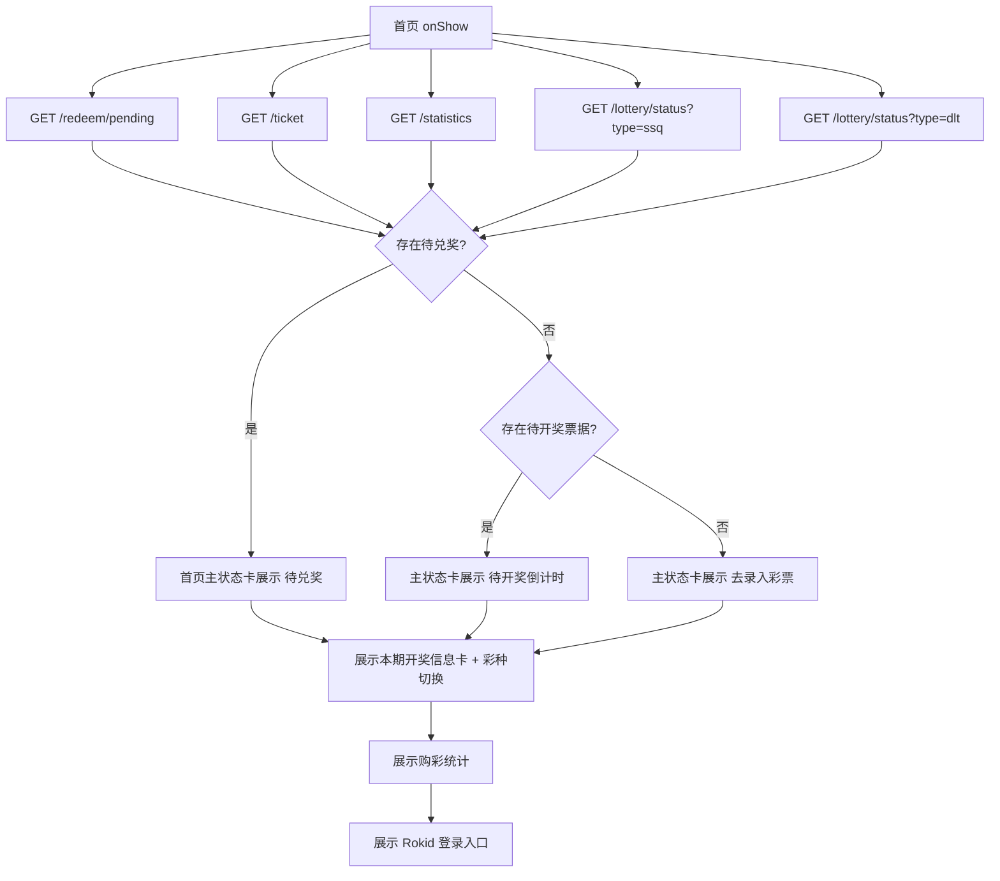
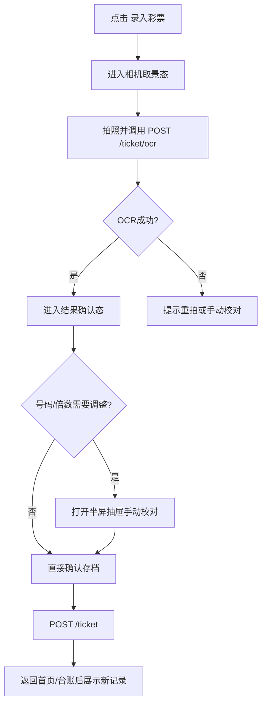
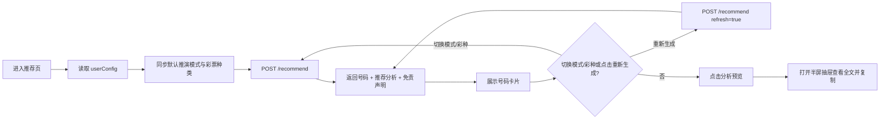

# 彩票小助手 · 微信小程序需求规格文档

> 文档版本：V1.3
> 编制目的：用于微信小程序端的技术设计、接口梳理、开发参考
> 当前状态：**前后端已联调通过并部署上线**（`https://lottery.memorymap.cn/api`，2026-08-25 首次上线时域名为 `api.memorymap.cn`，2026-10-30 迁至 `lottery` 子域），本文已按实际落地代码反向同步
> 运行载体：微信 App（iOS / Android），基于微信小程序平台
> 产品定位：彩票小助手的小程序版本为主板产品，提供兑奖提醒、彩票录入、购彩台账、趣味号码推荐等完整能力
> 关系：眼镜端为主板能力的轻量触点与子集入口；本文仅聚焦微信小程序完整版需求，后台接口字段以《服务端后台开发技术文档_V1.2.md》§8 为准

---

## 0. 版本变更说明

V1.3 相对 V1.2 的变更（**Rokid 眼镜端口令绑定接入**，2026-08-25，依《现有小程序前后台改造说明.md》V1.2）：

1. **首页 Rokid 入口改为真实口令抽屉**（§7）：占位文案替换为——6 位验证码输入 + 口令实时预览（`R{userId}-{code}`）+ 使用步骤 + 长期有效提示；「复制口令」先 `POST /api/auth/rokid/passcode` 设置成功再写剪贴板（失败不复制）；验证码不满 6 位复制按钮禁用；更换验证码时提示重新粘贴到 Rokid 快捷指令。
2. **接口清单新增**（§11.3）：`POST /api/auth/rokid/passcode`（设置口令验证码），共 18 个接口。
3. **`GET /api/user/config` 新增 `userId` 字段**：口令拼装依赖用户 ID，未初始化用户也返回。
4. **眼镜端对接**：口令绑定接口 `POST /api/auth/rokid/bind` 由眼镜端调用（不经过小程序）；小程序侧仅负责口令生成与展示。

V1.2 相对 V1.1 的变更（**微信登录上线 + 多端体验优化**，2026-08-21 下午）：

1. **微信登录上线（openid 身份）**（§3.2、§6.1、§11.3）：App 启动 `wx.login` → `POST /api/auth/login` 换 openid → 返回 `deviceToken`；**同一微信号手机/PC 多端为同一用户、数据互通**。`api.ensureToken()` 优先微信登录，失败降级匿名 `register`（眼镜端场景）。原"启动即匿名注册"改为"启动即微信登录"。
2. **初始化判断改为查库**（§6.3）：首页 `onShow` 不再只信本地 `userConfig` storage——本地无缓存时查询后端 `GET /api/user/config`，**库中已配置（`initialized=true`）直接进首页**（修复 PC 端登录被误要求重新配置的问题）；真未配置才跳 `init` 页；查库失败不跳转、留错误态可重试。
3. **40100 自动重登录**（§11.5）：`request` 与 `ocrUpload` 在 Token 失效时自动重新获取身份（微信登录优先）并重试一次，替代原"自动重注册"。
4. **OCR 上传链路修复**（§8.2）：真机相册上传多次失败的根因（nginx 1MB 限制 + uploadFile 无 40100 兜底）已修复：后端 `client_max_body_size 5m`、超限返回明确 `40001 图片超过 2048KB 上限`；前端上传带 40100 自动重试。
5. **金额显示统一整数元**（§7.3）：全站金额展示去角分（`¥3,000`），存储/计算仍为分精度；购彩统计卡样式统一（白底细边框，中奖总额绿色 `#00B473`），去掉底部"本月中奖 N 次"文案（与中奖总额重复）。
6. **台账月份图例对齐修复**（§10.2）：月份标签改为网格容器内绝对定位（与格子列共享坐标原点），消除硬编码 `margin-left` 导致的错位；图例位于热力图下方，间隔与格子列距一致（46rpx）。
7. **接口清单新增**（§11.3）：`POST /api/auth/login`，共 17 个接口。
8. **Rokid 入口卡片**（§7.5）：logo 图片圆角与外框统一（14rpx）。

V1.1 相对 V1.0 的变更（**依据联调部署通过后的实际代码反向更新**，2026-08-21）：

1. **接口合同来源切换**：原《云后台接口约定.md》已废止，接口字段唯一合同来源改为《服务端后台开发技术文档_V1.2.md》§8（其字段口径又以本文档前端代码为准，双方闭环）。
2. **接口调用清单补全**（§11.3）：补入 `/api/auth/register`（App 启动自动注册）、`DELETE /api/ticket/:id`、`POST /api/redeem/confirm`、`GET /api/lottery/draw`、`POST /api/lottery/sync`（日历补差同步）、`GET /api/lunar`，共 16 个接口。
3. **录入通道新增"相册选图"**（§8.2）：`wx.chooseMedia` 从相册选图走同一 OCR 链路（开发者工具无摄像头时调试用 + 真机备选）。
4. **40100 自动重注册机制**（§11.5）：`utils/api.js` 的 `request` 与 `ocrUpload` 在 Token 失效时自动调 `/auth/register` 换新 Token 并重试一次，后端清库后用户不卡死。
5. **票据列表新增开奖号码字段**（§5、§10.4）：列表项带 `winningRed`/`winningBlue`（该期真实开奖号码，历史票也可逐球高亮）与 `matchedRed`/`matchedBlue`（命中数）；台账"号码待同步"格子提供"同步开奖信息"按钮（`POST /api/lottery/sync`）。
6. **购彩统计改为三项**（§7.3）：已购期数 / 本月花费 / 本月中奖（`totalSpent`、`totalWon`，单位分）。
7. **推荐支持强制刷新**（§9.3）："重新生成"按钮传 `refresh=true` 绕过当日缓存。
8. **生产域名已定**（§12.3）：`https://lottery.memorymap.cn/api`（2026-10-30 起），微信后台合法域名待配置；`USE_MOCK=false` 已切生产。
9. **热力图等级阈值固化**（§10.3）：L1 ≤¥4 / L2 ≤¥10 / L3 ≤¥30 / L4 >¥30（图例文案仍"¥50+"）。

---

## 目录

- [0. 版本变更说明](#0-版本变更说明)
- [1 总体概述](#1-总体概述)
- [2 产品边界与版本定位](#2-产品边界与版本定位)
- [3 运行环境与能力基线](#3-运行环境与能力基线)
- [4 系统架构](#4-系统架构)
- [5 数据模型](#5-数据模型)
- [6 模块一：初始化配置](#6-模块一初始化配置)
- [7 模块二：首页状态聚合与兑奖提醒](#7-模块二首页状态聚合与兑奖提醒)
- [8 模块三：拍照录入与手动校对](#8-模块三拍照录入与手动校对)
- [9 模块四：趣味号码推荐生成](#9-模块四趣味号码推荐生成)
- [10 模块五：台账与日历热力图](#10-模块五台账与日历热力图)
- [11 后台接口调用与扩展](#11-后台接口调用与扩展)
- [12 非功能与基础约束](#12-非功能与基础约束)
- [13 风险与待确认项](#13-风险与待确认项)

---

## 1 总体概述

本产品为运行在微信中的彩票趣味辅助小程序，是“彩票小助手”体系中的主板产品。用户通过触摸交互完成初始化配置、开奖提醒查看、彩票录入、台账管理和趣味号码推荐。当前需求文档以小程序前端完整版为主，不再以眼镜端流程为主线展开说明。

### 1.1 主要业务能力

1. **打开自动兑奖校验**：小程序打开/切回前台时，向后台取预计算的待兑奖结果；
2. **拍照录入彩票**：调用手机相机拍照，上传后台 OCR，并提供手动校对抽屉完成号码修正与台账存档；
3. **趣味号码推荐**：基于用户配置与当前推演模式，调用后台推荐服务生成趣味号码与分析摘要；
4. **首次初始化**：完成用户偏好与基础信息配置（表单式）。

### 1.2 当前版本范围

- 小程序版本为当前主产品，负责承载完整业务闭环；
- 业务闭环包括：配置、首页提醒、拍照录入、手动校对、号码推荐、台账热力图与详情查看；
- 眼镜端仅视为主板产品的触点与子集入口，不在本文中展开详细交互设计；
- 本文描述以当前小程序前端已校对完成的静态页面与交互为准。

---

## 2 产品边界与版本定位

### 2.1 主板定位

微信小程序版为彩票小助手的主板产品，承担如下完整职责：

- 用户基础配置与偏好管理；
- 首页兑奖提醒与开奖状态聚合；
- 彩票拍照录入、OCR 结果确认与手动校对；
- 趣味号码推荐生成、分析预览与复制；
- 购彩台账、热力图、开奖说明、明细详情与状态处理。

### 2.2 与其他触点的关系

虽然系统可能存在眼镜端等其他触点，但当前阶段的功能定义以小程序主板为准：

- 小程序定义数据结构、页面结构、状态流与交互规范；
- 其他触点若存在，应视为对主板能力的裁剪、映射或快捷入口；
- 后续若扩展其他端形态，应优先复用小程序已确认的配置模型、状态模型与后台接口定义。

### 2.3 共用后台（核心约束）

小程序与其他端可共用同一套云后台：

- **同一域名**（`https://lottery.memorymap.cn/api`）、**同一套 API**、**同一份数据**（用户配置、彩票档案、开奖历史）；
- 接口字段以《服务端后台开发技术文档_V1.2.md》§8 为准（其口径来源为本文前端代码），本文不重复定义底层字段合同，仅说明调用方式与页面用途；
- 任一端的写入（录入彩票、修改配置、处理票据状态）应可在其他端可见。

---

## 3 运行环境与能力基线

### 3.1 运行环境

- 平台：微信 App（iOS / Android）；
- 基础库：微信小程序（建议使用较新基础库）；
- 显示：**全彩手机屏**（不受单色约束，可用彩色）；
- 模块化：支持 ESM 与 npm（小程序 npm 构建）。

### 3.2 本小程序使用的平台能力

| 能力 | API | 用途 |
|---|---|---|
| App 生命周期 | `App.onLaunch` / `onShow` | 打开/回前台时自动注册设备与兑奖刷新 |
| 页面生命周期 | `onLoad` / `onShow` / `onReady` | 页面初始化 |
| 网络 | `wx.request`（HTTPS，需合法域名） | 请求后台 API |
| 文件上传 | `wx.uploadFile`（multipart，字段名 `file`） | 彩票图片上传 OCR |
| 相机 | `camera` 组件 + `wx.createCameraContext().takePhoto()` | 拍摄彩票 |
| 相册 | `wx.chooseMedia`（sourceType: album，compressed） | 相册选图，走同一 OCR 链路 |
| 存储 | `wx.setStorageSync` / `wx.getStorageSync` | deviceToken、userConfig、离线缓存兜底 |
| 剪贴板 | `wx.setClipboardData` | 复制推荐分析内容 |
| 组件 | view/text/button/image/scroll-view/picker/camera | 界面 |

### 3.3 当前实现边界

- **无内置 LLM**：号码推荐走后台 `/recommend`（火山方舟，日级缓存）；
- **无内置 OCR**：OCR 走后台 `/ticket/ocr`（deepseek-v4-1-flash-261017 视觉模型，图片不落盘，单张 ≤2MB）；
- **当前未接入扫码录入**：扫码能力保留为后续扩展项；
- **当前不展开语音交互设计**：本期以触控页面为主；
- **合法域名**：微信后台需新增 `lottery.memorymap.cn`（request + uploadFile）；旧 `api.memorymap.cn` 在确认切换无误前保留，避免回退受阻。

---

## 4 系统架构

### 4.1 整体架构图



> 关键：小程序作为主板前端，负责完整页面组织、状态切换与交互闭环；后台负责 OCR、开奖、兑奖、推荐与数据存储。

### 4.2 小程序与后台的职责

| 端 | 职责 |
|---|---|
| 小程序端 | 触摸交互（拍照录入/表单/抽屉）+ 页面状态编排 + 台账管理 |
| 后台 | OCR、开奖 cron、兑奖引擎、农历、数据存储、统计聚合、**推荐服务（新增，供小程序）** |

---

## 5 数据模型

数据模型以小程序主板当前实现为主，底层字段合同详见《服务端后台开发技术文档_V1.2.md》§8。当前小程序前端已确认的关键模型包括：

- 用户配置：`lotteryType`、`name`、`birth`、`gender`、`divinationSystem`；
- 首页状态模型：`待兑奖 / 待开奖 / 去录入彩票` 三态主卡；
- 彩票记录模型：彩种、期号、开奖日期、投注号码、倍数、状态、金额，以及该期真实开奖号码（`winningRed`/`winningBlue`，供逐球高亮）与命中数（`matchedRed`/`matchedBlue`）；
- 推荐结果模型：彩种、推演模式、号码结果、用户信息行、分析摘要、免责声明；
- 购彩统计模型：已购期数、本月花费（`totalSpent`）、本月中奖（`totalWon`）；
- 台账热力图模型：开奖日期、彩种、金额色阶（0-4 五阶）、该期开奖信息、月份定位、票据筛选状态。

---

## 6 模块一：初始化配置

### 6.1 触发条件

小程序启动后，首页 `onShow` 通过 `checkInitConfig()` 判断是否进入初始化页（**V1.2：本地缓存优先、无缓存则查库**）：

1. 本地缓存有有效 `userConfig`（含 `lotteryType`/`lotteryTypes`）→ 直接进首页（快速路径）；
2. 本地无缓存 → 查询后端 `GET /api/user/config`：
   - 库中已配置（`initialized=true` 或含 `lotteryType`）→ **直接进首页**并回写本地缓存（修复 PC 端与手机端同一 openid 用户被误要求重新配置的问题）；
   - 库中未配置 → 进入 `init` 页；
   - 查库失败（网络异常）→ 不跳转，首页显示错误态可重试。

用户也可在首页点击顶部问候文案再次进入配置页修改信息。

### 6.2 表单式初始化

小程序采用**单页表单配置**，无需对话式初始化。当前前端已落地的字段与顺序如下：

- 默认推演模式：single select（星座占星 / 五行推命）；
- 优先彩票种类：single select（双色球 / 大乐透）；
- 姓名：input；
- 性别：single select；
- 出生日期：picker（日期选择器）。

提交后 `POST /user/config` 保存，并同步本地缓存 `userConfig`。其中主字段采用单选 `lotteryType`，同时可兼容旧结构 `lotteryTypes` 作为回填兜底。

> 当前前端未实现语音录入按钮，初始化流程以触控表单为准。

### 6.3 流程



---

## 7 模块二：首页状态聚合与兑奖提醒

### 7.1 触发条件

- 小程序 `App.onLaunch`（首次启动且无 `deviceToken` 时自动登录：`wx.login` → `POST /api/auth/login` 微信登录，失败降级 `POST /api/auth/register` 匿名注册，V1.2）；
- 小程序 `App.onShow`（打开或从后台切回前台）；
- 首页 `onShow`（从其他页面返回首页）。

> 当前前端首页采用卡片化聚合展示，不再承载语音唤醒链路。

### 7.2 流程



### 7.3 屏幕输出

- 首页主状态卡优先级为：`待兑奖 > 待开奖 > 去录入彩票`；
- 待兑奖状态展示中奖金额、兑奖截止日期（`deadlineDate` + 剩余天数 `daysLeft`）与兑奖渠道指引（`redeemChannel`：shop 彩票店 / center 彩票中心，单注 ≥¥1 万须彩票中心）；
- 待开奖状态展示开奖倒计时（后端返回 `saleEndAt` 停售时刻时间戳，前端每秒跳动实时倒计时）与预计开奖日期；
- 空状态展示录入引导；
- 页面下方固定展示"本期开奖信息""购彩统计""Rokid 智能体登录入口"三块内容；
- 购彩统计为三项：**已购期数 / 本月花费 / 本月中奖**（`purchasedPeriods` / `totalSpent` / `totalWon`，金额单位分、前端格式化）；
- **Rokid 口令抽屉**（2026-08-25 改造说明 §4）：点击"Rokid 智能体登录"入口打开半屏抽屉——填写 6 位数字验证码 → 实时预览口令 `R{userId}-{code}` → 「复制口令」（先 `POST /auth/rokid/passcode` 设置成功再写剪贴板，失败不复制）→ 引导粘贴至 Rokid App「AI 快捷指令」；口令长期有效，更换验证码后提示重新粘贴。验证码不满 6 位时复制按钮禁用。

> 首页中的兑奖确认、Rokid 口令设置均使用半屏抽屉承载，抽屉打开时需同步隐藏自定义底部 tabBar。

---

## 8 模块三：拍照录入与手动校对

### 8.1 触发条件

用户在首页点击"录入彩票"按钮。

### 8.2 当前录入通道

当前前端已落地的是**拍照 OCR + 相册选图 + 手动校对**闭环：

| 通道 | 说明 | 状态 |
|---|---|---|
| 拍照 OCR | `camera` 组件取景 + `wx.createCameraContext().takePhoto()`，拍照后 `wx.uploadFile` 上传后台 `/ticket/ocr`（multipart，字段名 `file`，单张 ≤2MB） | 已实现 |
| 相册选图 | `wx.chooseMedia`（album + compressed），选图后走同一 OCR 链路；开发者工具无摄像头时调试用，真机备选 | 已实现 |
| 手动校对 | OCR 结果不准确时（含 `code=40010` 识别失败），通过半屏抽屉点选号码和调整倍数 | 已实现 |
| 扫码 | 通过 `wx.scanCode` 快速录入彩票二维码 | 预留扩展，当前页面未接入 |

### 8.3 流程



### 8.4 关键字段

- 彩种类型 `lotteryType`、彩种名称、期号 `period`（纯数字字符串，提交前清洗非数字字符）、开奖日期 `drawDate`（优先票面 OCR 识别值 `YYYY-MM-DD`，缺省由后端推算）；
- 每注号码按红区/蓝区或前区/后区拆分展示；
- 倍数使用加减步进器，最小为 `1` 倍；
- `totalAmount` 单位为分（每注 ¥2 × 倍数，后端保存时重算校验）；
- 手动校对控件需区分双色球与大乐透两套选号规则：
  - 双色球：`6 红 + 1 蓝`
  - 大乐透：`5 前区 + 2 后区`
- 手动校对采用点选号码圆圈，不使用纯文本输入。

### 8.5 保存后的自动开奖比对（2026-08-20 新增）

- `POST /api/ticket` 保存成功后，后端自动触发：该期已开奖 → 直接兑奖比对；票面开奖日已过但未同步 → 先补同步开奖结果再比对；未来期 → 保持"待开奖"；
- 保存响应返回 `{ id, status }`，`status` 为比对后的最新状态（可能已流转为"待兑奖"/"未中奖"），保存会多耗 1-3 秒；
- 用户保存历史期彩票后无需等待定时任务，立即可见中奖状态。

### 8.6 与其他页面联动

- 录入成功后，首页主状态卡与购彩统计可在下次进入首页时自动刷新；
- 台账页会显示新增票据，并用于热力图、开奖筛选和详情查看；
- 手动校对抽屉打开时，需同步隐藏底部 tabBar。

---

## 9 模块四：趣味号码推荐生成

### 9.1 触发条件

用户进入“号码推荐”页或点击“重新生成”按钮。

### 9.2 输入数据源

1. 静态：用户配置中的姓名、性别、出生日期、默认推演模式、优先彩票种类；
2. 动态：当前日期，以及后台返回的推荐结果摘要。

> 推荐页在 `onShow` 时会重新同步 `userConfig`，并据此更新当前推演模式和彩票种类的默认选中状态。

### 9.3 流程



> 缓存与刷新：后端按 `用户 + 日期 + 彩种 + 推演体系` 日级缓存，同组合当日重复请求秒回；"重新生成"按钮传 `refresh: true` 绕过缓存强制重算（LLM 生成约 5-8 秒，有 loading 反馈）。

### 9.4 两套独立推演体系

1. 西方体系：星座占星；
2. 东方体系：五行推命。

- 默认用初始化选定体系；支持切换；两套独立不混合；
- **Prompt 模板维护在后台**，由小程序按当前推演模式调用对应推荐能力。

### 9.5 输出要求

1. 推荐号码卡片优先展示，支持双色球 / 大乐透切换；
2. 顶部显示用户信息：姓名、性别、生日、今日；
3. 卡片内仅展示两行左右的推荐分析预览，超出省略；
4. 点击分析区域后，使用半屏抽屉完整展示分析描述，并提供“关闭 / 复制”；
5. 页面底部保留娱乐免责提示与“重新生成”按钮。

---

## 10 模块五：台账与日历热力图

### 10.1 触发条件

用户进入"台账"页。

### 10.2 内容

- 购彩热力图（`GET /heatmap`），参考 GitHub 贡献图式布局；
- 开奖说明区：点击热力图格子后显示该期开奖信息；
- 购彩明细列表（`GET /ticket`）；
- 票据详情半屏抽屉。

### 10.3 全彩热力图

- 采用 12 周范围的 GitHub 风格热力图布局；
- 行表示开奖日，列表示周：
  - 周一 / 周三 / 周六：大乐透
  - 周二 / 周四 / 周日：双色球
  - 周五不开奖
- 每格对应一期开奖记录，颜色深浅映射该期购彩金额，5 阶色板 `['#EEF0F3','#C8E6C9','#81C784','#4CAF50','#2E7D32']`；
- 金额等级阈值（后端口径，图例文案仍为"¥0 / ¥50+"）：L0 ¥0；L1 ≤¥4（1~2 注）；L2 ≤¥10；L3 ≤¥30；L4 >¥30（超过仍为 L4）；
- 月份标识显示在"该月第一个开奖日所在列"的下方，并与对应列左侧对齐；
- 后端 `/api/heatmap` 返回 `draws`（日期 → 该期开奖信息 map）：格子点击后直接展示该期开奖号码；**该日期无 `draws` key 且已过开奖日 → 显示"号码待同步"与"同步开奖信息"按钮**（`POST /api/lottery/sync`，幂等，冷启动补历史开奖）。

### 10.4 小程序端增强

> 手机屏幕大、触摸精准，适合承载更细粒度的筛选与详情交互：

- 点击热力图某格 → 同步筛选该开奖期购买的彩票，并刷新开奖说明区；
- 筛选态下，底部"点击加载更多"切换为"查看全部"，用于恢复完整列表；
- 列表号码按单个号码独立着色：未命中为灰色，命中号码单独高亮为红色或蓝色。**开奖号码基准优先用票据自带的 `winningRed`/`winningBlue`**（后端按期号精确反查，历史票也能高亮；无则回退热力图 `draws` → 最新期状态）；
- 点击票据卡片 → 打开半屏抽屉展示开奖信息、我的号码（命中高亮 + `matchedRed`/`matchedBlue` 命中数）、中奖情况；
- 票据详情抽屉底部提供"关闭 / 删除"（调 `DELETE /api/ticket/:id`，后端级联删除注与兑奖记录），若状态为"待兑奖"则切换为"关闭 / 兑奖"（调 `POST /api/redeem/confirm`，传 `ticketId`）。

---

## 11 后台接口调用与扩展

### 11.1 封装原则（实际落地）

- 所有后台调用统一封装在 `utils/api.js`（`request` 通用封装 + 16 个接口函数），**无独立 request.js**；
- 域名与开关配置在 `config/index.js`：`USE_MOCK`（true 走本地 mock 独立调试，**当前生产为 false**）与 `apiBaseUrl`（**当前为 `https://lottery.memorymap.cn/api`**，接口相对路径不带 `/api` 前缀）；
- `apiBaseUrl` 域名须配置为小程序"request 合法域名"与"uploadFile 合法域名"（已配置）；
- 所有请求自动携带 `X-Device-Token`（storage 缓存，`App.onLaunch` 无 Token 时自动注册）。

### 11.2 request 封装（实际代码要点）

```javascript
// utils/api.js（节选）
function request({ url, method = 'GET', data = {}, header = {}, retried = false }) {
  return new Promise((resolve, reject) => {
    wx.request({
      url: config.apiBaseUrl + url,
      method,
      data,
      header: {
        'Content-Type': 'application/json',
        'X-Device-Token': header.token || wx.getStorageSync('deviceToken') || '',
        ...header
      },
      success: (res) => {
        const body = res.data || {};
        // Token 无效（后端清库/换设备后旧 Token 失效）：自动重新获取身份并重试一次
        //（V1.2：ensureToken 优先微信登录 wx.login → /api/auth/login，失败降级匿名 register）
        if (body.code === 40100 && !retried) {
          tokenAndRetry({ url, method, data, header }, resolve, reject);
          return;
        }
        resolve(body);   // 2xx 原样透传 {code, message, data}
      },
      fail: (err) => reject(err)
    });
  });
}
```

> OCR 上传走独立的 `ocrUpload`（`wx.uploadFile`，字段名 `file`），内置同款 40100 自动重试（2026-08-21 修复：此前上传接口缺失该兜底，清库后 OCR 一直失败；后随微信登录上线改为 `ensureToken` 优先登录）。身份获取有防并发锁（`ensuring` 单例 Promise）。

### 11.3 接口调用清单

> 字段定义见《服务端后台开发技术文档_V1.2.md》§8。

| 接口 | 方法 | 调用位置 | 用途 |
|---|---|---|---|
| `/api/auth/register` | POST | `app.js` onLaunch 降级 / `api.js` 40100 兜底 | 匿名注册设备，返回 `deviceToken`（每次注册独立用户） |
| `/api/auth/login` | POST | `app.js` onLaunch 微信登录（`ensureToken`） | 微信登录：`{code}` → openid → 返回 `deviceToken`；同一微信号多端同一用户（V1.2） |
| `/api/auth/rokid/passcode` | POST | 首页 Rokid 口令抽屉「复制口令」 | 设置/更新口令验证码（6 位数字，幂等 upsert；V1.3） |
| `/api/user/config` | GET/POST | init / recommend / home | 配置读写 |
| `/api/ticket/ocr` | POST（multipart `file`） | record | 拍照/相册图片识别 |
| `/api/ticket` | POST | record | 保存票据（保存后自动开奖比对，返回 `{id, status}`） |
| `/api/ticket` | GET | home / ledger | 彩票列表（含 `winningRed/Blue` 与命中数） |
| `/api/ticket/:id` | DELETE | ledger 抽屉 | 删除票据（级联） |
| `/api/redeem/pending` | GET | home | 待兑奖列表（含 `deadlineDate`/`redeemChannel`/`daysLeft`） |
| `/api/redeem/confirm` | POST | home / ledger 抽屉 | 兑奖确认（`id` 或 `ticketId`） |
| `/api/lottery/status` | GET | home / ledger | 期号/奖池/倒计时/开奖号码（含 `saleEndAt` 实时倒计时） |
| `/api/lottery/draw` | GET | ledger | 开奖结果（`issue` 可选，缺省最新一期） |
| `/api/lottery/sync` | POST | ledger 日历"同步"按钮 | 按开奖日期补差同步该期开奖 |
| `/api/statistics` | GET | home | 本月已购/花费/中奖统计 |
| `/api/heatmap` | GET | ledger | 热力图（`amounts` + `draws` + `legend`） |
| `/api/lunar` | GET | recommend | 农历干支（推荐 Prompt 输入） |
| `/api/recommend` | POST | recommend | 生成号码、分析摘要与免责声明（`refresh` 可选） |
| `/health` | GET | — | 健康检查（运维探活，前端不调用） |

### 11.4 后台接口契约：`/api/recommend`

> 完整契约见《服务端后台开发技术文档_V1.2.md》§8.3.14。

```
POST /api/recommend
```

参数：

| 参数 | 必填 | 说明 |
|---|---|---|
| `system` | 是 | `astrology`（星座占星）/ `iching`（五行推命） |
| `lottery` | 是 | `ssq`（双色球）/ `dlt`（大乐透） |
| `refresh` | 否 | 布尔，默认 `false`；`true` 绕过当日缓存强制重算 |

响应：

```json
{
  "code": 0,
  "message": "ok",
  "data": {
    "systemName": "星座占星",
    "date": "2026-08-19 周三",
    "userText": "春生 · 2000-01-15 生 · 今日 丙午年七月初一",
    "redLabel": "红球区 · 6 个",
    "blueLabel": "蓝球区 · 1 个",
    "redBalls": ["03", "08", "15", "21", "27", "30"],
    "blueBalls": ["09"],
    "summary": "结合用户信息与当前推演模式生成的趣味分析描述。",
    "disclaimer": "本推荐仅供娱乐，不构成任何购彩建议"
  }
}
```

> 后台实现：读取用户配置 → 结合推演模式与彩种生成结构化号码（火山方舟 LLM，号码经服务端二次合法化修正）→ 返回号码、简短分析和免责声明。`userText` 由后端组装（姓名 + 生日 + 农历），前端在 `recommend.js` 的 `buildAnalysisText` 中基于 `userText` + `summary` 拼接完整分析。

### 11.5 错误处理约定

- 接口失败 reject，页面 catch 后 `wx.showToast` 或展示错误态；
- **`code=40100`（Token 无效）由 `utils/api.js` 统一兜底**：自动调 `/auth/register` 换新 Token（含防并发锁）并重试一次，页面无需感知；
- 其余错误码语义见《服务端后台开发技术文档_V1.2.md》§8.4（如 40001 参数错误、40010 OCR 失败→手动校对抽屉、40401 未开奖→展示待开奖）。

---

## 12 非功能与基础约束

### 12.1 数据持久化

- 后台数据库为唯一真源；
- 小程序本地 `Storage` 为缓存：最近配置 `userConfig`、首页状态与列表数据，断网可展示已有内容；
- 写操作先后台成功再更新本地；读操作优先后台失败回退本地。

### 12.2 全彩显示适配

- 手机全彩屏，**可用彩色**；
- 中奖金额/状态可用醒目颜色高亮；
- 热力图可用多色阶；
- 页面统一使用卡片、圆球号码、胶囊按钮和半屏抽屉；
- 自定义底部 tabBar 为悬浮胶囊样式，并带半透明模糊遮罩层；当页面抽屉打开时，tabBar 与遮罩必须同步隐藏。

### 12.3 网络约束

- `wx.request` / `wx.uploadFile` 强制 HTTPS；
- 生产域名 `https://lottery.memorymap.cn/api`（2026-10-30 迁移，此前为 `api.memorymap.cn`）；微信后台需同步新增 request / uploadFile 合法域名；
- 本地联调时改 `apiBaseUrl` 为 `http://localhost:3000/api`，并在开发者工具勾选"不校验合法域名"。

### 12.4 性能约束

- 避免频繁 `setData`；
- 图片上传前可压缩（小程序 `wx.compressImage`）降低上传延迟；
- 第三方库经小程序 npm 构建使用；
- 前端支持 `USE_MOCK` 模式，允许在未联调后台时独立完成页面与交互验证。

### 12.5 合规

- 个人趣味工具，号码推荐仅娱乐，不构成购彩建议；
- 推荐结果附娱乐免责提示。

---

## 13 风险与待确认项

| 编号 | 项 | 影响 | 状态 / 建议应对 |
|---|---|---|---|
| R1 | 扫码录入通道尚未接入当前前端 | 影响快捷录入能力 | 待扩展：补充 `wx.scanCode` 入口，并明确二维码解析规则 |
| R2 | 后台 OCR 识别率 | 影响录入准确率 | ✅ 已缓解：deepseek-v4-1-flash-261017 + JSON 强约束输出 + 服务端规则校验；识别失败 40010 转手动校对 |
| R3 | 开奖数据源稳定性 | 影响兑奖及时性 | ✅ 已缓解：SearchInfinity 多候选投票 + 二轮重搜 + 用户端手动补差同步 |
| R4 | 后台 LLM 成本与延迟 | 影响推荐体验 | ✅ 已缓解：日级缓存 + `thinking disabled`（生成约 5-8s）+ refresh 强刷 |
| R5 | 图片上传延迟 | 录入体验 | ✅ 已缓解：前端压缩选图 + 2MB 上限 + loading 反馈 |
| R6 | 后台服务可用性 | 整体可用性 | ✅ 已部署：PM2 进程守护 + /health 探活；告警待接入 |
| R7 | 小程序合法域名配置 | 发布 | ⚠️ 待办：`lottery.memorymap.cn` 需在微信后台新增（request + uploadFile），旧 `api.memorymap.cn` 暂留作回退 |
| R8 | 多触点数据一致性 | 共用后台体验 | 以后台 DB 为真源，本地仅缓存 |
| R9 | 小程序内容合规 | 发布审核 | 彩票类小程序可能受限，需评估类目与审核要求（当前个人自用，未提审） |
| R10 | 期号日历推算跨春节失准 | 开奖同步正确性 | ⚠️ 待维护：期号锚点（2026-08 固化）跨春节休市后需以真实同步数据校准（后端 `lottery-rules.ts`） |

---

> 本文档聚焦“彩票小助手”微信小程序主板版本的完整需求归拢，作为当前产品功能、页面交互、状态模型与接口调用的主参考文档。后台接口字段以《服务端后台开发技术文档_V1.2.md》§8 为唯一合同来源；若后续扩展其他端形态，应以本文定义的小程序主板能力为基准进行裁剪或映射。
