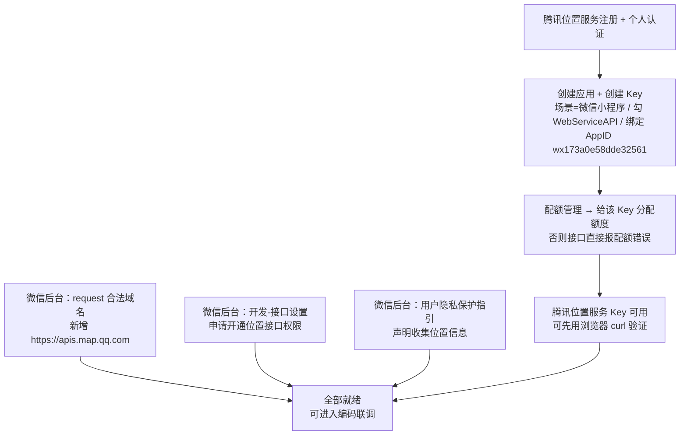
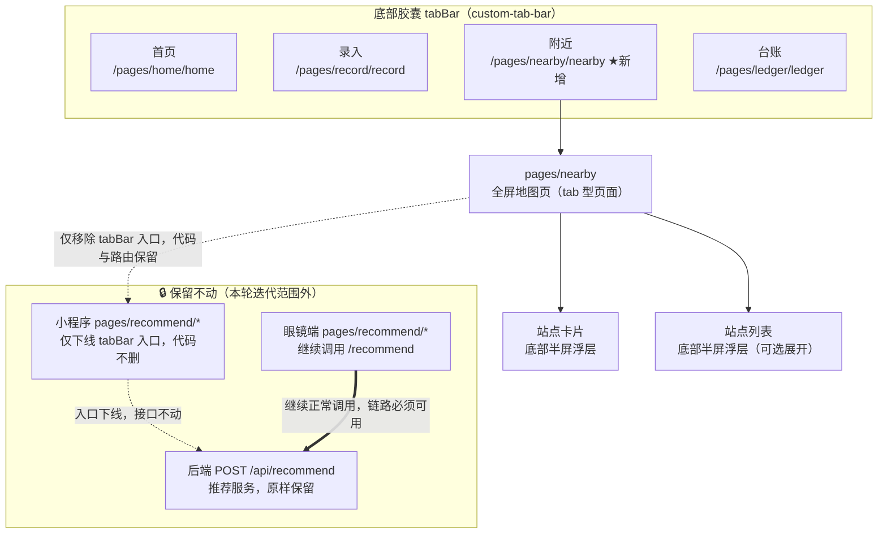
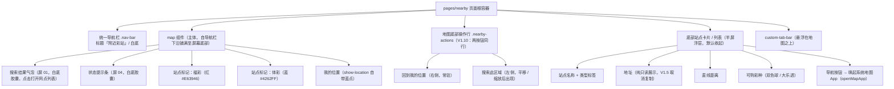
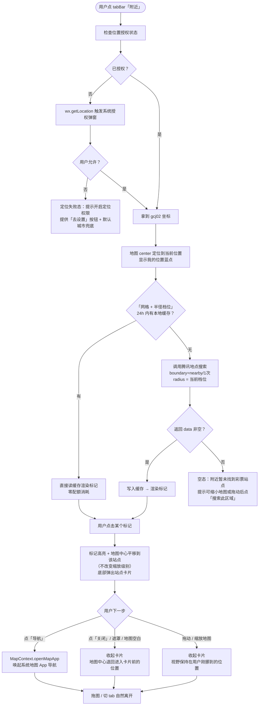
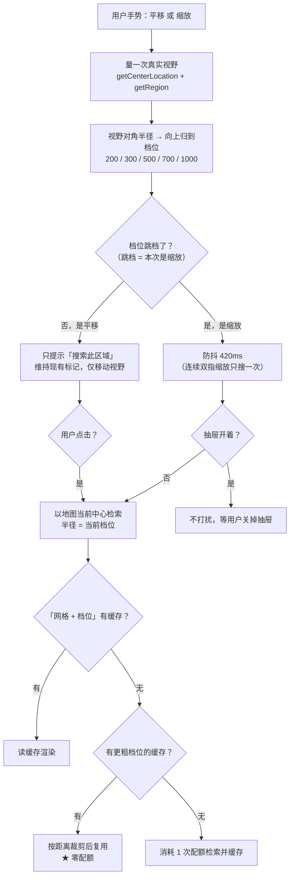
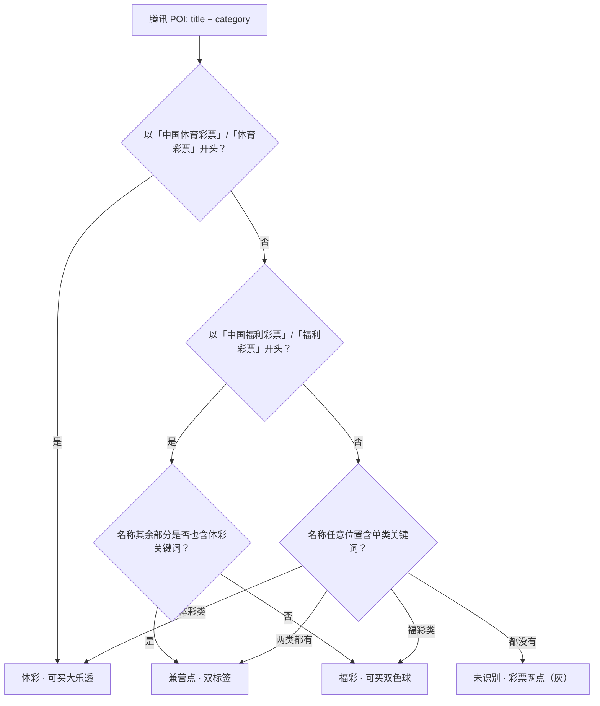
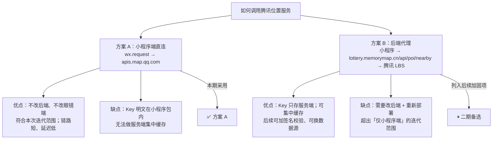
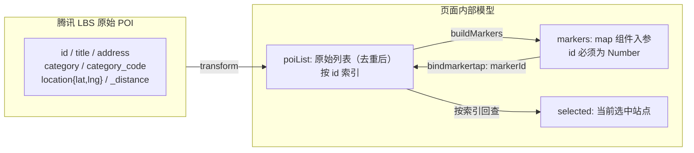
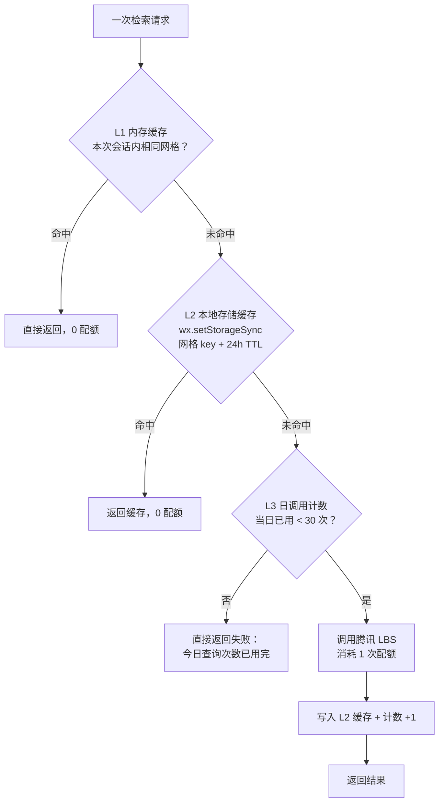

# 彩票小助手 · 小程序「附近」功能需求迭代说明

> 文档版本：V1.0（首版）→ V1.1（Key 实测后补充）→ V1.2（2026-09-15，推荐服务下线边界澄清）→ V1.3（2026-09-15，静态前端落地 + 接口对接位置回填）→ V1.4（2026-09-15，抽屉骨架与设计量表对齐）→ V1.5（2026-09-15，导航改用官方 openMapApp + 下线地址复制 + tabBar 浮层按页开关）→ V1.6（2026-09-15，去掉页标题：搜索结果改为无外壳浮层，占原标题位）→ V1.7（2026-09-15，V1.6 顶部重排整体回退，页标题改为「附近彩站」）→ V1.8（2026-09-15，二期后端代理落地：新增 `GET /api/poi/nearby`，小程序端一个开关即可切换）→ V1.9（2026-09-15，二期后端代理已部署至生产、生产联调 39 项断言全绿、前端开关已切 `true`）→ **V1.10（2026-09-15，检索半径跟随地图视野（真机反馈修正）+ 底部两按钮同行；后端二次部署）** → **V1.11（2026-09-15，视野改为适配检索结果：真机实测证明 `auto_extend=1` 让 `radius` 基本失效，「半径跟随视野」不足以修掉「说的 ≠ 看到的」；数量口径与覆盖描述一并订正）** → **V1.12（2026-09-15，标记图标去掉自带白色描边 + 点标记/列表项与地图中心联动：选中居中、关闭退回、全程不缩放；顺带修掉让「缩放自动重搜」失效的 `causedBy` 白名单）** → **V1.13（2026-09-15，标记放弃全部自备 PNG，改为不传 `iconPath` 直接用 map 组件自带的默认标记；旧「白边检测」契约随图标退役，换成「不得出现 iconPath」契约）** → **V1.14（2026-09-15，原生图钉没有任何改色接口 → 改用 `marker.label` 彩色角标补回类型区分：双色球红 / 大乐透蓝 / 兼营墨 / 未识别灰，角标挂图钉尖端下方）** → **V1.15（2026-09-15，需求方裁定「还是改回显示有颜色的图标」→ 恢复 4 张自备 PNG；V1.13 的「零自备图标」与 V1.14 的「label 彩色角标」同时作废）** → **V1.16（2026-09-15，文档收尾：验收表加实现状态列、订正已闭环的过期状态、新增 §5.4 真机验收清单）**
> 编制日期：2026-09-15
> 迭代范围：**仅微信小程序端**的**一个 tab 位**（眼镜端 Rokid AIUI **零改动**；后端**一期零改动、零部署**，见 §4.1 方案 A；**二期（V1.8）后端新增代理接口，见 §4.7**）
> 迭代性质：**小程序端入口替换** —— 小程序 tabBar 第 3 位「推荐」→「附近」。
> ⚠️ **「推荐」功能只是从小程序前端一级入口下线，其后端服务与眼镜端链路必须原样保留**（见 §3.7 变更边界矩阵）
> 外部依赖：**腾讯位置服务（LBS）** —— 账号、Key、配额与微信平台权限见 §2「前置准备」，**开工前必须全部就绪**
> 关联文档：《微信小程序需求规格文档_V1.0.md》《服务端后台开发技术文档_V1.2.md》《现有小程序前后台改造说明.md》

> **V1.1 修订说明（2026-09-15）**：腾讯位置服务 Key 已开通并完成**真实接口冒烟测试**（4 次调用，实测数据见 §2.7），据此订正三处方案：
> ① **关键词策略确认**：`keyword=彩票` 单词即可覆盖福彩 + 体彩两类站点（实测 count=71，含 12 福彩 + 7 体彩），**无需拆成 2 次调用**，配额减半的设计成立；
> ② **`filter=category` 实测无增益**：加与不加结果**完全一致**（均为 count=71、前 20 条逐条相同），确认一期**不加 filter**，避免因分类标注缺失而漏检；
> ③ **`auto_extend=1` 的真实行为被实测推翻**：并非「仅无结果时才扩大」——1km 内有 11 条结果时，接口仍自动扩大到约 1.5km 以**填满一页 20 条**。即**一次调用实际覆盖半径 ≈1.5km / 20 个站点**，比原方案预期更好（§4.2 已订正）。
> 另据实测发现 **POI 名称本身存在错误**（如「中国体育福利彩票」「中国体育彩票(福利彩票)」），类型判定规则由「包含关键词」改为**前缀优先**（§3.4 已订正）。
> 当前阻塞项仅剩**微信后台「位置接口权限」审批中**（§2.5 第 6 项），其余前置项已完成。

> **V1.2 修订说明（2026-09-15）**：澄清「推荐」功能的**下线边界** —— 本次只做**小程序前端一级入口下线**，不涉及推荐能力本身的退役：
> ① 新增 **§3.7「推荐」功能变更边界矩阵**，逐资产列明「谁下线、谁保留」，作为编码与部署时的硬约束；
> ② 新增 **§3.7.3 眼镜端依赖契约**，把眼镜端对 `POST /api/recommend` 的入参 / 出参字段固化为**不可变更契约**；
> ③ 明确 **本次迭代后端零部署**：腾讯位置服务由小程序直连（方案 A），后端**不产生任何代码改动、不执行任何发布动作**，从机制上排除误伤推荐服务的可能；
> ④ §5.2 验收标准新增「眼镜端推荐功能回归」专项检查项，§6 新增风险 R13（误清理推荐资产）。

> **V1.3 修订说明（2026-09-15，本轮静态前端落地）**：按定稿设计稿（画布「彩票小助手 · 附近功能设计稿」6 屏 + 规范板）完成**小程序端静态前端编码**，并把**接口对接位置与参数**回填进文档：
> ① 新增 **§4.6「前端接口对接位置与参数备注」** —— 逐接口给出**代码落点（文件:函数）+ 入参 + 出参 + 错误码分流 + 消费方**，作为联调与后续维护的唯一索引；
> ② **修正 §3.2 两处与设计稿不一致的描述**：标记资源由 2 张改为 **4 张**（福彩 / 体彩 / 兼营 / 未识别）；「卡片出现时不隐藏 tabBar」改为**抽屉打开期间隐藏 tabBar 与搜索结果气泡**（按定稿设计稿）；
> ③ **§4.5 文件改造清单全部标注完成状态**，并补记 4 张 marker 图的真实出图规格；
> ④ 本轮**仍然零后端改动、零部署** —— `utils/nearby.js` 直接调腾讯 LBS，不经过自家后端（方案 A 不变，§3.7 冻结清单已自动化校验通过）。

> **V1.4 修订说明（2026-09-15，联调前自查发现的问题修复）**：静态前端跑起来后暴露两个实现缺陷，已修复并把结论固化进本文档：
> ① **抽屉底部操作行被列表顶出抽屉外**（真机/模拟器实锤）。根因：列表抽屉只给了 `max-height`，父级高度不确定时 `flex` 不会收缩，`scroll-view` 被内容撑开、把「关闭」按钮挤到抽屉外。**修法**：改用项目既有抽屉 `pages/ledger` 的 `.ledger-drawer` 同一套骨架 —— 抽屉给**确定高度**（`height: 70vh; min-height: 860rpx; max-height: calc(100vh - 140rpx)`），内容区用 **`flex: 1; height: 0`**。详见 §3.2.2。
> ② **点地图标记打不开站点卡片**。根因：部分机型点标记会**连发 `markertap` + `tap`**，后到的 `tap` 触发 `onMapTap` 把刚打开的卡片又关掉。**修法**：`onMarkerTap` 记录时间戳，`onMapTap` 忽略其后 400ms 内的 `tap`（`MARKER_TAP_GUARD_MS`）。
> ③ 顺带把抽屉的内间距 / 按钮位置 / 字号统一到项目既有抽屉（按钮恒为最后一行、`.btn-ghost` + `.btn-primary`、底部内边距 `safe + 32rpx`），并把「配色 / 字号 / 字重量表」做成了自动校验（见 §4.5 自检脚本）。
> ④ 本轮**不改设计稿、不改后端、不改眼镜端**：所有订正都落在小程序前端代码内。

> **V1.5 修订说明（2026-09-15，交互优化，**本节起以下三条为现行有效需求，与旧版冲突处以本节为准**）**：三条交互调整，其中两条推翻了此前「不做导航 / 地址可复制」的表述：
> ① **导航改为调用官方 API 唤起第三方地图 App** —— 用 `MapContext.openMapApp`（基础库 **2.14.0** 起支持，**不支持 Promise 风格**）替代原「弹窗 + 复制地址」方案。**§1.3 非目标 1 与本条冲突的部分作废**：仍不做内嵌路线规划、不画 `polyline`（路线交给第三方 App），但**允许唤起地图 App**。详见 §3.6（已整节重写）。
> ② **下线「地址复制」**：站点卡片内的地址改为**纯只读展示**，同时移除地址行的 `copy` 图标与点击态；`components/icon/index.js` 中随之移除已零引用的 `copy` 图标（新增图标由 8 个降为 **7 个**）。相应地 `wx.setClipboardData` 在本页面**不再存在**。
> ③ **tabBar 毛玻璃浮层按页开关**：`custom-tab-bar` 新增 `backdrop` 数据项（默认 `true`）。「附近」页底图是地图瓦片，毛玻璃浮层会糊在地图纸上产生视觉冲突，因此**仅本页**由 `nearby.js` 的 `updateTabBar()` 置 `false`；首页 / 录入 / 台账**保持原样**（组件按页实例化，互不影响）。详见 §3.2.3。

> **V1.6 修订说明（2026-09-15，顶部结构重排，**与旧版冲突处以本节为准**）**：地图页顶部原本是「状态栏 + 页标题『附近』」，标题占了一整条高度带却只有两个字，左上角显得空；而真正有信息量的搜索结果反而被压到标题**下方**。本轮重排顶部：
> ① **去掉页标题**：本页不再渲染 `.nav-bar`（其余页面不受影响）。地图自**状态栏下沿**铺满至屏幕底部，`mapHeight` 不再扣减导航栏高度。
> ② **搜索结果占据原标题位**：搜索结果整体上移到原导航栏所在的高度带，与**右上角微信胶囊垂直居中对齐**（由 `navBarHeight` 驱动），左右不再有高度浪费。
> ③ **搜索结果去掉外壳**：取消白底、描边、阴影与胶囊圆角，**只剩图标 + 文字直接浮在地图上**；点击图标或文字即打开网点列表抽屉（行为未变，仍是 `onBubbleTap`）。因底图色不可控，给文字加了一层**白色字形光晕**（`text-shadow`）保证可读性 —— 它是发光、不是外壳，不产生任何可见边界。
> ④ **状态提示条（屏 04）保留白底胶囊**，但 top 随之调整，与搜索结果落在同一条水平线上（避免两种顶部浮层高度不一致）。
> ⑤ 画布设计稿已同步（6 屏全部删除页标题、地图区上移、气泡去壳），需求文档与代码、画布三者一致。

> **V1.7 修订说明（2026-09-15，回退 V1.6 顶部重排，**与 V1.6 冲突处以本节为准**）**：V1.6 去掉页标题、把搜索结果改成无壳浮层后，实际观感不成立 —— 顶部失去锚点，去壳文字压在地图瓦片上也显得凌乱。本轮**整体回退**到 V1.5 的顶部结构：
> ① **恢复页标题**：本页重新渲染统一导航栏 `.nav-bar`（与首页 / 录入 / 台账一致）；`mapHeight` 恢复为 `windowHeight - statusBarHeight - navBarHeight`，地图重新自导航栏下沿铺满。
> ② **标题文字改为「附近彩站」**（原为「附近」）：点明本页承载的是「附近的彩票销售站点」。
> ③ **搜索结果恢复白底胶囊**：重新带背景 / 描边 / 阴影 / 胶囊圆角，位置回到地图左上固定 `top: 32rpx`，不再由 JS 计算 —— `hintTop`、`text-shadow` 光晕、`hover-class` 压暗一并删除（去壳配套已无意义）。
> ④ 状态提示条（屏 04）同样回到 CSS 固定 `top: 32rpx`，与搜索结果落在同一条基线上。
> ⑤ 画布设计稿已同步回退（6 屏恢复页标题、地图区下移、气泡恢复外壳）；静态自检的顶部契约已**反向改写**，防止再次漂移（见 §5.3 验收 27–30）。

> **V1.8 修订说明（2026-09-15，二期后端代理落地）**：按 §4.1 与 §4.6.7 的预留，把「查腾讯」这件事从**小程序直连**改为**服务端代理**。本体量只做一件事，但**明确收回了 §4.5 冻结清单里的两项**，以免新旧表述打架：
> ① **新增后端接口 `GET /api/poi/nearby`**（§4.7）：Key 从「小程序代码包里的明文」挪到服务端 `.env`；服务端进程内缓存**跨设备共享**；日配额闸门收到服务端（客户端改不了）。返回体**与腾讯响应体同构** ⇒ 页面层、类型判定、marker 构建、三层缓存**一行都不用改**。
> ② **前端只加一个开关**：`config/index.js` 的 `nearby.useBackendProxy`（默认 `false`）。**不动这个开关，行为与 V1.7 完全一致**；改 `true` 即切代理，改回 `false` 即回退一期直连 —— 无需动后端。
> ③ **解除两项冻结**（与 V1.7 及更早的表述冲突处，以本条为准）：`backend/src/**` 与 `utils/api.js` 不再冻结 —— 前者新增 `modules/poi`、`integrations/tencent-lbs`、`api/v1/poi.controller.ts`；后者追加导出通用 `request()`（供附近页走代理时复用 token 注入与 40100 自动重登重试）。**推荐链路本身（`POST /api/recommend`、`modules/recommend/*`、方舟推荐配置、两端推荐页）仍然零改动**，自检脚本已把「mtime 冻结」改成**按内容断言推荐资产仍在**（§4.5）。
> ④ **部署侧规则相应调整**：一期是「不改就不部署」，二期**需要一次后端部署**（新增接口）。部署后仍按既有铁律做 **dist 全量 md5 审计**；眼镜端仍**零改动**（不涉及本次部署）。
> ⑤ **新增自检**：`backend/scripts/test-poi.ts`（40 个断言，含「配额触顶不再打上游」「失败不写缓存」）+ `_dev_tools/test_nearby.js` 第 9 组（代理链路 20 个断言）。

> **V1.9 修订说明（2026-09-15，二期后端代理「已部署 + 已联调 + 开关已打开」）**：V1.8 只写了代码，本条记录**上线结果**，并把 V1.8 的「默认 `false`」订正为**当前线上为 `true`**。
> ① **后端已部署**到 `/opt/lottery-helper`（腾讯云轻量 `YOUR_INSTANCE_ID`，走 TAT 免 SSH）。推送 17 个文件（8 个 `dist` + 8 个 `src` + `prisma/schema.prisma`），`pm2 restart lottery-helper` 后实测启动日志出现 `PoiController {/api/poi}` → `Mapped {/api/poi/nearby, GET} route`。
> ② **部署后 dist 全量 md5 审计 62/62 一致**（审计前 54 一致 / 6 缺失 / 2 不一致，补传后全绿）。同时把 `src/*.ts` 一并推送，**避免将来有人在服务器上 `npm run build` 时用旧源码把 dist 覆盖回去**（该事故已发生 2 次）。
> ③ **服务端 `.env` 补 `TENCENT_LBS_KEY` + `POI_DAILY_LIMIT=100`**（改前先备份为 `.env.bak.<时间戳>`）。
> ④ **生产联调 39 项断言全绿**：鉴权（无 token → 40100）、入参校验（4 类越界 → 40001，且**不消耗腾讯配额**）、返回体同构（8 个字段齐全、`id` 保持字符串、坐标与距离为数字）、服务端缓存（同网格二次调用 `source=cache` / `costMs=0` / `used` 不增）、缓存网格容差（3 位小数格内位移命中、跨格换格）、境外坐标不 500。台账侧 8 行 `tencent_lbs` 记录、配额计数器工作正常、无新增错误日志。
> ⑤ **前端开关已打开**：`config/index.js` → `nearby.useBackendProxy: true`，`BUILD_VERSION` → `20260915-1500-nearby-proxy-on`。**回退成本仍是一行**（改回 `false`）。⚠️ 本次改动**需重新上传体验版**才会在真机生效。
> ⑥ **可做但本轮未做**：删掉小程序包内的 `TENCENT_LBS_KEY`（Key 从此只在服务端）。留待真机验证通过后再删，以便回退时一期直连仍可用。

> **V1.10 修订说明（2026-09-15，检索半径跟随地图视野 + 底部按钮同行；由真机使用反馈驱动）**：两处交互修正。其中第 1 条**推翻了 §3.3「为什么不做视野内自动检索」的结论**，该节已整段重写，冲突处以新节为准。
> ① **检索半径改为跟随地图视野**。原先半径恒为 `radius=1000`，而手机把地图放大后可视范围只有两三百米 —— 返回的 20 个网点全落在屏幕之外，用户看到的就是「提示已找到 20 个网点，屏幕里一个标记都没有」。现在半径由 `MapContext.getRegion()` 的**实测视野**换算得出（取**对角半径**，保证屏幕四角可见的点也在检索范围内），并**向上归到 5 个档位**（200 / 300 / 500 / 700 / 1000 米）。**不用 `scale` 套经验公式**：各机型 DPR、地图容器高度、纬度（经度方向要乘 `cos(纬度)`）都不同，任何公式都会在某些机器上是错的。
> ② **缓存键必须带上半径 —— 前后端同改，不是可选项**。`radius` 一旦成为变量，缓存键若仍只有网格，就会出现「放大到 300 米却拿到 1 公里那次的结果」，症状与 ① 一模一样。前端 `utils/nearby.js` 与后端 `src/modules/poi/poi.service.ts` 的 `cacheKeyOf()` 是**同一套拼法**（`网格@半径`），**改一处必须改两处**。
> ③ **缩放自动重搜（对「不自动检索」铁律的一次有意识修订）**。平移与缩放都改变视野，但只有**缩放改变范围**。判据是「档位是否跳档」：平移档位不变 → 仍只提示「搜索此区域」；缩放跳档 → 防抖 420ms 后按新半径自动重搜。代价被三层措施压住：半径离散成 5 档（同档位直接命中缓存）、**放大时可复用更粗档位的缓存并按距离裁剪（零配额）**、服务端 100 次/日闸门仍然兜底。
> ④ **「搜索此区域」移到「回到我的位置」同一行的左侧**，两端边距均为 `40rpx`（与左上气泡同刻度）。两按钮改由 `.nearby-actions` 行容器统一排布，容器用 `justify-content: flex-end` + 搜索按钮 `margin-right: auto` —— 这样**只剩定位按钮时它仍然靠右**，不会因为兄弟节点消失而跑到左边。详见 §3.2.5。
> ⑤ **后端已二次部署**：仅 `dist/modules/poi/poi.service.js` + `src/modules/poi/poi.service.ts` 两个文件（部署前审计 61/62 一致，唯一差异正是本次改动；部署后 **62/62 全绿**）。`pm2 restart` 后启动日志出现 `Mapped {/api/poi/nearby, GET} route`。生产验证 **12 项断言全绿**；服务端台账给出直接证据 —— 同一 `gridKey` 下并存 `radius=1000` 与 `radius=300` 两条记录（见 §4.7.5.2）。
> ⑥ ⚠️ **前端改动需重新上传体验版**才会在真机生效，`BUILD_VERSION = 20260915-1600-nearby-zoom-sync`。
> ⑦ 新增自检：`_dev_tools/test_radius_api.py`（生产半径隔离，12 断言）、`test_nearby.js` 第 10 组（半径换算与缓存裁剪，36 断言）、`backend/scripts/test-poi.ts` 第 9 组（缓存键含半径，13 断言）、`check_miniprogram.py` 新增「底部操作行」静态契约。

> **V1.11 修订说明（2026-09-15，视野改为适配检索结果；由真机截图 + 生产复现驱动；**与 V1.10 第 1/2 条冲突处以本条为准**）**：
> **V1.10 的诊断是对的，但修法不足以解决问题。** V1.10 认为「半径没跟随视野」是「提示搜到了、屏幕里没标记」的原因；真机复现后发现**根因是另一个**：腾讯的 `auto_extend=1` 会在半径内凑不满一页时**自动向外扩展**，导致 `radius` 这个参数**实际上不起作用**。
>
> **实测铁证**（用户真实坐标 `39.939258 / 116.210617`，取自 nginx 访问日志，非估算值）：
>
> | 检索半径 | 返回条数 | 距离序列（米） |
> |---|---|---|
> | `radius=1000` | 20 | 533, 653, 653, 867, 900, 914, 925, 936, …, **1825** |
> | `radius=300` | 20 | **逐条完全相同**（同序列、同最远点） |
>
> 即：**换半径换不到数据**。而该位置 ≤1000m 的只有 8 条、≤533m 的只有 1 条；手机在 `scale=16` 时的视野等效半径只有**约 600m** —— 所以 20 个标记里屏内只落得下最近的那 1 个。用户看到「已找到 20 个网点 · 约 1.8 公里 内」而屏幕几乎全空，是**几何必然**，跟半径挂不挂钩无关。
>
> **修法：反过来 —— 让视野去适配结果集。**
> ① **定位类检索（首屏 / 回到我的位置 / 重试）成功后调用 `MapContext.includePoints`，把返回的点整体框进视野**（`frameStations()`，见 §4.6.6）。这样「已找到 N 个」与「屏幕上有 N 个标记」在**任何密度、任何缩放级别下都成立**。
> ② **只在定位类检索里框，不在每次检索里框**：否则用户一放大就被拉回总览，永远放不大。判据用 `loadNearby` 的 `recenter` 参数（该参数本就是「定位驱动」的标志）。
> ③ **少于 2 个点不框**：`includePoints` 对单点会把视野缩到最极限（屏幕上只剩一个孤点、底图全无），比保持原视野更糟。另加 `typeof` 能力探测（老基础库无此方法）。`includePoints` 触发的 `regionchange` 的 `causedBy` 为程序更新类，被既有过滤逻辑忽略，**不会引发自动重搜**。
> ④ **数量口径订正（重要）**：气泡数量改用**实际渲染出的标记数**，不用接口的 `count`。后端 `count` 是腾讯的**匹配总数**（实测该位置 = **96**），而 `data` 受 `page_size=20` 限制 —— 用 `count` 就是又一次「说的 ≠ 看到的」。
> ⑤ **覆盖描述改用最近点**：`约 1.8 公里 内` → `最近 533 米`。旧文案用**最远点**距离，会被读成「检索半径」，且「1.8 公里」是 `auto_extend` 撑出来的跨度、不是用户选的范围。
> ⑥ **修 L2 缓存丢 `total`**：`writeStorageCache` 早期不存 `total`，导致同一份数据「首次真实请求」与「二次进页面读 L2」两条路径显示的数量不同（实测出现过 96 → 20 的跳变）。现已一并写入。
> ⑦ **修 `applyViewport` 的假基准**：视野量不出来时（`getRegion` 失败）**不再更新** `_radiusTier`。早期无条件写入会把兜底的 1000 固化成「上次档位」，等真机量出真实视野（如 300）时被误判成一次缩放、白触发一次自动重搜。
> ⑧ `auto_extend` **保持 1 不变**。改成 0 虽然能让 `radius` 真正生效，但会走向另一个极端：本位置 600m 视野内只有 3 家、250m 内 0 家，「附近彩站」将频繁显示空态。**「总是给最近的一批，再把视野调好让它们可见」比「严格按半径返回」更符合本功能意图。**
> ⑨ ⚠️ **前端改动需重新上传体验版**才会在真机生效，`BUILD_VERSION = 20260915-1700-nearby-viewport-fit`。
> ⑩ 新增自检：`check_miniprogram.py` 新增「附近页视野适配」静态契约（4 条：存在 `frameStations` / 单点守卫 / 能力探测 / 只在 `recenter` 下调用；另有数量口径与覆盖描述两条），并已**反向验证 4/4 捕获**。

> **V1.12 修订说明（2026-09-15，标记图标去白边 + 站点选中与地图中心联动；由真机使用反馈驱动）**：
> ① **图标去掉白色外描边**。按用户建议先核查官方能力：**微信小程序 map 组件没有可复用的默认标记图标** —— `marker.iconPath` 官方标注**必填**（`MapContext.setLocMarkerIcon` 改的是「当前定位点」那个蓝点，`initMarkerCluster` 的默认样式只作用于聚合簇），所以标记只能自备。
> 定位到源头：`_dev_tools/gen_markers.py` 在彩色水滴之外又画了一层「形状外扩 5px」的**白色描边** —— 它把外轮廓撑到**超出画布**，只在水滴上下弧段与尖尾两侧露出来，这就是真机上那圈明显的白边。**修法：把这个白边层从生成脚本里删掉**，alpha 与颜色都改由彩色本体决定；重新出图后白色像素 `962 → 360`（剩下的正好是中心白孔）。
> ⚠️ **不要用「把白边像素填成主色」的做法**：那是更直觉的方案，但会把图形轮廓膨胀到白边外径 —— 实测面积 +21%、与顶层轮廓 IoU 仅 **0.81**，比设计稿规定的 `circle r14 @2x`（正好撑满画布）胖一圈。原始带白边版已存档在 `_dev_tools/marker_icons_orig/` 供追溯。
> ② **点地图标记 / 点列表项 → 卡片弹出的同时，屏幕中心移到该站点；关闭卡片 → 中心退回进入卡片前的位置；全程不改变地图缩放级别。**（本节起以下各条为现行有效需求，与旧版冲突处以本节为准）
> ③ **实现要点与四条硬约束**：
> · 只能用 `MapContext.moveToLocation`（官方「把地图中心移到指定位置」）。**不能用 `includePoints`** —— 它的职责是「缩放视野以包含所有点」，会改缩放级别（只该用在 `frameStations`）；**也不能再用 `MapContext.moveTo`** —— 它**不在官方 API 列表中**，而旧代码用的就是它，既无能力探测也无兜底。
> · 退回锚点取「**进入卡片前的地图中心**」（`rememberAnchor()` / `currentMapCenter()`）。首屏 / 点「回到我的位置」/ 重试之后该值**就是**用户所在位置，与「回到用户当前位置」等价；但用户先把地图拖到别处再搜、再看站点时，退回拖动后的位置才符合直觉（硬跳回 GPS 点会把视野甩到几公里外，而附近数据还是原区域的）。在列表里连点多个站点时锚点**不覆盖**，关闭后退回最初那个位置。
> · `closePanel(restoreView)` 区分两种收起：**用户主动关**（「关闭」按钮 / 点遮罩 / 点地图空白）→ 退回视野；**拖动或缩放导致收起** → **不退回**（视野是用户刚挪出来的，拉回去等于跟他的操作打架）。`wxml` 因此改走 `onClosePanel`，避免事件对象被当成 `restoreView` 传进去。
> · `panTo()` 后设 `PROGRAMMATIC_PAN_GUARD_MS`（700ms）保护窗：`moveToLocation` 属于「调用接口导致」的视野变化（`causedBy='update'`），本应被 `onRegionChange` 过滤；再加一层时间窗兜底，防某家基础库把它报成 `drag`/`scale` 而**把刚打开的卡片立刻关掉**。
> · 旧的 `focusStation()`（把站点移到可视区**中下部**、带 `FOCUS_OFFSET_RATIO` 偏移）已删除 —— 需求改为**站点落在屏幕正中**。
> ④ **顺带修掉一个让 V1.10 功能失效的 bug**：`onRegionChange` 的 `causedBy` 白名单原本是 `'drag'` 与 `'gesture'`，而官方 `map` 组件的取值是**拖动 `drag` / 缩放 `scale` / 调用接口 `update`** —— 按官方枚举，**缩放会被整条漏掉**，V1.10 设计的「缩放自动重搜」不会触发。现已把三个值都收下（兼容各家基础库的差异）。
> ⑤ **验证**：`check_miniprogram.py` 新增两项契约 —— **「标记图无白色外描边」**（真解码 PNG，逐行取轮廓像素判白）与**「附近页中心联动」**（8 条：三个新成员存在；只能用 `moveToLocation`；`panTo` 内不得出现 `includePoints`；`causedBy` 白名单必须含 `'scale'`；`closePanel` 必须带 `restoreView` 且 `wxml` 走 `onClosePanel`；`selectStation` 必须先记锚点；保护窗必须在）。**反向验证 12/12 全部捕获**，还原后复跑为绿。本轮**零后端改动、零部署**。
> ⑥ ⚠️ **前端改动需重新上传体验版**才会在真机生效，`BUILD_VERSION = 20260915-1800-nearby-focus-pan`。

> **V1.13 修订说明（2026-09-15，标记改用 map 组件自带默认图标：零自备 PNG）**：
> ① **放弃自备 PNG 标记，改为「不传 `iconPath`」直接用 map 组件的默认标记。**（本节起以下各条为现行有效需求；**V1.12 第 ① 条关于「标记只能自备」的部分作废**）
> 一条重要的能力认知订正：官方文档把 `marker.iconPath` 标成**必填**，但**运行时并不强制** —— 不传时组件渲染**自己的默认标记**。
> 反证：微信开放社区有一帖《小程序地图如何去除默认标记点？》，官方给的解法就是「自己做一个 1 像素透明 PNG 替换 `iconPath`」来**把默认图标盖掉**；主贴追问也写明「marker 中有数据的情况下，如何去除**默认的图标**」。可见默认图标确实存在 —— 而这正是我们要的「组件自带标记」。
> ⚠️ 两个必须记住的坑：① **绝不能写 `iconPath: ''`** —— 空字符串会被当成「设了图标」，触发 `[渲染层错误] width and height of marker id X are required`，必须**整个字段删掉**；② 不传 `iconPath` 时 `width` / `height` / `anchor` 一并不要设（默认锚点本来就是**底边中点**，正是「尖端对准坐标」要的效果）。
> ② **代价（明确取舍）**：四种站点类型（福彩 / 体彩 / 兼营 / 未识别）在地图上**不再有颜色区分**，标记一律是组件默认样式。类型信息改由**网点列表**与**站点卡片**承担（地图只负责「位置」）。选中态仍保留 —— 靠 `zIndex` 抬升（默认标记改不了颜色，这是唯一可用的原生高亮手段）。
> ③ **资源与实现清理**：`buildMarkers()` 只产出 `id` / 经纬度 / `zIndex`；`utils/nearby.js` 删除 `MARKER_ICON` 与 `MARKER_SIZE`，`toStation()` 不再产出 `iconPath`。4 张 PNG **退役出小程序包**（移到 `_dev_tools/marker_icons_retired/`，**是移动不是删除**，可一键回退）；`_dev_tools/gen_markers.py` 保留为**回退路径**并加了弃用说明（完整回退 = 跑脚本重出图 + 在 `buildMarkers` 里补回 `iconPath` 等字段）。
> ④ **验证**：`check_miniprogram.py` 的标记检查**整节改写** —— 旧「白边检测」（含 PNG 解码辅助函数）随图标退役删除，改为**「附近标记走组件默认标记」契约**：`buildMarkers` 函数体内不得出现 `iconPath` / `width` / `height` / `anchor`，且必须保留 `zIndex`；`utils/nearby.js` 不得再有 `MARKER_ICON` / `MARKER_SIZE` / `iconPath` 赋值；`assets/` 下不得再出现 4 张 marker 图；退役目录必须留有 4 张备份。
> 契约只判**代码**（脚本内置一个注释剥离器）—— 否则注释里为说明而写的 `iconPath: ''` 字样会被误判，那等于逼人删掉最有价值的警示注释。
> ⑤ 反向验证扩到 **13 条**（原 12 条里的「图标换回带白边版」随图标退役作废，换成「自备图标被搬回 `assets/`」与「`buildMarkers` 重新带上 `iconPath`」两条）→ **13/13 全部捕获**，还原后复跑为绿。**本轮零后端改动、零部署。**
> ⑥ ⚠️ **前端改动需重新上传体验版**才会在真机生效，`BUILD_VERSION = 20260915-1900-nearby-native-marker`。

> **V1.14 修订说明（2026-09-15，原生图钉无法改色 → 改用 `marker.label` 彩色角标）**：
> ① **背景**：V1.13 改成「零自备 PNG」后，需求方随即反馈「大乐透和双色球不能用同一个颜色」。复核官方 `map` 组件文档后确认：**marker 没有任何改颜色的接口** —— `iconPath` / `width` / `height` / `anchor` / `zIndex` / `label` / `callout` 里没有一个是「给默认图钉上色」的。因此「零自备图标」与「图标本身有颜色」**只能二选一**。
> ② **结论（明确取舍）**：保持零自备图标，改用 **`marker.label` 彩色角标**承担类型区分。**V1.13 第 ② 条「地图上不再有颜色区分」作废。**
> > · 双色球 / 福彩 = 红 `#E63946`（同号码球红）、大乐透 / 体彩 = 蓝 `#4262FF`（同号码球蓝）、兼营 = 墨 `#1C1C1E`、未识别 = 灰 `#8E91A0` —— 与「网点列表」的 4 态标签同一套语义。
> > · 角标文案**都用单字**（双 / 大 / 兼 / 彩）：四个角标因此等宽（≈方形），把 `anchorX` 的平台差异压到看不见。
> ③ **四条真机约束（都是实测反馈换来的，已写进契约）**：
> > · **角标挂图钉尖端下方**（`anchorY` 为正）。默认图钉高度官方未公开、各平台并不一致，任何「放到上方」的负偏移都是在猜钉高，猜错就压在钉头上 —— 放下方零假设（图钉永远在原点上方）。竖向观感也符合国内地图习惯（高德 / 百度的 POI 名称就挂在图标下方）。
> > · **`fontSize` / `padding` / `borderRadius` 必须写成数字**，字符串在真机上会静默不生效。
> > · **颜色必须是 6 位十六进制**（8 位带 alpha 在部分机型上被整条忽略）；兼营不用「红底 + 蓝描边」表达 —— `label.borderColor` 在部分安卓机型上不生效，一旦失效兼营就退化成与福彩完全同色。
> > · ⚠️ **`label.textAlign` 在真机上基本无效**，居中只能自己算 `anchorX`（`badgeAnchorX()`，往左挪半个角标宽）。因此**真机上角标若水平方向略有偏移，只需调 `badgeAnchorX()` 这一个函数**。
> ④ **顺带把「选中态」补回来**：V1.13 自备图标退役后地图上已无任何选中反馈，现在选中项角标加一圈白描边（`borderWidth: 2`）叠在 `zIndex` 抬升之上。
> ⑤ **验证**：`check_miniprogram.py` 新增 `check_nearby_marker_badges()`（9 条：四类文案齐备且都是单字；红 / 蓝各归其位且四类两两不同色；色值必须 6 位十六进制且在配色量表内；三个数值字段不得写成字符串；`anchorY` 必须为正；`buildMarkers` 必须挂 `label`；兼营不得用描边），并新增反向验证脚本 `_dev_tools/_reverse_check_badge.py` → **9/9 全部捕获**，还原后复跑为绿。`test_nearby.js` 同步新增 12 条断言。**本轮零后端改动、零部署。**
> ⑥ ⚠️ **前端改动需重新上传体验版**才会在真机生效，`BUILD_VERSION = 20260915-2000-nearby-marker-badge`。

> **V1.15 修订说明（2026-09-15，恢复自备彩色图标 —— 走完三次反复后定案）**：
> ① **需求方裁定**：「还是改回显示有颜色的图标吧」。**V1.13 第 ① ② 条（零自备 PNG / 不再有颜色区分）与 V1.14 全节（改用 `label` 彩色角标）同时作废**，本节起以下各条为现行有效需求。
> ② **为什么角标方案没能满足**：`marker.label` 能给**文字**上色，但**图钉本体永远是同一个颜色**（官方 marker 字段里没有任何「给默认图钉上色」的能力，见 V1.14 ①）。需求方要的是**图标本身有颜色** —— 所以只能回到自备图标。**结论：「零自备图标」与「图标本身有颜色」在平台上不可兼得**，现在按后者做。这条演进（V1.13 → V1.14 → V1.15）完整记在此处，避免第四次反复。
> ③ **实现（= V1.12 的形态，白边已在 V1.12 修掉）**：
> > · 四类图标 `assets/marker-{fucai|tiyu|both|unknown}.png`，出图 **56×68 @2x**、显示 **28×34**（选中态 `32×39`，放大 1.15 倍）；
> > · 配色与号码球、列表 4 态标签同一套语义：**双色球 / 福彩 = 红 `#E63946 + 白心`、大乐透 / 体彩 = 蓝 `#4262FF + 白心`、兼营 = 红底 + 白环 + 蓝心、未识别 = 灰 `#8E91A0 + 白心`**；
> > · `anchor {x: 0.5, y: 1}` 让**水滴尖端对准坐标点**（默认锚点不是尖端，这一项不能省）；选中态叠加 `zIndex` 从 10 抬到 20；
> > · ⚠️ 设了 `iconPath` 就**必须同时给 `width` / `height`** —— 否则触发 `[渲染层错误] width and height of marker id X are required`；`iconPath` 也**绝不能是空字符串**（会被当成「设了图标」）。
> ④ **图标的唯一真相源**：`_dev_tools/gen_markers.py`（零依赖、纯 stdlib）。改配色 / 尺寸**必须改脚本重出图**，**不要手工改 png** —— 那圈白边就是手工/脚本两条路径脱钩的产物（V1.12 溯源到脚本里「形状外扩 5px」的描边层）。两份备份用途不同：`marker_icons_retired/` 是 **V1.12 修好白边的版本**（与线上同源，可安全覆盖）；`marker_icons_orig/` 是**去白边之前**的版本，**切勿用来覆盖 `assets/`**。
> ⑤ **验证**：`check_miniprogram.py` 的标记检查**再次改写** —— V1.13 的 `check_nearby_markers_native()` 与 V1.14 的 `check_nearby_marker_badges()` 一并删除，改为 `check_nearby_marker_icons()`：`MARKER_ICON` 四类齐全且**四类指向四张不同的图**、路径指向的文件**真的在包里**；`toStation` 产出 `iconPath`；`buildMarkers` 必须同时有 `iconPath` + `width` + `height` + `anchor` + `zIndex` 且不得再有 `label`；`BADGE_*` / `buildBadge` / `badgeAnchorX` 必须清干净；**真解码 PNG 复核轮廓像素**（轮廓偏白即报错）并核对**出图尺寸是显示尺寸的 2 倍**。
> ⑥ 反向验证脚本 `_dev_tools/_reverse_check_focus.py` 扩到 **19 例**（含 6 条全新的图标契约：图标带白边 / 图标缺失 / 去掉 `iconPath` / 给 `iconPath` 却不给宽高 / `iconPath` 退化成空串 / 四类共用一张图 / `toStation` 不产出 `iconPath` / `label` 角标回归）→ **19/19 全部捕获**，还原后复跑为绿。V1.14 的独立脚本 `_reverse_check_badge.py` 随角标契约一并**移入 `_dev_tools/_retired/`**（它验证的契约已不存在，留在原地只会误导）。
> ⑦ ⚠️ **前端改动需重新上传体验版**才会在真机生效，`BUILD_VERSION = 20260915-2100-nearby-color-icon`。
> ⑧ 本轮**零后端改动、零部署**（只动小程序端、`_dev_tools` 与文档），不消耗腾讯 LBS 配额。

> **V1.16 修订说明（2026-09-15，文档收尾 —— 「功能已实现」状态标记 + 过期状态订正）**：开发阶段收尾，本轮**零代码改动**，只做文档与工程目录的整理：
> ① **§5.3 验收标准新增「状态」列**（62 项逐条标注）：`✅ 已实现` **21 项**（代码落地且判定依据可静态验证，已全绿）、`✅ 已上线` **8 项**（后端/部署类，生产实测通过）、`⏳ 待真机` **28 项**（判定依据只能来自真机观感）、`— 作废` **5 项**（被后续版本推翻，**保留行号以稳定验收编号**）；
> ② **新增 §5.3.0 实现状态总览** —— 一张表说清「开发全部完成、唯一未闭环是真机验收」，避免读者把「已实现」误读为「真机没问题」；
> ③ **新增 §5.4 真机验收清单** —— 把 V1.10~V1.15 六轮改动要在真机上确认的 13 个点列成可逐条执行的清单（含「未通过时怎么办」的单点回退表），作为体验版上传后的操作指引；
> ④ **订正 8 处已闭环但仍写着「待办 / 审批中 / 待执行」的过期状态**（共 12 处替换，逐处断言锚点唯一）：§2.5 #6 位置权限「审批中（当前唯一阻塞项）」→ **✅ 已完成**（V1.11 起真机能拿到真实定位即反证）、§2.5 #7 隐私指引「☐ 待办」→ **✅ 已完成**、§5.2 标题「当前状态适用」→ 标注为 **V1.3 历史记录**、**§7 #10「⏳ 待执行」→ 「✅ ①②③④ 已执行（V1.9）」**（原文与 §4.7.5.1 的上线记录**自相矛盾**，本次消除）、§7 #3 / #5 / #6 / #7 / #8 从「⏳ 待确认」逐条收口、R2 风险「当前状态：审批中」→ **✅ 已通过**、R3 隐私风险 → **✅ 已消除**；
> ⑤ **§7 的剩余真实待办**收敛为两条：**① 真机验收（§5.4）**、**② 通过后删 `TENCENT_LBS_KEY`**（§6 R6）。§7 #5「默认兜底城市」虽标为已可用，但 `DEFAULT_CENTER` 当前是北京 —— **若要改成你常驻的城市，给个城市名即可**（一行改动）；
> ⑥ 本轮不消耗腾讯 LBS 配额（无接口调用）。

> **二期实测订正三条（2026-09-15，覆盖 V1.1 的乐观表述）**：
> ① **`auto_extend=1` 并非「只在无结果时扩大」**。实测同一 Key 下不同区域行为不同：天安门一带 1km 内仅 11 条 → 扩到约 1.22km 填满 20 条；银河 SOHO 一带 1km 内已够 20 条 → 完全不扩（`max=919m`）。**因此「一定覆盖 1.5km」是错的，只能保证「不低于 1km、不超过约 1.5km」**。
> ② **腾讯返回的距离并非严格升序**。实测存在 `978.31m` 紧接 `978.02m` 这种 0.3m 级逆序，**来自上游**（我们只做整形与去重，未重排序）。对 UI 无影响，但自检脚本**不可断言严格升序**。
> ③ **3 位小数网格 ≈ 100m 是「格边长」而非「容差半径」**。跨过网格线（如 `lat 39.9194 → 39.9196`）就换格，因此**坐标移动 30m 也可能不命中缓存**。这是设计内的行为，前后端两层（Storage 缓存与服务端缓存）用的是同一个 `gridKeyOf`，判定一致。

---

## 目录

- [1 迭代背景与目标](#1-迭代背景与目标)
- [2 前置准备：腾讯位置服务账号与权限](#2-前置准备腾讯位置服务账号与权限)
- [3 功能需求说明](#3-功能需求说明)
- [4 技术方案](#4-技术方案)
- [5 实施步骤与验收标准](#5-实施步骤与验收标准)
- [6 风险与注意事项](#6-风险与注意事项)
- [7 待确认事项](#7-待确认事项)

---

## 1 迭代背景与目标

### 1.1 背景

- 现有小程序 tabBar 共 4 位：首页 / 录入 / 推荐 / 台账。其中「推荐」（`pages/recommend`）由火山方舟 LLM 驱动，按星座占星 / 五行推命两套体系生成趣味号码。
- **实际使用习惯：购买机选彩票** —— 号码由销售机随机产生，推荐结果对决策没有实际影响。该 tab 位属于**低频、可替代**位置，长期占用首屏一级入口不划算。
- **真实高频诉求：到店购彩** —— 用户拿到号码后需要就近找到能出票的网点（福彩站出双色球、体彩站出大乐透），当前小程序没有任何线下网点能力，只能靠手机地图 App 现查。
- 结论：在**小程序端**用「附近」替换「推荐」，把一级入口从「娱乐型功能」换成「实用型功能」（见 §1.1.1）。

#### 1.1.1 「替换」的边界（重要）

「替换」**只发生在小程序的 tabBar 入口这一层**，不涉及推荐能力的退役：

- 小程序端：`pages/recommend/*` 代码**保留不删**，仅从 tabBar 移除入口，随时可改回 4 行配置恢复。
- 后端：`POST /api/recommend` 推荐服务**原样保留、继续运行**，不删不改。
- 眼镜端：`pages/recommend/*` **一行不改**，继续正常调用 `/recommend`。

> 之所以小程序端可以下线、眼镜端必须保留：**眼镜端没有 tabBar**，它的「推荐」是首页 3 键功能区（录入 / 推荐 / 台账）循环中的一等入口，与小程序端的低频位性质完全不同。两端共用同一个后端接口，因此**后端必须保持可用**。完整边界见 §3.7。

### 1.2 迭代目标

| 维度 | 目标 |
|---|---|
| 功能 | 进入「附近」页即以当前位置为中心展示地图，附近的福彩 / 体彩销售网点以标记形式落点在地图上 |
| 交互 | 点击标记 → 底部弹出站点卡片（站名 / 地址 / 距离 / 可购彩种）→ 「导航」按钮唤起系统地图 App 完成导航（`MapContext.openMapApp`，V1.5 订正） |
| 性能 | 首屏地图 + 站点标记在定位完成后 1 次网络请求内完成（不叠加多次检索） |
| 配额 | 在腾讯位置服务**个人开发者 200 次/日**的地点搜索配额内长期稳定运行（见 §2.3 与 §4.4） |
| 安全合规 | 位置信息采集符合微信《用户隐私保护指引》要求，位置接口权限审批通过 |
| 范围 | 眼镜端零改动；后端**零改动、零部署**；小程序端推荐页面代码保留可回退；**推荐后端服务与眼镜端推荐页不受影响，继续可用**（见 §3.7 变更边界矩阵） |

### 1.3 非目标（本期明确不做）

| # | 不做 | 说明 |
|---|---|---|
| 1 | **不做内嵌导航能力** | 不做内嵌路线规划、不算预计到达时间、不画 polyline。**V1.5 订正**：允许通过官方 `MapContext.openMapApp` **唤起第三方地图 App** 完成导航（基础库 2.14.0+）；路线规划与呈现全部交给第三方 App，小程序内不产生任何路线数据。**仍不使用 `wx.openLocation`**（微信内置地图）。详见 §3.6 |
| 2 | 不做眼镜端 | 眼镜端不提供地图（无触控精度与屏幕条件），保持现状 |
| 3 | 不做后端接口 | 一期不新增 `/api/poi/*` 代理接口；如后续要收敛 Key 或做服务端缓存，按 §4.1 方案 B 单独排期。**同时不删除、不修改、不降级任何既有后端接口**，特别是 `POST /api/recommend`（眼镜端在用，见 §3.7） |
| 4 | 不做 POI 数据自建 | 不自建「地点云」表、不做站点数据清洗、不做用户上报纠错 |
| 5 | 不做站点运营能力 | 不做收藏 / 常去 / 签到 / 到店核销 / 库存查询 |
| 6 | 不做城市切换器 | 一期只按「当前位置」展示；定位失败时给默认城市兜底（见 §3.5），不做城市列表页 |
| 7 | 不做「推荐」功能迁移与退役（**仅限小程序端**） | **小程序端**推荐页面不搬家、不改造、不删除，仅下线 tabBar 入口。**后端推荐服务与眼镜端推荐页面完全不在此范围内** —— 二者保持现状、继续可用（见 §3.7） |
| 8 | 不动眼镜端任何一个文件 | 眼镜端 `pages/recommend/*`、`app.js` 的推荐缓存逻辑、`/recommend` 调用链**一行都不改**（本轮迭代物理上不涉及眼镜端目录） |

### 1.4 术语

| 术语 | 含义 |
|---|---|
| 福彩站 | 中国福利彩票销售网点，可购买**双色球** |
| 体彩站 | 中国体育彩票销售网点，可购买**大乐透** |
| POI | Point of Interest，腾讯位置服务的地点数据（本站点指彩票销售网点） |
| 标记 / Marker | 微信小程序 `map` 组件叠加在地图上的自定义图标点 |
| 配额 | 腾讯位置服务的接口日调用量（PV）与并发量（QPS）上限 |

---

## 2 前置准备：腾讯位置服务账号与权限

> ⚠️ **本章是开工阻塞项**。§2.1 ~ §2.4 中任何一项未完成，功能都无法联调（最常见的表现是：地图能显示、但一个站点标记都没有，或直接报「此 Key 每秒请求量已达到上限」）。
> 全部完成后按 §2.5 清单逐项打勾，再进入编码。

### 2.1 腾讯位置服务账号（需要，且需要实名认证）

| 项 | 说明 |
|---|---|
| 是否必须 | **必须**。没有账号就拿不到 Key，没有 Key 无法调用任何检索接口 |
| 注册地址 | `https://lbs.qq.com/` → 右上角「注册」，可用 **QQ 账号或微信** 快速登录 |
| 认证 | 需完成**个人认证**（实名）。未实名状态下调用会被拒绝或处于极低配额状态 |
| 费用 | 一期使用**免费额度**，个人开发者无需付费。仅当地点搜索 200 次/日不够用时才需要考虑企业认证 / 购买配额（个人自用基本不会触顶，见 §4.4） |
| 谁来操作 | 需要你本人（绑实名信息） |

### 2.2 创建应用与 Key（需要，且有两个易踩的坑）

操作路径：腾讯位置服务控制台 → **应用管理 → 我的应用 → 创建应用** → 在该应用下 **添加 Key**。

新建 Key 的配置项：

| 配置项 | 填写内容 | 是否关键 |
|---|---|---|
| Key 名称 | 如 `lottery-helper-mp` | — |
| 使用场景 | **微信小程序** | ✅ 关键 |
| 勾选服务 | **WebServiceAPI**（必须勾） | ✅ **关键**，不勾则小程序 SDK / `wx.request` 全部无权限 |
| 绑定 AppID | `wx173a0e58dde32561`（彩票小助手） | ✅ 关键，绑定后该 Key 仅对这个小程序生效，泄漏风险大幅降低 |
| 配额分配 | 控制台 → **配额管理 → 账户额度** 给该 Key **分配额度** | ✅ **关键坑**：新建 Key 默认**未分配配额**，表现是接口直接返回配额错误，而不是「Key 无效」 |
| 签名校验（SN） | **一期不开启** | 开启后每次请求都要服务端算 `sig`，会强制引入后端改动；个人自用 + AppID 绑定已足够，见 §6 R6 |

产出物（需交付给开发）：

```
腾讯位置服务 Key：________________（32 位，形如 XXXXX-XXXXX-XXXXX-XXXXX-XXXXX-XXXXX）
```

### 2.3 配额说明（**本次迭代最硬的技术约束**）

腾讯位置服务自 **2025-03-18** 起调整了个人开发者基础接口额度，与「附近」功能直接相关的接口如下：

| 接口 | 路径 | 个人开发者 | 企业开发者 | 本次是否使用 |
|---|---|---|---|---|
| **地点搜索** | `/ws/place/v1/search` | **200 次/日**，并发 5 | 2,000 次/日，并发 100 | ✅ **主接口，唯一使用** |
| 周边推荐 explore | `/ws/place/v1/explore` | 200 次/日，并发 5 | 2,000 次/日，并发 100 | ❌ 不用（无关键词，无法锁定彩票站） |
| 逆地址解析 | `/ws/geocoder/v1` | 6,000 次/日，并发 5 | 3,000,000 次/日 | ❌ 不用（不需要「把坐标转成地址文字」） |
| 关键词输入提示 | `/ws/place/v1/suggestion` | 6,000 次/日，并发 5 | 300,000 次/日 | ❌ 不用（无搜索框） |
| 路线规划（驾车） | `/ws/direction/v1/driving` | 6,000 次/日，并发 5 | 300,000 次/日 | ❌ 不用（路线由第三方地图 App 承担，V1.5 起改由 `openMapApp` 唤起，见 §3.6） |

**结论与推论（直接决定 §4.4 的设计）**：

1. 「附近」页每次「新鲜检索」只能消耗 **1 次** 地点搜索配额 → 必须用**单关键词 + 单次调用**完成（关键词只能传 1 个，见 §4.2）；
2. 200 次/日 ÷ 1 次/次检索 = **理论每天 200 次页面访问**。个人使用远低于此，但**必须禁止「地图一拖动就检索」**，否则一次滑动就能烧掉十几次；
3. 必须做**本地缓存**：同一位置网格 + 24 小时内直接读缓存，正常使用一天的真实调用量会降到个位数；
4. 配额是**账号级共享**的，同一账号下所有 Key 共用额度 —— 后续如果为其他项目申请了 Key，要留意别共用额度。

### 2.4 微信公众平台侧配置（4 项，全部需要管理员权限）

以下均在 `https://mp.weixin.qq.com` → 微信小程序后台操作。**均需要小程序管理员扫码 / 审批**。

| # | 位置 | 操作 | 作用 | 不做会怎样 |
|---|---|---|---|---|
| 1 | 开发管理 → 开发设置 → **服务器域名** | `request` 合法域名新增 `https://apis.map.qq.com` | 允许小程序请求腾讯位置服务 | 真机 / 体验版所有检索请求直接失败（开发工具里勾了「不校验合法域名」看不出来，**真机必炸**） |
| 2 | 开发管理 → **接口设置** | 申请开通 **位置接口权限**（`wx.getLocation`） | 允许获取用户当前经纬度 | `wx.getLocation` 返回「无权限」，页面无法定位到用户当前位置 |
| 3 | 设置 → 服务内容声明 → **用户隐私保护指引** | 新增收集项「**位置信息**」，说明用途（如「用于展示附近的彩票销售网点」） | 隐私合规前置校验 | 基础库 2.32.3+ 下未声明即**直接禁用**接口，弹窗都不会出现 |
| 4 | 设置 → **基本设置 → 服务类目** | 核对已选类目是否覆盖「位置/地图」相关场景 | 接口权限审批的前置条件 | 第 2 项的申请会被驳回 |

补充说明：

- 第 2 项需要在申请表单里填写**使用场景说明**（建议：「用户进入附近页面时获取其当前位置，用于在地图上展示附近的彩票销售网点，位置信息不用于其他用途、不对外提供」）。审核有周期，**建议第一时间提交**。
- 第 3 项的隐私指引修改后**需要发布生效**，不是改完立刻生效。
- `app.json` 侧还要同步声明（代码改动，见 §4.5）：

```json
{
  "permission": {
    "scope.userLocation": {
      "desc": "你的位置信息将用于展示附近的彩票销售网点"
    }
  },
  "requiredPrivateInfos": ["getLocation"]
}
```

> 声明位置只写 `getLocation` 一个，**不要多写** `chooseLocation` / `onLocationChange` 等未使用的接口 —— 多声明会扩大隐私采集范围，属于审核减分项。

### 2.5 前置准备清单（开工前逐项确认）



| # | 事项 | 平台 | 归属 | 状态（2026-09-15） |
|---|---|---|---|---|
| 1 | 注册腾讯位置服务账号 + 个人实名认证 | lbs.qq.com | 你本人 | ✅ 已完成 |
| 2 | 创建应用与 Key（勾 WebServiceAPI、绑定 AppID） | lbs.qq.com | 你本人 | ✅ 已完成 |
| 3 | 配额管理 → 给 Key 分配额度 | lbs.qq.com | 你本人 | ✅ 已完成 |
| 4 | Key 连通性验证（§2.6 命令跑通） | 本地 | 你本人 | ✅ **已完成，实测通过**（结果见 §2.7） |
| 5 | request 合法域名新增 `https://apis.map.qq.com` | mp.weixin.qq.com | 管理员 | ✅ 已完成 |
| 6 | 申请开通位置接口权限（`wx.getLocation`） | mp.weixin.qq.com | 管理员 | ✅ **已完成**（V1.16 订正：已于 2026-09-15 通过。反证：V1.11 起多轮真机复现均能拿到真实定位——「一进入地图就能看到周围有站点」即依赖本权限） |
| 7 | 用户隐私保护指引新增「位置信息」并发布 | mp.weixin.qq.com | 管理员 | ✅ **已完成**（V1.16 订正：未声明位置信息时 `wx.getLocation` 会被直接禁用、连弹窗都没有；真机能定位即证明本项已发布） |

### 2.6 Key 连通性验证（拿到 Key 后先跑这一步）

先把 Key 存到环境变量，再请求一次（注意 `boundary` 里的 `nearby(...)` 与中文 keyword 都要 URL 编码）：

```bash
# 用北京天安门坐标做冒烟测试，radius=1000m，keyword=彩票
curl "https://apis.map.qq.com/ws/place/v1/search?boundary=nearby(39.908491,116.423545,1000,1)&keyword=%E5%BD%A9%E7%A5%A8&page_size=20&page_index=1&orderby=_distance&key=$LBS_KEY"
```

判定标准：

| 返回 | 含义 | 处理 |
|---|---|---|
| `"status": 0` 且 `data` 有若干条 `title` 含「彩票 / 体彩 / 福彩」的记录 | ✅ 打通，且关键词命中良好 | 进入编码 |
| `"status": 0` 但 `data` 为空 | Key 正常，但**该位置周边确实没有彩票站**或关键词命中差 | 换一个已知有彩票站的坐标再试；仍为空则按 §6 R4 走关键词兜底方案 |
| `"status": 110` / `111` 等 Key 类错误 | Key 未分配配额 / 未勾 WebServiceAPI | 回 §2.2 补配置 |
| `"status": 120` / 每日配额已满 | 配额未分配或已耗尽 | 回 §2.3 查配额管理 |
| 无返回 / 域名不通 | 网络或 Key 格式问题 | 检查 Key 是否为完整 32 位 |

> 这一步同时用于**验证关键词策略**：把 `keyword` 依次换成 `彩票` / `福利彩票` / `体育彩票`，对比同一坐标下的结果数量与准确率，据此确定 §4.2 的最终关键词（预期 `彩票` 覆盖面最广，因为福彩/体彩网点名称大多含「彩票」二字）。

### 2.7 Key 台账与实测结果（2026-09-15 已执行）

**Key 台账**：

| 项 | 值 |
|---|---|
| 腾讯位置服务 Key | `YOUR_TENCENT_LBS_KEY` |
| 绑定 AppID | `wx173a0e58dde32561`（仅本小程序可用） |
| 已开通服务 | WebServiceAPI · 地点搜索（个人开发者 200 次/日，并发 5） |
| 配置位置 | `彩票小助手-小程序/config/index.js` → `TENCENT_LBS_KEY` |
| 测试脚本 | `_dev_tools/lbs_smoke_test.py`（每次运行约消耗 4 次配额，勿频繁重跑） |

**实测环境**：中心点取北京天安门 `39.908491,116.423545`，`radius=1000`，`auto_extend=1`，`page_size=20`，`orderby=_distance`，共消耗 4 次配额。

| 关键词 | 命中总数 `count` | 返回条数 | 福彩 | 体彩 | 未识别 | 结论 |
|---|---|---|---|---|---|---|
| **`彩票`**（采用） | **71** | 20 | 12 | 7 | 1 | ✅ 单词同时覆盖两类站点，**主方案成立** |
| `福利彩票` | 36 | 20 | 20 | 0 | 0 | 只出福彩，会漏掉体彩站 |
| `体育彩票` | 37 | 20 | 2 | 18 | 0 | 只出体彩，会漏掉福彩站 |
| `彩票` + `filter=category=彩票销售点` | 71 | 20 | 12 | 7 | 1 | ⚠️ **与不加 filter 结果逐条完全一致 → 无增益** |

**由实测得出的三条结论（已回写到后续章节）**：

1. **关键词确定用 `彩票`**（§4.2）。`福利彩票`(36) + `体育彩票`(37) ≈ `彩票`(71) 验证了单词的覆盖等价性 —— 若拆成 2 次调用，配额消耗翻倍但结果集不变。
2. **`filter=category` 一期不加**（§4.2）。实测加与不加返回完全一致（因为命中的 POI 本来就都是该分类），但一旦某些真实彩票站的分类标注不同，加了反而会漏检 —— 属于「无收益 + 有风险」的参数。
3. **`auto_extend=1` 的行为与官方文档描述不一致**（§4.2 已订正）。实测：1km 内已有 11 条结果，接口仍继续扩大到约 **1.5km** 以填满一页 20 条。**即一次调用实际覆盖半径 ≈1.5km、最多 20 个站点**，优于原方案预期，意味着「附近」首屏的信息量是够的。

**P0 数据质量发现（影响类型判定规则）**：

实测样本中出现了**名称自相矛盾**的 POI，例如：

| POI 名称 | 实际情况 | 原规则（包含关键词）判定 | 新规则（前缀优先）判定 |
|---|---|---|---|
| 中国体育福利彩票 | 名称本身矛盾（腾讯 POI 数据问题） | ❌ 判为福彩 | ✅ 判为体彩（「中国体育」开头） |
| 中国体育彩票(福利彩票) | 已迁址的福彩体彩兼营点 | ❌ 判为福彩 | ✅ 判为体彩 |
| 中国福利彩票福彩体彩竞猜大乐透(朝阳门南小街店) | 兼营两类，名称含全部关键词 | 判为福彩 | 判为福彩 + 标记「兼营」 |

结论：**不能简单用「名称是否包含某关键词」判定站点类型**，必须改为**前缀优先**规则，并对兼营站点做双标签处理（详见 §3.4）。同时这也印证了 §1.3 非目标 4 —— 小程序不做 POI 数据维护，类型标签只作参考，卡片上需有兜底文案。

**顺便验证的接口事实**：

| 事实 | 实测值 |
|---|---|
| 分类字段实际层级 | `生活服务:彩票:彩票彩券销售点`，`category_code = 142410`（三级分类） |
| 距离字段 | `_distance` 单位为米，浮点（如 `417.55`），可直接用于卡片展示 |
| `page_size=20` 是硬上限 | 确认；若需更多需翻页，但**每次翻页同样消耗 1 次配额**，一期不做翻页 |
| 坐标体系 | 返回坐标为 GCJ-02，与 `wx.getLocation({type:'gcj02'})` 一致，**无需转换** |

---

## 3 功能需求说明

### 3.1 入口与导航结构

**tabBar 替换**（第 3 位）：

| 位置 | 现状 | 迭代后 |
|---|---|---|
| 文案 | 推荐 | **附近** |
| 路径 | `/pages/recommend/recommend` | `/pages/nearby/nearby` |
| 图标 | IconPark `lightning` | IconPark `local`（定位类几何图标，48×48 viewBox / stroke-width=4，与现有图标体系一致） |
| 选中态 | 黑底 + 白图标 | 不变 |

改造后导航结构：



> 说明：
> - 小程序端 `pages/recommend/*` **不删除、不修改**，仅从 tabBar 的 `list` 中移除。该页面仍在 `app.json` 的 `pages` 数组中注册，随时可通过改回 tabBar 配置恢复入口（成本 = 改 4 行配置）。这与「先做简单方案、保留回退路径」的既有约定一致。
> - **下线仅作用于小程序这一个入口。** 后端 `POST /api/recommend` 与眼镜端推荐页面构成一条**独立且必须持续可用的链路**（图中粗线），本轮迭代不得触碰（详见 §3.7）。

### 3.2 页面结构与视觉



视觉与布局要求：

| 项 | 要求 |
|---|---|
| 页标题 | 沿用现有 `.nav-bar` + `.nav-bar__title`（与首页 / 录入 / 台账一致），标题文字为**「附近彩站」**。V1.6 曾下线标题，V1.7 已回退 |
| 顶部浮层 | 两种内容**互斥**，且都固定在地图左上（`left: 40rpx` / `top: 32rpx`）：**搜索结果气泡**（屏 01）与**状态提示条**（屏 04）。二者外壳一致（白底 + 描边 + 阴影 + 胶囊圆角），基线相同，切换时不跳动 |
| 地图区 | 从 **nav-bar 下边缘**铺满至屏幕底部（含 tabBar 区域）；`mapHeight = windowHeight - statusBarHeight - navBarHeight` |
| tabBar | 复用现有 `custom-tab-bar`。**V1.5 订正**：本页**关闭**胶囊下方的 `backdrop` 毛玻璃浮层（半透明白雾会与地图瓦片糊在一起），其余 tab 页保持开启，见 §3.2.3 |
| 标记 | **自备水滴形彩色图标**（V1.15 订正，回到 V1.12 的形态）：显示 **28×34 px**（选中态放大 1.15 倍 ≈ 32×39），`anchor {x: 0.5, y: 1}` 让**水滴尖端对准坐标点**。四类四色，与号码球色同一套语义 —— **福彩 / 双色球 = 红 `#E63946`**、**体彩 / 大乐透 = 蓝 `#4262FF`**、**兼营 = 红底 + 白环 + 蓝心**、**未识别 = 灰 `#8E91A0`**。选中态 = 尺寸放大 + `zIndex` 抬升。**地图上四类一眼可辨** |
| 标记资源 | **4 张 PNG（V1.15 恢复）**：`assets/marker-fucai.png`、`assets/marker-tiyu.png`、`assets/marker-both.png`、`assets/marker-unknown.png`。**出图 56×68 @2x**，显示按 28×34 缩放；**无白色描边**（V1.12 订正 —— 原来的 5px @2x 白描边超出画布，在真机上就是一圈明显的白边）。生成脚本 `_dev_tools/gen_markers.py` 是**唯一真相源**，**改完必须跑它重新出图，不要手工改 png**；⚠️ 设了 `iconPath` 就必须同时给 `width` / `height`（否则 `width and height are required` 渲染层报错），且 `iconPath` 绝不能是空字符串 |
| 站点卡片 | 底部半屏浮层（bottom sheet），**顶部圆角 40rpx、方底**、白底。**V1.3 订正**：抽屉打开期间**隐藏底部 tabBar 与地图左上角的搜索结果**，抽屉自上而下铺到屏幕底部；关闭抽屉后二者一并恢复。原「卡片层需在 tabBar 之下」的写法作废 —— 已改为「抽屉优先」显隐规则（见 §3.2.1）。**V1.4**：抽屉骨架与内间距统一到项目既有抽屉（见 §3.2.2）。**V1.5**：卡片内地址行改为纯只读展示（取消复制与 `copy` 图标）、「导航」按钮改为唤起系统地图 App（见 §3.6）。**V1.6**：顶部结构重排，无页标题、搜索结果去壳（见 §3.2.4） |
| 字号 | 沿用现有层级：站点名称 15/B、地址 14、距离与标签 11 |
| 底部操作行 | **V1.10 新增**：「回到我的位置」与「搜索此区域」落在**同一行**（`.nearby-actions`），两端边距均为 `40rpx`。详见 §3.2.5 |

#### 3.2.1 抽屉态显隐规则（V1.3 固化，实现见 `pages/nearby/nearby.js` 的 `refreshChrome()` / `updateTabBar()`）

| 状态 | tabBar | 搜索结果 | 说明 |
|---|---|---|---|
| 地图态（屏 01） | 显示 | 显示 | 抽屉收起，展示「已找到 N 个网点 · 约 X 内」 |
| 拖动后（屏 04） | 显示 | **隐藏** | 改为顶部提示条「地图已移动，请点右下角「搜索此区域」」，右下浮现搜索胶囊（带黄色角标） |
| 抽屉打开（屏 02 / 03） | **隐藏** | **隐藏** | 抽屉成为唯一下层内容，铺至屏幕底部 |
| 关闭抽屉 | 恢复 | 恢复 | 拖拽把手下拉 / 点遮罩 / 点底部「关闭」 |

> **关闭提示的约定（与项目现有三处抽屉对齐）**：顶部拖拽把手（72×8rpx、`#DADDE5`）+ 底部 `.btn-ghost`「关闭」按钮。项目现有 `home` / `ledger` / `recommend` 三处抽屉**均不使用角标关闭图标**，本功能沿用这一约定，规范板区块 06 已同步。

#### 3.2.2 抽屉骨架（V1.4 固化，实现见 `pages/nearby/nearby.wxss`）

两个抽屉（站点卡片 / 网点列表）共用一套骨架，**照搬 `pages/ledger` 的 `.ledger-drawer`**，不另创结构：

```
抽屉（.nearby-sheet，白底 + 顶部圆角 40rpx）
 ├─ 拖拽把手（72×8rpx，margin: 20rpx auto 24rpx）
 ├─ 内容区
 │    · 卡片（屏 02）：站名 / 类型标签+距离 / 地址 / 兜底微文字
 │    · 列表（屏 03）：列表头 + <scroll-view>（唯一可滚动区域）
 └─ 底部操作行（.nearby-sheet__actions，白底，**恒为最后一行**）
      · 卡片：[关闭]（.btn-ghost）+ [导航]（.btn-primary）
      · 列表：[关闭]（.btn-ghost）
```

**三条硬约束**（都是踩过坑才写下来的，改动前务必保留）：

| # | 约束 | 为什么 |
|---|---|---|
| 1 | **列表抽屉的抽屉本体给「确定高度」**：`height: 70vh; min-height: 860rpx; max-height: calc(100vh - 140rpx)`；滚动容器 `flex: 1; height: 0` | 只写 `max-height` 时父级高度不确定，`flex` 不收缩，`scroll-view` 被内容撑开并把底部按钮顶出抽屉外（V1.4 实测缺陷） |
| 2 | **底部操作行是内容区的兄弟节点**，独立白底条、`flex-shrink: 0` | 列表再长也压不到按钮；按钮位置与首页抽屉、台账抽屉完全一致 |
| 3 | **按钮一律用全局 `.btn-ghost` / `.btn-primary`**（h104rpx、字号字重由全局给），页面只负责 `flex: 1` 均分 | 不在页面里自造按钮样式，避免与全站按钮尺寸/字号漂移 |

**内间距对齐值**（取自 `.ledger-drawer__actions` / `.home-drawer`）：水平 32rpx；底部 `calc(env(safe-area-inset-bottom) + 32rpx)`；操作行与内容区之间 24rpx 间距。

**卡片内元素的字号 / 配色**（直接取自设计稿画布节点，与 `app.wxss` 量表一致）：

| 元素 | 设计稿 | 代码 |
|---|---|---|
| 站名 / 列表标题 | 15px/Bold | `30rpx / 700 / #1C1C1E` |
| 类型标签 | 11px/SemiBold | `22rpx / 600`（福彩 `#E63946`、体彩 `#4262FF`、未识别 `#8E91A0`） |
| 距离 | 11px/Medium | `22rpx / 500 / #8E91A0`，**靠右** |
| 地址（卡片） | 14px/Regular | `28rpx / 400 / #555A6A` |
| 地址（列表项） | 12px/Regular | `24rpx / 400 / #555A6A` |
| 列表项名称 | 14px/SemiBold | `28rpx / 600 / #1C1C1E` |
| 兜底微文字 | 11px/Regular | `22rpx / 400 / #A5A8B5` |
| 列表分隔线 | `#EEF0F3` | `#EEF0F3` |

#### 3.2.3 tabBar 毛玻璃浮层的按页开关（V1.5 新增）

`custom-tab-bar` 的胶囊下方有一层**毛玻璃渐变浮层**（`.tabbar__backdrop`：底部 196rpx、上圆角 44rpx、`backdrop-filter: blur(20rpx)` + `#F7F8FA` 渐变）。它叠在普通页面底色上是对的，但叠在**地图瓦片**上会形成一层半透明白雾，与底图产生视觉冲突。

| 页面 | `backdrop` | 说明 |
|---|---|---|
| 首页 / 录入 / 台账 | `true`（默认） | 保持原有观感，**不改** |
| **附近** | **`false`** | 由 `pages/nearby/nearby.js` 的 `updateTabBar()` 单独置 `false`，胶囊直接浮在地图上 |

**实现契约**：

```js
// custom-tab-bar/index.js —— 新增数据项，默认开启
data: { selected: 0, hidden: false, backdrop: true, list: [...] }

// custom-tab-bar/index.wxml —— 浮层受控
<view class="tabbar__backdrop" hidden="{{!backdrop}}"></view>

// pages/nearby/nearby.js —— 仅本页关闭
this.getTabBar().setData({ selected: TAB_INDEX, hidden, backdrop: false });
```

> **为什么这样写是安全的**：微信自定义 tabBar **按页实例化**，每个 tab 页持有自己的组件副本，`setData` 只影响当前页。因此附近页置 `false` **不会**外溢到其他页；其他页无需任何改动（继续吃默认值 `true`）。
>
> **注意**：`backdrop` 与 `hidden` 是**两个独立开关**。抽屉打开时 `hidden=true` 会把整条 tabBar（含浮层）一起隐藏，无需再单独处理 `backdrop`。

#### 3.2.4 顶部结构（V1.7 回退 V1.6 后定稿）

**布局契约**（实现见 `pages/nearby/nearby.js` 的 `onLoad()` 与 `nearby.wxss`）：

| 项 | 规则 | 为什么 |
|---|---|---|
| 页标题 | 渲染统一 `.nav-bar` + `.nav-bar__title`，文字**「附近彩站」**（40rpx / Bold，左内边距 40rpx）；`mapHeight = windowHeight - statusBarHeight - navBarHeight` | 与首页 / 录入 / 台账一致；顶部有锚点，用户一眼知道身处哪个页面 |
| 顶部浮层 | 搜索结果气泡与状态提示条**都**固定 `left: 40rpx` / `top: 32rpx`，且外壳一致（白底 + 2rpx `#EEF0F3` 描边 + 阴影 + 胶囊圆角 + 72rpx 高） | 两种浮层的**基线相同**，屏 01 ⇄ 屏 04 切换时文字不会上下跳动 |
| 点击热区 | 气泡本体即热区（有白底，边界清晰），无需额外扩展 | — |
| 点击反馈 | 依赖组件默认点击态（WXML 不写 `hover-class`） | 恢复按钮外观后，整体压暗反馈不再必要 |

> **V1.6 教训（保留备查，避免重蹈）**：曾尝试「**去掉页标题 + 搜索结果去壳**」——把白底换成字形**白色光晕**（`text-shadow`），意图让左上角更清爽、把标题带让给搜索结果。实测观感不成立：顶部失去锚点，且去壳文字压在地图瓦片上显得凌乱。
> **结论：顶部沿用统一导航栏 + 白底胶囊，不再尝试去壳。**
> 回退时同步清理了全部配套产物：`hintTop` 计算、`text-shadow` 光晕、`hover-class` 压暗，以及自检脚本中为此放行的**白色 `rgba` 白名单**（白名单已收回，恢复「只允许墨色 rgba」）。

#### 3.2.5 底部操作行（V1.10 新增）

地图底部原先有**两个各自绝对定位**的悬浮按钮：「回到我的位置」（右下 `bottom: 220rpx`）与「搜索此区域」（右下 `bottom: 332rpx`）。两个都是独立浮标，视觉上不成组，且搜索按钮出现/消失时位置会跳。

V1.10 把它们收进**一行**：

```
地图底部操作行 .nearby-actions（position: absolute; left: 40rpx; right: 40rpx; bottom: 220rpx）
 ├─ 左侧：搜索此区域（.nearby-search，深色胶囊 + 黄色角标）—— 平移 / 缩放后出现
 └─ 右侧：回到我的位置（.nearby-fab，白色圆钮 + aiming 图标）—— 常驻
```

| 约束 | 写法 | 为什么 |
|---|---|---|
| 两端边距对称 | 容器 `left: 40rpx` / `right: 40rpx` | 左侧按钮到左边缘、右侧按钮到右边缘均为 40rpx，与顶部浮层（`.nearby-hint` 的 `left/right: 40rpx`）**同一刻度** |
| 只剩一个按钮时仍靠右 | 容器 `justify-content: flex-end` + `.nearby-search { margin-right: auto }` | 用 `space-between` 的话，「搜索此区域」消失时定位按钮会跑到**左边** —— 它会随着另一个按钮的出现/消失而左右横跳 |
| 两按钮都不得自行绝对定位 | `.nearby-search` / `.nearby-fab` 内**不得**出现 `position: absolute` | 一旦加上就会脱离行容器、飞回自己原来的坐标。页面照样能跑、按钮照样能点，只是布局悄悄错了 —— 因此已做成静态自检项（见 §4.7.7） |
| 垂直对齐 | 容器 `align-items: center` | 搜索胶囊 80rpx、圆钮 88rpx，居中后视觉成一行 |

> 相关文案同步更新：顶部提示条由「地图已移动，请点**右下角**「搜索此区域」」改为**「地图已移动，请点左下角「搜索此区域」」**；空态浮层描述改为「可缩小地图看更大范围，或拖动后点左下角「搜索此区域」」。

### 3.3 交互流程

**主流程**：



**地图手势后的二次检索（V1.10 重写：平移与缩放分开处理）**：



**为什么平移不自动检索、缩放却自动检索**（V1.10 —— 修订了此前「两者都不自动」的结论）：

| 手势 | 改变了什么 | 处理 | 理由 |
|---|---|---|---|
| **平移** | 视野的**位置** | 只提示「搜索此区域」，**不自动检索** | 用户可能只是随手滑一下看看周围。每滑一次就消耗一次配额，一次会话能烧掉十几条 |
| **缩放** | 视野的**范围** | **跳档即自动重搜**（防抖 420ms） | 范围变了，旧结果对新视野就是错的：放大到 300 米后，1 公里范围那批标记全在屏幕之外 —— 这正是 V1.10 要修的 bug（「提示搜到了，屏幕里一个标记都没有」） |

判据用「**档位是否跳档**」而不是 `regionchange` 的 `causedBy`：各家基础库对拖动 / 缩放的 `causedBy` 取值并不一致（都可能是 `gesture`），而「视野跨度变没变」是几何事实，稳定可靠。

**配额风险怎么压住**（自动检索必须有配套，否则会重演「一次滑动烧掉多次配额」）：

1. **半径离散成 5 档** —— 同一个缩放级别永远算出同一个半径，缓存才可能命中。连续取值会让缓存永不命中，档位化是自动重搜的前提。
2. **放大时复用更粗档位的缓存（零配额）** —— 上游按 `_distance` 升序返回**最近的 20 条**，所以「大半径的结果集」必然包含「小半径结果集」的全部条目，按 `distance ≤ 目标半径` 裁剪即可、不会漏点。缩放是最高频操作，而**放大路径几乎总能命中缓存**（只要先前搜过更大范围）。
3. **防抖 420ms** —— 连续双指缩放只在停手后搜一次。
4. **服务端 100 次/日闸门不变** —— 客户端层面怎么调，最终仍受服务端权威计数约束（§4.7.3）。

> **V1.9 及更早写的「为什么不做视野内自动检索」已作废**，其两条理由分别被纠正：
> ① 「`radius` 上限 1000m，无法一次覆盖整个可视范围」 —— 这只对**缩小**（视野直径 > 2km）成立；而那种情况下半径本就取到上限 1000、档位不再跳档，**不会触发重搜**。对**放大**（视野 < 1km）方向恰恰相反：问题不是覆盖不了，而是**搜得太远**。
> ② 「自动检索会迅速烧穿额度」 —— 那是在「半径固定 1000、每次缩放都产生新请求」的前提下成立。半径跟随视野并**离散成 5 档**后，缩放产生的重复请求绝大多数命中缓存，实际增量是个位数。

> **实测补充（V1.10，一次踩坑记录）**：`auto_extend=1` 会把小半径**自动撑大**。实测某位置最近网点在 373m，请求 `radius=300` 时上游自动外扩、返回的条数与 `radius=1000` 完全相同（都是 47 条）。因此**不能**用「小半径返回的条数更少」作为「半径生效」的判据 —— 判据应当是 `source='lbs'`（真的重新检索了，没串缓存）。服务端台账里同一 `gridKey` 并存 `radius=1000` / `radius=300` 两条记录，才是半径真的传下去的直接证据（§4.7.5.2）。

### 3.4 站点标记与彩种映射

业务映射关系（**本功能的核心价值点**）：

| 站点类型 | 判定依据 | 可购彩种 | 标记颜色 | 卡片标签 |
|---|---|---|---|---|
| 福彩站 | 名称前缀为「中国福利彩票 / 福利彩票 / 福彩」 | 双色球 | 红 `#E63946` | 福彩 · 双色球 |
| 体彩站 | 名称前缀为「中国体育彩票 / 体育彩票 / 体彩」 | 大乐透 | 蓝 `#4262FF` | 体彩 · 大乐透 |
| 兼营点 | 名称同时含两类关键词（实测存在） | 双色球 + 大乐透 | 红蓝渐变 / 红为主 | 福彩+体彩 · 均可 |
| 未识别 | 命中关键词但名称不含上述特征 | 未知 | 灰 `#8E91A0` | 彩票网点 |

**判定规则（2026-09-15 实测订正为「前缀优先」）**：



> **为什么必须用前缀优先**：实测中发现腾讯 POI 存在名称自相矛盾的记录，如「**中国体育福利彩票**」「**中国体育彩票(福利彩票)**」。若按「包含关键词」判定，前者会被误判为福彩（因为它含有「福利彩票」子串），而它的主体标识是「中国体育」。前缀是最可靠的类型信号。
>
> **兜底要求**：因 POI 名称与分类由腾讯地图维护、可能存在滞后或错误，站点卡片底部**常驻一行微文字**：「网点经营类型以现场为准」。这与 §1.3 非目标 4（不自建 POI 数据）一致 —— 小程序只做展示，不做数据权威背书。

未识别的站点**照常落点**（宁可多显示、不可漏显示），仅标签弱化、颜色降为灰色。

**标记图标：自备 4 张彩色 PNG（V1.15 恢复，取代 V1.13「零自备图标」与 V1.14「label 角标」）**

- 四张图与站点类型一一对应，**颜色由图标本体承担**：福彩 / 双色球 = 红、体彩 / 大乐透 = 蓝、兼营 = 红底白环蓝心、未识别 = 灰。地图上四类**一眼可辨** —— 这正是 V1.14 用角标没能完全满足的点（角标能给文字上色，图钉本体仍同色）。
- 尺寸：出图 **56×68 @2x**、显示 **28×34**（选中 32×39）；`anchor {x: 0.5, y: 1}` 让**水滴尖端对准坐标点**。
- `buildMarkers()` 产出 `iconPath` + `width` + `height` + `anchor` + `zIndex` 五项，**一个都不能少**。
- ⚠️ **设了 `iconPath` 却不给 `width` / `height`** → `[渲染层错误] width and height of marker id X are required`；`iconPath` **绝不能是空字符串**（会被当成「设了图标」，同样触发上面的报错）。
- **不能自备图标的那个理由已经站不住**：V1.13 曾用「官方文档标 `iconPath` 必填但运行时不强制、不传即渲染默认标记」来支撑零图标方案（微信开放社区《小程序地图如何去除默认标记点？》可作反证）。这个事实**仍然成立**，但方案已被需求方否决 —— 因为**默认标记改不了颜色**。
- 资源与备份：线上 4 张图在 `assets/`；`_dev_tools/marker_icons_retired/` 是**同源的备份**（V1.12 修好白边的版本，可安全覆盖）；`_dev_tools/marker_icons_orig/` 是**去白边之前**的版本，⚠️ 切勿用来覆盖 `assets/`（那样白边会回来）。生成脚本 `_dev_tools/gen_markers.py` **已恢复为在用状态**，是这 4 张图的**唯一真相源**。
- 静态契约：`check_miniprogram.py` 的 `check_nearby_marker_icons()` —— 四类齐全且**指向四张不同的图**、路径文件真实存在、`toStation` 产出 `iconPath`、`buildMarkers` 五项齐备且无 `label`、`BADGE_*` / `buildBadge` / `badgeAnchorX` 已清干净、**真解码 PNG 复核轮廓不带白边**、出图尺寸必须是显示尺寸的 2 倍。**契约只判代码**（脚本内置注释剥离器）。

标记交互细节：

| 交互 | 行为 |
|---|---|
| 点击标记 | 标记进入选中态（**图标放大 1.15 倍 + `zIndex` 抬升**）→ 地图中心**平移到该站点**（`MapContext.moveToLocation`，**不改变缩放级别**）→ 底部弹出卡片 |
| 点击列表项 | 与「点击标记」完全一致：中心平移到该站点 + 弹出卡片（列表抽屉同时被卡片替换） |
| 关闭卡片 | 点「关闭」/ 点遮罩 / 点地图空白 → 收起卡片，地图中心**退回进入卡片前的位置**（同样不改变缩放级别） |
| 拖动 / 缩放地图 | 卡片与选中态一并收起，但**视野保持用户刚挪到的位置**（**不**退回 —— 视野是他自己挪出来的，拉回去等于跟他的操作打架，见 §4.6.8 的 `restoreView`） |
| 标记密集重叠 | 一期**不做聚合**（clustering）。附近彩票站密度低，同屏重叠概率小；如真机发现密集，再按 §7 待确认 3 评估 |
| 我的位置 | 用 `map` 的 `show-location` 原生蓝点，不额外画标记 |

### 3.5 异常与空态

| 场景 | 触发条件 | 页面表现 |
|---|---|---|
| 定位中 | `wx.getLocation` 未返回 | 地图默认落在**默认城市中心**（§见下），顶部一条「正在定位…」轻提示；标记区留空 |
| 定位被拒 | 用户点了「拒绝」或系统定位开关关闭 | 地图落到默认城市中心 + 居中卡片：「无法获取你的位置，已为你展示 XX 市」+「去设置」按钮（`open-type="openSetting"`）+「重试」按钮 |
| 检索无结果 | 接口返回 `status=0` 但 `data` 为空 | 空态浮层：「附近暂未找到彩票站点，可缩小地图看更大范围，或拖动后点左下角「搜索此区域」」。**V1.10 改**：半径跟随视野后，「地图放得太大」已成为无结果最常见的原因，所以把「缩小地图」放在第一条指引 |
| 网络失败 | 请求超时 / 非 0 状态码 | 浮层：「加载失败，请检查网络后重试」+「重试」按钮；**保留地图底图可正常浏览** |
| 配额耗尽 | 接口返回配额类错误，或前端自计数触顶 | 浮层：「今日查询次数已用完，明天再来看看」；若有历史缓存则直接展示缓存站点 |
| 隐私未同意 | 隐私指引未声明 / 用户未同意 | 按微信规范走 `wx.requirePrivacyAuthorize` 授权流程，同意后再执行定位；拒绝则按「定位被拒」处理 |

**默认城市兜底**：定位不可用时，用固定坐标兜底（建议取常驻城市中心，如北京 `39.908491,116.423545`，或从用户配置中读取城市）。一期写死在 `config/index.js` 作为 `DEFAULT_CENTER`，不引入城市选择器。

### 3.6 导航策略（V1.5 整节重写：调用官方 API 唤起系统地图 App）

需求原文「无需集成导航，只专注位置地图显示，导航功能提示用户跳转到 App 完成」。**V1.5 订正**：跳转动作由用户手动完成改为**由小程序主动唤起**，用微信官方 API 直接把目的地交给系统地图 App。

| 动作 | 行为 |
|---|---|
| 卡片上的「导航」按钮 | 调 `MapContext.openMapApp({ latitude, longitude, destination })` —— **拉起地图 App 选择列表**，用户选中后该 App 直接进入该点位的导航 |
| 唤起失败 | `fail` 回调 → `wx.showToast`「未能唤起地图应用，请手动打开地图 App 搜索该网点」（`icon: 'none'`，2800ms）。**文案不预设原因**（无地图 App / 用户在 App 选择列表取消都会走这里）。不再引导复制地址 |
| 基础库过低（< 2.14.0） | 能力探测命中 → `wx.showToast`「当前微信版本过低，请升级微信后使用导航」。**与上一条分开提示** —— 这是环境问题，便于用户反馈「点了没反应」时直接定位 |
| 卡片上的地址文本 | **纯只读展示**，无点击态、无复制动作（V1.5 取消） |

**接口契约**（依据官方文档，2026-09-15 核对）：

| 项 | 值 |
|---|---|
| API | `MapContext.openMapApp(Object object)` |
| 基础库 | **2.14.0** 起支持，低版本需兼容处理 |
| Promise 风格 | **不支持**（必须用回调） |
| 必填参数 | `longitude`（目的地经度）、`latitude`（目的地纬度）、`destination`（目的地名称） |
| 可选参数 | `preferApplication`（指定推荐使用的地图 App：`baidu` / `amap` / `tencent` / `petal` / `apple` / `google`）、`poiId`（传递给地图 App 的 POI 参数） |
| 本项目用法 | 三个必填参数取自选中站点（`station.latitude` / `station.longitude` / `station.name`）；**不指定 `preferApplication`** —— 交给系统弹出地图 App 选择列表，尊重用户习惯 |

**代码落点**：`pages/nearby/nearby.js` → `onNavigate()`（含 `typeof ctx.openMapApp !== 'function'` 的能力探测）与 `showNavigateFallback()`。

> **仍然不做的部分**（与 §1.3 非目标 1 一致）：不做内嵌路线规划、不算预计到达时间、不画 `polyline`、不使用 `wx.openLocation`。小程序内**不产生、不持有任何路线数据**，只把「终点坐标 + 名称」交给第三方 App。
>
> **坐标系注意**：传给 `openMapApp` 的经纬度必须与地图组件同源。本项目全链路使用 **GCJ-02**（`wx.getLocation` 指定 `type: 'gcj02'`，腾讯 LBS 返回亦为 GCJ-02），因此**无需任何坐标转换**——这与 marker 落点的坐标系要求一致。
>
> **与审核的关系**：唤起外部地图 App 属于微信官方 API，不涉及额外类目。但仍**不引入路线规划接口**，避免被判定为地图导航类功能（见 §6 风险 R10）。

### 3.7 「推荐」功能的变更边界（V1.2 新增）

> **一句话结论**：本次只是把「推荐」从**小程序的一级入口**上摘下来。推荐能力本身**原封不动** —— 后端服务照常运行，眼镜端照常使用。

#### 3.7.1 变更边界矩阵

| # | 资产 | 归属 | 本次动作 | 具体要求 |
|---|---|---|---|---|
| 1 | `彩票小助手-小程序/pages/recommend/*` | 小程序端 | ⚠️ **仅下线入口** | 从 tabBar `list` 中移除；`app.json.pages` 数组**保留注册**；**文件不删、代码不改** |
| 2 | `custom-tab-bar/index.js` 的 `list[2]` | 小程序端 | 修改 | 改为「附近」（§3.1） |
| 3 | `utils/api.js` 中 recommend 相关封装 | 小程序端 | **不改** | 函数保留，只是不再被页面调用。**V1.8**：本文件追加导出了通用 `request()`（供附近页走代理复用网络层），recommend 封装本身仍不动 |
| 4 | **`POST /api/recommend` 接口** | 后端 | 🔒 **零改动** | 服务继续正常运行 |
| 5 | `backend/src/api/v1/recommend.controller.ts`、`backend/src/modules/recommend/*` | 后端 | 🔒 **零改动** | 不删、不改、不重构、不"顺手清理" |
| 6 | 方舟 LLM 推荐相关配置（`src/config/configuration.ts` 中推荐 env、`integrations/volcengine/ark.service.ts`） | 后端 | 🔒 **零改动** | 即使看起来"小程序不再用了"，也**不得清理** —— 眼镜端仍在消费 |
| 7 | `rokid眼镜端/pages/recommend/*` | 眼镜端 | 🔒 **零改动** | **一行都不改** |
| 8 | `rokid眼镜端/app.js` 推荐缓存逻辑（`recommendToday` / `getRecommendCache` / `setRecommendCache` / `globalData.recommendCache`） | 眼镜端 | 🔒 **零改动** | **一行都不改** |
| 9 | `rokid眼镜端/pages/home/home.ink` 的「推荐」功能键与 `NAV_TARGETS` | 眼镜端 | 🔒 **零改动** | 保留 |

**部署侧硬约束**：**一期**（V1.3–V1.7）后端**不执行任何发布动作**（方案 A 由小程序直连腾讯 LBS，后端不产生任何代码改动 → 没有部署理由），原则是 **「不改就不部署」**，从机制上彻底排除误伤推荐服务的可能。
**V1.8（二期）例外且仅此一次**：后端新增 `GET /api/poi/nearby`（§4.7），因此**需要一次后端部署**；但部署内容**只新增 poi 模块与腾讯 LBS 集成**，推荐链路依旧零改动，且部署后按既有铁律做 **dist 全量 md5 审计**（见《服务端后台开发技术文档》部署章节）。**眼镜端不涉及本次部署。**

#### 3.7.2 为什么后端推荐服务必须保留

| # | 原因 |
|---|---|
| 1 | **眼镜端没有 tabBar** —— 它的「推荐」是首页 3 键功能区（录入 / 推荐 / 台账）循环中的一等入口，不是可裁剪的低频位（`rokid眼镜端/pages/home/home.ink` 的 `NAV_TARGETS`） |
| 2 | **两端共用同一个后端接口** —— 下线的动机（用户买机选、小程序端用不上）**只对小程序端成立**，对眼镜端不成立 |
| 3 | **眼镜端已围绕该接口做了性能优化** —— 按 `label`（如 `星座-双色球`）缓存当日结果，依赖接口的幂等性实现「秒开零请求」（`app.js` 2026-08-26 性能优化） |
| 4 | 若后端推荐服务下线，眼镜端「推荐」将**直接不可用**，属于本次迭代范围外的**功能回归** |

#### 3.7.3 眼镜端依赖契约（本轮冻结）

以下为眼镜端实际消费的字段，**本轮迭代中属于冻结契约**，任何一项变更都需作为独立需求评估并回归眼镜端：

| 项 | 契约值 | 变更后果 |
|---|---|---|
| 路径 | `POST /api/recommend` | 眼镜端请求 404 |
| 入参 | `{ system, lottery }`（`system`: `astrology`/`wuxing`；`lottery`: `ssq`/`dlt`） | 参数校验失败，推荐不可用 |
| 出参 `date` | 字符串，形如 `"2026-08-25 周二"` | 日期显示错误 —— 眼镜端**以该字段为唯一日期权威**（真机时钟不可信，故不取本地时间） |
| 出参 `reds` / `blues` | 号码数组（眼镜端同时兼容旧字段名 `redBalls` / `blueBalls`） | 号码区为空 |
| 出参 `cached` | 布尔值，是否命中当日缓存 | 「当日已计算缓存秒回」提示失效 |
| 出参 `analysis` / `summary` | 分析文案字符串 | 文案退化为默认免责声明 |
| 幂等性 | 同一 `(system, lottery)` 当日重复调用返回缓存结果 | 眼镜端网络层 `retry: 1` 可能产生重复 LLM 计算，耗时与成本翻倍 |

#### 3.7.4 一个务必注意的命名坑

小程序端与眼镜端**各存在一个 `pages/recommend/` 目录**，路径同名、内容完全不同：

| 端 | 路径 | 本次处理 |
|---|---|---|
| 小程序 | `彩票小助手-小程序/pages/recommend/`（`.wxml`/`.js`/`.wxss`/`.json`） | 仅下线 tabBar 入口 |
| 眼镜端 | `rokid眼镜端/pages/recommend/`（`recommend.ink`） | **绝对不要动** |

> 编辑 tabBar 配置或做全局检索替换时，**务必先确认文件绝对路径属于小程序目录**，避免误改眼镜端同名文件。

---

## 4 技术方案

### 4.1 方案选型



**采用方案 A 的理由**：

1. 与本次迭代范围（仅小程序端）严格一致，不动后端、不动部署、不影响眼镜端正在使用的线上接口；
2. Key 已绑定小程序 AppID（§2.2），其他小程序无法复用；个人自用场景下泄漏的实际损失仅为「配额被别人刷掉」，并非数据泄露；
3. 链路更短，少一次服务端转发，地图页首屏更快。

**同时接受的两点代价**（对应 §6 风险）：

- Key 明文存在于小程序代码包中（`config/index.js`，随代码包可被反编译查看）；
- 缓存只能做在小程序本地（`wx.setStorageSync`），换设备 / 清缓存后缓存失效。

### 4.2 检索接口调用契约

**接口**：腾讯位置服务 · 地点搜索

```
GET https://apis.map.qq.com/ws/place/v1/search
```

请求参数（**本项目固定写法**）：

| 参数 | 值 | 说明 |
|---|---|---|
| `boundary` | `nearby(lat,lng,{radius},1)` | 周边搜索。`lat,lng` 为**纬度在前、经度在后**；`radius` 单位米、**接口上限 1000 米**，**V1.10 起由小程序端按当前地图视野动态给出**（档位 200 / 300 / 500 / 700 / 1000，见 §3.3）；末尾 `1` = auto_extend。**实测订正**：并非「仅无结果时扩大」——1km 内已有 11 条结果时，接口仍扩大到约 1.5km 以**填满一页 20 条**（§2.7） |
| `keyword` | `彩票`（URL 编码 `%E5%BD%A9%E7%A5%A8`） | **只能传 1 个关键词**（接口硬限制）。选「彩票」的理由：**已由实测确认** —— `彩票` 命中 71 条（12 福彩 + 7 体彩），而 `福利彩票`(36) + `体育彩票`(37) 拆开调用结果集等价但配额翻倍。**结论：单词策略成立，一期不再调整** |
| `page_size` | `20` | 单页上限 20 条。实测 1.5km 内共 71 个彩票点，首页 20 条足以铺满地图且不显拥挤；**翻页同样消耗配额，一期不做翻页** |
| `page_index` | `1` | 一期只取首页 |
| `orderby` | `_distance` | 按直线距离由近到远排序，保证最近站点优先显示 |
| `added_fields` | `category_code` | 额外返回分类编码（实测 `142410`）。**仅用于诊断与日志，不作为类型判定依据**（判定见 §3.4） |
| `key` | `4VTBZ-RRZ6Z-...-4TF4X` | 存放于 `config/index.js` 的 `TENCENT_LBS_KEY`，业务代码只读配置、不硬编码 |

**关键约束记录**（写实现代码时不要试图绕过）：

| 约束 | 值 | 影响 |
|---|---|---|
| `radius` 上限 | **1000 米** | 无法「一次查询 3 公里内所有站点」。**实测缓解**：`auto_extend=1` 会自动扩大并填满 20 条，实际覆盖面优于参数字面值（§2.7）。**V1.10 补充**：正因上限只有 1km，「地图缩小到视野超过 2km」时无法覆盖全屏 —— 但那种情况下半径已取到上限 1000、**档位不再跳档，因此不会反复重搜**（§3.3）。⚠️ **V1.11 再订正（更重要）**：`auto_extend=1` 的实际后果是 **`radius` 这个参数基本不起作用** —— 实测同一位置 `radius=300` 与 `radius=1000` 返回的 20 条**逐条完全相同**。所以**不要指望调 `radius` 来改变「屏幕上能看到什么」**；「视野内可见」这件事由 `frameStations()` 的视野适配保证（V1.11，§4.6.6） |
| 单次返回上限 | **200 条**（`page_size` 最大 20） | 个人自用无影响 |
| `keyword` 数量 | **仅 1 个** | 想同时搜「福利彩票 + 体育彩票」必须拆 2 次调用 → 配额翻倍。**实测已证伪该必要性**：`彩票` 单词覆盖两类站点，故采用单词策略（§2.7） |
| 坐标体系 | GCJ-02（火星坐标） | `wx.getLocation` 必须用 `type: 'gcj02'`，**不能用 `wgs84`**，否则标记与底图错位几百米。**实测确认**接口返回坐标同为 GCJ-02，可直接使用、无需转换 |
| `filter=category` | **一期不加** | 分类实际层级为 `生活服务:彩票:彩票彩券销售点`（`category_code=142410`）。**实测加与不加结果逐条完全一致**（均为 count=71、前 20 条相同）→ 无收益；而分类标注缺失的站点会被误过滤 → 有风险。故一期不加；将来若结果里混入非彩票类干扰项，可用 `filter=category=彩票彩券销售点` 或 `filter=category=142410` 收窄 |

请求示例（实际代码需对 keyword 做 `encodeURIComponent`）：

```javascript
// utils/nearby.js
const url = 'https://apis.map.qq.com/ws/place/v1/search'
  + `?boundary=nearby(${lat},${lng},1000,1)`
  + `&keyword=${encodeURIComponent('彩票')}`
  + '&page_size=20&page_index=1&orderby=_distance&added_fields=category_code'
  + `&key=${key}`;
```

响应字段（仅列出本项目使用到的）：

| 字段 | 类型 | 用途 |
|---|---|---|
| `status` | number | 0 = 正常，非 0 为错误（需按错误码区分：Key 类 / 配额类 / 其他） |
| `data[].id` | string | POI 唯一 ID，用于**去重**与缓存 key |
| `data[].title` | string | 站点名称 → 卡片标题 + 福彩/体彩判定 |
| `data[].address` | string | 站点地址 → 卡片副标题（**只读展示**，V1.5 取消复制） |
| `data[].category` | string | POI 分类 → 类型判定首选依据 |
| `data[].location.lat / lng` | number | 标记坐标 |
| `data[]._distance` | number | 直线距离（米） → 卡片距离展示（<1000m 显示「xxx 米」，≥1000m 显示「x.x 公里」） |
| `data[].tel` | string | 电话（可选展示，一期不展示） |

### 4.3 数据映射与结构



**必须处理的两个映射坑**：

| # | 坑 | 处理 |
|---|---|---|
| 1 | `map` 组件的 `marker.id` **必须是数字（Number）**，而腾讯 POI 的 `id` 是 **32 位字符串** | 建立 `markerId = index + 1`（数字）→ 回查 `poiList[index]` 的映射表；**不要把 POI id 强转 Number**（会精度丢失并可能重复） |
| 2 | 接口返回的站点可能重复（`auto_extend` 扩大范围时的边界重叠） | 按 POI `id` 去重后再渲染 |

单条站点内部结构（供实现与 mock 复用）：

```javascript
// 页面 data.markers 中的一项（map 组件入参）
{
  id: 1,                                   // Number，由 index 生成
  latitude: 39.908491,
  longitude: 116.423545,
  iconPath: '/assets/marker-fucai.png',    // V1.15：四类四色自备图标（fucai/tiyu/both/unknown）
  width: 28,                               // ⚠️ 设了 iconPath 就必须给宽高，否则触发
  height: 34,                              //    「width and height of marker id X are required」
  anchor: { x: 0.5, y: 1 },                // 水滴尖端对准坐标点（默认锚点不是尖端，不能省）
  zIndex: 10                               // 选中项 20：抬到其他标记之上
  // ⚠️ V1.15 起**不再有 label 角标** —— 颜色由图标本体承担，角标纯属冗余
  //    （V1.14 曾在更早的 V1.13 零图标方案下用它补色，见 V1.15 修订说明 ②）
}

// 页面 data.poiList 中的一项（站点业务模型）
{
  id: 'POI_STRING_ID',                     // 腾讯原始 id（去重用）
  name: '中国福利彩票（XX 路店）',
  address: '北京市东城区 XX 路 12 号',
  distance: 320,                           // 米
  distanceText: '320 米',
  type: 'fucai',                           // fucai | tiyu | unknown
  typeLabel: '福彩 · 双色球',
  lotteries: ['双色球'],
  latitude: 39.908491,
  longitude: 116.423545
}
```

### 4.4 配额保护与缓存策略

三层保护，任一层生效即可避免触顶：



| 层 | 机制 | 参数 |
|---|---|---|
| L1 内存缓存 | 页面会话内，相同 `cacheKey` 直接复用 | 生命周期 = 页面实例 |
| L2 本地缓存 | `wx.setStorageSync('nearby_cache_' + cacheKey, { ts, stations })` | **TTL = 24 小时**；`cacheKey` = **`gridKey@radius`**（V1.10 起**含半径档位**）。`gridKey` = 经纬度各保留 3 位小数（≈ 100 米精度）拼接，避免坐标抖动导致缓存永远不命中 |
| **L2b 粗档位复用**（V1.10 新增） | 放大到更小档位时，若存在**同网格、更大半径**的缓存 → 按 `distance ≤ 目标半径` 裁剪后直接复用 | **零配额**。依据：上游按 `_distance` 升序返回**最近 20 条**，所以大半径的结果集必然包含小半径结果集的全部条目，裁剪不会漏点 |
| L3 自计数 | `wx.setStorageSync('nearby_quota_' + yyyymmdd, count)` | **日上限 30 次**（远低于 200 的理论值，留足余量给调试与异常重试）；触顶后不再发请求，展示缓存或提示 |
| 缓存清理 | 读取时惰性清理：同一 key 过期即覆盖；每日首次访问清理超过 7 天的缓存项 | 避免 Storage 无限增长 |

> 参数全部收敛到 `config/index.js` 的 `nearby` 块：`cacheTtlMs = 24h`、`dailyLimit = 30`、`gridPrecision = 3`、`radius = 1000`（兜底半径）、**`radiusTiers = [200, 300, 500, 700, 1000]`（V1.10 新增，检索半径的档位表）**。

### 4.5 文件改造清单 —— ✅ 全部完成（2026-09-15，静态前端）

**新增（5 个文件 + 4 张图）**：

| # | 文件 | 状态 | 内容 |
|---|---|---|---|
| 1 | `pages/nearby/nearby.js` | ✅ 已建 | 页面逻辑：定位、检索、缓存、marker 构建、选中态、卡片与列表、**导航唤起（`openMapApp`）** |
| 2 | `pages/nearby/nearby.wxml` | ✅ 已建 | 页面结构：**统一导航栏（标题「附近彩站」）+ map** + 搜索结果气泡 / 状态提示条 + 悬浮操作区 + 卡片/列表抽屉 + 异常浮层。**V1.7**：恢复页标题，气泡恢复白底胶囊 |
| 3 | `pages/nearby/nearby.wxss` | ✅ 已建 | 页面样式（沿用现有设计令牌：圆角、字号层级、按钮样式，未引入任何新色值） |
| 4 | `pages/nearby/nearby.json` | ✅ 已建 | 页面配置（`usingComponents` 引入 icon 组件；`disableScroll: true`） |
| 5 | `utils/nearby.js` | ✅ 已建 | 腾讯 LBS 封装：`getCurrentLocation()`、`fetchNearbyPois(center)`、三层缓存、日计数、类型判定、marker 构建。**本文件是「附近」功能唯一的网络出口**，详见 §4.6 |
| 6 | `assets/marker-fucai.png` | ✅ 已就位（V1.15 恢复） | 福彩标记（56×68 @2x，红 `#E63946` + 白心，**无描边**）—— 只卖双色球 |
| 7 | `assets/marker-tiyu.png` | ✅ 已就位（V1.15 恢复） | 体彩标记（56×68 @2x，蓝 `#4262FF` + 白心，**无描边**）—— 只卖大乐透 |
| 8 | `assets/marker-both.png` | ✅ 已就位（V1.15 恢复） | **兼营标记**（红底 + 白环 + 蓝心，**无描边**） |
| 9 | `assets/marker-unknown.png` | ✅ 已就位（V1.15 恢复） | **未识别标记**（灰 `#8E91A0` + 白心，**无描边**） |

> **V1.15：4 张图重新回到小程序包内**（`assets/` = 这 4 张 + `icons/` + `rokid-logo.png`）。V1.13 曾把它们移出包外、V1.14 改用 `label` 角标，两轮方案均已作废。备份见下方脚本清单。

> 开发辅助脚本（均在 `_dev_tools/`，非小程序包内文件）：
> - `lbs_smoke_test.py` ✅ 已建（2026-09-15）—— 腾讯接口冒烟测试与关键词覆盖对比，每次运行约消耗 4 次配额（实测输出见 §2.7）
> - `gen_markers.py` ✅ **在用（V1.15 恢复）** —— 零依赖生成 4 张 marker 位图，**这 4 张图的唯一真相源**：改配色 / 尺寸必须改脚本重出图，**不要手工改 png**。文件头写明了 V1.12→V1.13→V1.14→V1.15 的完整演进与「别用填色法」的教训
> - `marker_preview.py` ✅ 已建（V1.3，V1.15 重新在用）—— 把 4 张 marker 放大 3 倍并排预览，用于自检出图；产物 `_marker_preview.png` 留在 `_dev_tools/` 作参考
> - `marker_icons_retired/` ✅ 已存（V1.13）—— **V1.12 修好白边版的 4 张图**，与线上 `assets/` **逐字节相同**（可安全覆盖回去）
> - `marker_icons_orig/` ✅ 已存（V1.12）—— **去白边之前**的原始 4 张图，仅供追溯与对比；⚠️ 不要用它覆盖 `assets/`（那样白边会回来）。反向验证脚本正是用它来「制造白边」验证检查是否真生效
> - `_retired/` ✅ 已存（V1.15）—— 存放**契约已被删除**的一次性脚本。当前只有 `_reverse_check_badge.py`（V1.14 的角标反向验证器，随角标方案作废）
> - `check_miniprogram.py` ✅ 已建（V1.3，V1.4 / V1.12 / V1.13 / V1.14 / V1.15 多次扩项）—— 静态自检：JS 语法、图标 type 引用、页面注册、class 一致性、**配色/字号/字重量表校验**、**V1.15 附近标记自备彩色图标契约（含真解码 PNG 复核轮廓无白边 + 出图 2 倍尺寸）**、**冻结清单反向核对**
> - `test_nearby.js` ✅ 已建（V1.3）—— 核心逻辑单测：类型判定 12 例（含实测矛盾名称）、距离格式化边界、marker 构建（**V1.15：断言四类站点 → 四张不同图标、`iconPath` 指向包内文件、选中态 32×39 + `zIndex` 20、`anchor` 尖端对准、`type` 缺失退化为 `unknown` 图**）、URL 拼装、缓存网格

> **「量表校验」是什么（V1.4 新增，对应 §3.2.2 的字号表）**：`check_miniprogram.py` 会把 `nearby.wxss` 里出现的**所有色值 / 字号 / 字重**与 `app.wxss` 的令牌清单逐条比对，出现量表外的值直接判失败；同时禁止页面覆盖 `font-family`。
> 目的是把「顺手写了一个一次性色值/字号」这类设计漂移**在代码层拦掉**，而不是靠肉眼比对。需要引入新色值时必须先在脚本的 `ALLOWED_COLORS` 里登记并说明理由。
> 本轮执行结果：**配色 13 色 / 字号 22·24·26·28·30（rpx）/ 字重 500·600·700 —— 全部落在量表内 ✓**

**修改（6 个文件）**：

| # | 文件 | 状态 | 改动 |
|---|---|---|---|
| 1 | `app.json` | ✅ 已完成 | ① `pages` 数组新增 `"pages/nearby/nearby"`；② `tabBar.list` 第 3 项的 `pagePath` 改为 `pages/nearby/nearby`、`text` 改为 `附近`；③ 顶层新增 `permission.scope.userLocation.desc`；④ 顶层新增 `requiredPrivateInfos: ["getLocation"]` |
| 2 | `custom-tab-bar/index.js` | ✅ 已完成 | ① `list[2]` 改为 `{ pagePath: '/pages/nearby/nearby', text: '附近', icon: 'local' }`；② **V1.5** 新增数据项 `backdrop: true`（毛玻璃浮层的按页开关，见 §3.2.3） |
| 2b | `custom-tab-bar/index.wxml` | ✅ 已完成 | **V1.5** 浮层改为受控：`<view class="tabbar__backdrop" hidden="{{!backdrop}}">`。其余三个 tab 页继续吃默认值 `true`，行为不变 |
| 3 | `components/icon/index.js` | ✅ 已完成 | 新增 IconPark **7 个**图标 path：`local`（tabBar 入口 / 搜索结果）、`aiming`（回到我的位置）、`search`、`navigation`、`settingTwo`、`list`、`close`；并同步更新文件头的 `type` 注释清单。**V1.5**：`copy` 图标随「地址复制」下线一并移除（原为 8 个，现 7 个；移除前已确认全项目零引用） |
| 4 | `config/index.js` | ✅ 已完成 | 新增 `TENCENT_LBS_KEY` / `TENCENT_LBS_SEARCH_URL` / `DEFAULT_CENTER` / `nearby` 参数组；`BUILD_VERSION` 更新为 `20260915-1330-nearby-nav`（V1.5 刷新，真机排查先核对此值） |
| 5 | `utils/mock.js` | ✅ 已完成 | 新增 `nearbyStations`（8 条），覆盖 4 种类型判定分支 + 实测抓到的矛盾名称样本；字段与腾讯原始 POI 同构，走同一套 `toStation()` 转换 |
| 6 | `pages/nearby/{js,wxml,wxss,json}` | ✅ 已完成 | 本轮 V1.5 优化：**WXML** 卡片地址行去掉 `bindtap="onCopyAddress"` 与 `copy` 图标；**WXSS** 地址行去掉 `gap`；**JS** ① `onNavigate()` 改用 `openMapApp`、新增 `showNavigateFallback()`，② 删除 `onCopyAddress()` / `copyAddress()`，③ `updateTabBar()` 追加 `backdrop: false`。以上均在原文件内改，无新增文件 |

**新增（V1.3 补记，均为开发脚本，不进小程序包）**：见上方「开发辅助脚本」四项。

**不改动（🔒 冻结清单 —— 编码前先看一遍 §3.7 变更边界矩阵）**：

| # | 文件 / 资产 | 原因 |
|---|---|---|
| 1 | `彩票小助手-小程序/pages/recommend/*` | 保留可回退（§3.1），**只下线 tabBar 入口** |
| 2 | `utils/api.js` 中的 recommend 封装 | 保留，不再被页面调用，但**不删**（§3.7.1 第 3 项） |
| 3 | **后端推荐链路** —— `recommend.controller.ts`、`modules/recommend/*`、`ark.service.ts`、`configuration.ts` 的推荐 env | 推荐服务继续为眼镜端提供能力（§3.7.2）。**V1.8**：后端本身已解除冻结（新增 poi 模块与腾讯 LBS 集成、configuration.ts 追加 poi env），但**推荐链路仍是零改动** —— 自检已改为按内容断言 |
| 4 | **眼镜端全部代码** —— 含 `pages/recommend/*`、`app.js` 推荐缓存、`home.ink`「推荐」功能键 | 迭代范围外。**眼镜端推荐链路必须保持可用**（§3.7.3） |
| 5 | `pages/home`、`pages/record`、`pages/ledger` | 与本次迭代无关 |

> ⚠️ 编码完成后对照本清单做一次**反向检查**：`git status` / 文件时间戳中**不应出现**上表任何一项的改动。若出现，说明改超范围了。
>
> ✅ **V1.3 起已脚本化**：`_dev_tools/check_miniprogram.py` 会自动扫描 `rokid眼镜端/` 与 `pages/recommend/` 今天是否有改动，有则直接判失败。
> **V1.8 调整（重要）**：`backend/src/` 与 `utils/api.js` **解除 mtime 冻结**（本轮就是要动它们），改为**按内容断言**推荐资产仍在 —— 检查 `recommend.controller.ts` 的 `@Post()` + `recommendService.recommend`、`recommend.service.ts` 的 `RecommendService`、`configuration.ts` 的 `arkApiKey` / `arkLlmEndpointId`、`utils/api.js` 的 `url: '/recommend'` + `getRecommendation`。
> 理由：按 mtime 判会把本轮的正常后端改动全判成越界（假报警比漏报更糟），而「推荐资产被误伤」才是真正要防的事。
> ✅ **本轮执行结果**：`test_nearby.js` 全部断言通过；`check_miniprogram.py` 全部检查通过（含新增的推荐资产内容断言）；**新增检查项已按要求做反向验证**（把断言词换成不存在的串 → 确认 3 条都报错 → 还原）。

---

### 4.6 前端接口对接位置与参数备注（V1.3 新增 —— 代码 ⇄ 接口对照索引）

> 本节是**联调、换 Key、排查「为什么没有数据」、二期加后端代理时的第一入口**。
> 原则：**全项目只有 `utils/nearby.js` 一个文件对外发请求**，页面层不出现 `wx.request` / `wx.getLocation`。

#### 4.6.1 对外网络出口总表

| # | 接口 | 代码落点 | 被谁调用 | 消耗配额 | 一期 |
|---|---|---|---|---|---|
| 1 | 腾讯位置服务·地点搜索 | `utils/nearby.js` → `requestLbs()`（直连，一期）<br>`utils/nearby.js` → `requestBackendProxy()`（代理，二期） | `pages/nearby/nearby.js` → `loadNearby()` | ✅ 每次真调 **1 次** | ✅ 启用（二选一，见 §4.7） |
| 2 | 微信定位 | `utils/nearby.js` → `getCurrentLocation()` | → `resolveLocation()` | — | ✅ 启用 |
| 3 | 微信隐私授权 | `utils/nearby.js` → `ensurePrivacy()` | `getCurrentLocation()` 内部预检 | — | ✅ 启用 |
| — | **自家后端 `GET /api/poi/nearby`** | `utils/nearby.js` → `requestBackendProxy()` → `utils/api.js` 的 `request()` | `fetchNearbyPois()`（仅当 `useBackendProxy=true`） | — | ⏸ **一期不启用**（方案 A 直连）；**二期已落地，默认仍关，见 §4.7** |

> **V1.5 追加**：另有 1 项**微信地图能力**调用 —— `MapContext.openMapApp`（唤起系统地图 App 导航）。它不走小程序网络层、不产生 HTTP 请求、不消耗任何 LBS 配额，因此**不列入上表**，单独见 §4.6.8。

#### 4.6.2 接口 1：腾讯位置服务 · 地点搜索

**代码落点**

```js
// utils/nearby.js
fetchNearbyPois(center, {radius})   // ← 唯一检索入口，三层缓存 + 日计数都在这里
  ├─ radiusTierOf(v)                //   V1.10：半径向上归到档位（200/300/500/700/1000）
  ├─ gridKeyOf(lat, lng)            //   缓存网格 key（≈100m）
  ├─ cacheKeyOf(gridKey, radius)    //   V1.10：缓存 key = 网格@半径
  ├─ readCoarserCache(gridKey, r)   //   V1.10：放大时复用更粗档位的缓存（零配额）
  ├─ buildSearchUrl(lat, lng, r)    // ← 只在这里拼参数，改参数只动这个函数
  ├─ requestLbs(url)                //   wx.request 封装，timeout 8000
  └─ toStation(poi)                 //   原始 POI → 页面业务模型
      ├─ classifyPoi(title)         //   类型判定（前缀优先，§3.4）
      ├─ formatDistance(m)          //   米 / 公里自适应
      └─ dedupeStations(list)       //   按 id 去重

// pages/nearby/nearby.js —— 视野 → 半径（V1.10）
readViewport()                      // getCenterLocation + getRegion → 中心点与视野
  ├─ viewRadiusMeters(region)       //   视野两角 → 对角半径（米）
  │   └─ radiusTierOf(raw)          //   对角半径 → 档位（向上取，宁大勿小）
  └─ → 顺手刷新 _mapCenter          //   V1.12：实测中心，用户拖动后 data 上的经纬度已过期

// pages/nearby/nearby.js —— 地图中心联动（V1.12）
selectStation(index, focus)         // 进卡片态： rememberAnchor() 记锚点 → setData → focus 时 panTo()
  ├─ rememberAnchor()               //   记下「进入卡片前的地图中心」，已记录则不覆盖
  │   └─ currentMapCenter()         //     优先用实测 _mapCenter，回落 currentCenter()（GPS）
  └─ panTo(lat, lng)                //   平移中心的唯一出口： moveToLocation（禁止 includePoints / moveTo）
closePanel(restoreView)             // 收起抽屉， restoreView=true 时 panTo(_anchorCenter) 退回视野
onClosePanel()                      // wxml 事件入口（包装层，防止事件对象被当成 restoreView）
```

**请求**：`GET https://apis.map.qq.com/ws/place/v1/search`

参数表 —— **值全部取自 `config/index.js`，业务代码不硬编码**：

| 参数 | 代码取值 | config 键 | 备注 |
|---|---|---|---|
| `boundary` | `nearby(${lat},${lng},${radius},${autoExtend})` | `radius` 由页面按视野传入并归一到 `nearby.radiusTiers`；`nearby.autoExtend` | **纬度在前、经度在后**；radius 接口上限 1000。**V1.10**：`buildSearchUrl(lat, lng, radius)` 新增第三参，**不传时回落 `nearby.radius`（兼容旧调用）** |
| `keyword` | `encodeURIComponent(config.nearby.keyword)` | `nearby.keyword` = `彩票` | 接口只允许 1 个关键词；**不要改成「福利彩票」**（会漏体彩站） |
| `page_size` | `20` | `nearby.pageSize` | 接口上限 |
| `page_index` | `1` | 代码内固定 | 一期不翻页（翻页同样消耗配额） |
| `orderby` | `_distance` | 代码内固定 | 由近到远，保证最近站点优先显示 |
| `added_fields` | `category_code` | 代码内固定 | **仅用于诊断，不作类型判定依据** |
| `key` | `config.TENCENT_LBS_KEY` | 顶层 | 已绑定 AppID `wx173a0e58dde32561` |
| 请求超时 | `8000` ms | `requestLbs()` 内 | 弱网兜底 |

**响应 → 页面模型映射**

| 接口字段 | `toStation()` 产出 | 界面落点 |
|---|---|---|
| `data[].id` | `station.id`（**保持字符串，禁止强转 Number**） | 去重 key；不直接展示 |
| `data[].title` | `station.name`、`station.type`、`typeLabel` | 卡片标题 / 列表名称 / 类型判定输入 |
| `data[].address` | `station.address` | 卡片地址行（**纯只读展示**，V1.5 取消复制）/ 列表项地址行 |
| `data[]._distance` | `station.distance` / `distanceText` | 卡片与列表距离，`formatDistance()` 做米/公里自适应 |
| `data[].location.lat` / `.lng` | `latitude` / `longitude` | marker 坐标。**GCJ-02，与 `wx.getLocation({type:'gcj02'})` 同坐标系，无需转换** |
| `data[].category` / `category_code` | `station.category` / `categoryCode` | 目前仅透传，不参与判定 |
| `body.count` | `total` | 「已找到 N 个网点」/「共 N 个」文案 |
| `body.status` | — | 错误码分流，见下表 |

**错误码分流**（常量 `QUOTA_STATUS` / `KEY_STATUS` 定义在 `utils/nearby.js` 顶部）

| status | 分组 | 返回 `error` | 页面表现 |
|---|---|---|---|
| `0` | 正常 | `null`；无数据时 `'empty'` | 有数据 → 渲染标记 + 搜索结果；无数据 → 屏 06 空态浮层 |
| `120` `121` `122` `123` | `QUOTA_STATUS` | `'quota'` | 「今日查询次数已用完」浮层 + 优先展示历史缓存 |
| `110` `111` `112` `113` | `KEY_STATUS` | `'key'` | 走网络失败浮层。**这两组不写缓存、不计入日计数** |
| 其它非 0 | — | `'network'` | 加载失败浮层 + 重试按钮 |
| 请求 fail / 超时 | — | `'network'` | 同上；存在任意未过期缓存则先展示缓存 |

**返回结构（页面消费的完整契约）**

```js
{
  list: Station[],                 // 已去重、已转业务模型的站点数组
  total: number,                   // 接口 count（不是 list.length —— 一页最多 20 条）
  fromCache: false | 'memory' | 'storage',
  quotaExceeded: boolean,
  error: null | 'network' | 'key' | 'quota' | 'empty',
  status?: number,                 // 仅非 0 时带出，便于排查
  message?: string,
  used: number, limit: number      // 当日已用 / 上限（调试时可展示）
}
```

**Station（业务模型）字段**

```js
{
  id, name, address, category, categoryCode,
  distance, distanceText,
  type,          // 'fucai' | 'tiyu' | 'both' | 'unknown'
  typeLabel,     // '福彩 · 双色球' / '体彩 · 大乐透' / '福彩+体彩 · 均可' / '彩票网点'
  lotteries,     // ['双色球'] / ['大乐透'] / ['双色球','大乐透'] / []
  iconPath,      // V1.15：/assets/marker-{fucai|tiyu|both|unknown}.png（随 type 走）
  latitude, longitude, tel
}
```

**marker 构建契约**（`buildMarkers(stations, selectedIndex)`）

```js
{
  id: index + 1,                       // ⚠️ 必须是 Number，且用 index 映射回查，禁止强转 POI id
  latitude, longitude, iconPath,       // iconPath 随 type 走（四类四色）
  width: 28 / 32, height: 34 / 39,     // 选中态放大 1.15 倍
  anchor: { x: 0.5, y: 1 },            // 水滴尖端对准坐标点
  zIndex: 10 / 20                      // 选中项置顶
  // ⚠️ V1.15：五项一个都不能少 —— 设了 iconPath 却不给 width/height 会触发
  //    「width and height of marker id X are required」；iconPath 也不可为空字符串
}
```
点击回调：`bindmarkertap` 给出 `e.detail.markerId` → 页面按 `index = markerId - 1` 回查 `stations[index]`。

#### 4.6.3 接口 2：微信定位

**代码落点**：`utils/nearby.js` → `getCurrentLocation()` → `Promise<{latitude, longitude} | null>`

> **全项目唯一调用 `wx.getLocation` 的地方。**
> §5.2 的实现约束：位置接口权限审批通过后只替换这个函数内部实现，`pages/nearby/nearby.js` **零改动**。

| 项 | 值 |
|---|---|
| 调用参数 | `{ type: 'gcj02' }` —— **必须 gcj02**，用 `wgs84` 会让标记与底图整体偏移几百米 |
| 成功 | `resolve({ latitude, longitude })` |
| 失败 / 用户拒绝 / 系统定位开关关闭 | **`resolve(null)`，不 reject** —— 这是预期分支而非异常。页面据此走「定位被拒」态 + 默认城市兜底 |
| 兜底中心点 | `config.DEFAULT_CENTER`（当前为北京 `39.908491,116.423545`，见 §7 待确认 5，待替换为常驻城市） |
| 失败日志 | `console.warn('[nearby] getLocation 失败，走默认城市兜底:', errMsg)` |

#### 4.6.4 接口 3：微信隐私授权预检

`ensurePrivacy()`：先 `wx.getPrivacySetting` 判断是否需要授权，需要才调 `wx.requirePrivacyAuthorize`。

- 基础库不支持（`wx.getPrivacySetting` 不存在）→ **直接放行**；
- 用户拒绝授权 → 返回 `false`，`getCurrentLocation()` 记日志后走默认城市兜底（对应屏 05「隐私未同意」分支）；
- 后台未配置隐私协议导致 `fail` → **不阻断**，交给 `wx.getLocation` 自行处理（避免误伤）。

#### 4.6.5 三层缓存与日计数（本地，零网络）

| 层 | 实现 | Storage key | 参数（`config.nearby`） |
|---|---|---|---|
| L1 内存 | 模块级 `memoryCache` 对象 | — | 生命周期 = 页面会话 |
| L2 本地 | `wx.setStorageSync`，命中即免配额 | `nearby_cache_<gridKey>@<radius>` | `cacheTtlMs` = 24h；`gridKey` = 经纬度各保留 `gridPrecision`(3) 位小数（≈100m）。**V1.10：key 追加半径档位** —— 否则放大到 300m 会命中 1km 那次的缓存 |
| **L2b 粗档位复用**（V1.10 新增） | 同网格存在**更大半径**的缓存 → 按 `distance ≤ 目标半径` 裁剪后复用 | 复用结果会**以新 `cacheKey` 再写一份**，下次直接命中 L1/L2 | **零配额**。依据见 §4.4 |
| L3 日计数 | **真实请求返回 status=0 后才 +1**；触顶直接返回 `error:'quota'`，不再发请求 | `nearby_quota_<yyyymmdd>` | `dailyLimit` = 30（官方上限 200/日） |
| 缓存回收 | 每日首次访问清理 7 天前条目 | `nearby_gc_<yyyymmdd>` | `CACHE_GC_DAYS` = 7 |

**联调时强制走真实请求**：在开发者工具 Storage 面板删掉 `nearby_cache_*` 与 `nearby_quota_*`（V1.10 起缓存 key 带 `@半径` 后缀，**按前缀删**即可，`readAnyCache()` 也是按前缀扫的）。
**查看当日用量**：`nearby.readQuotaUsed()` / `nearby.dailyLimit()`。

#### 4.6.6 页面层消费点对照（6 屏 → 代码）

| 屏 / 行为 | 触发条件 | 代码落点 |
|---|---|---|
| 01 首屏落点 | 进入页面 | `onLoad()` → `loadNearby({withLocation:true, recenter:true})` → `renderResult()`；**检索半径在定位完成后才取** `this._radiusTier`（`onReady()` 已先量过一次真实视野，通常能赶在首屏请求之前就位）。搜索结果气泡文案在 `refreshChrome()`；**仅 `mapHeight` 在 `onLoad()` 计算**（`windowHeight - statusBarHeight - navBarHeight`），浮层位置由 CSS 固定；检索成功后调 **`frameStations()`** 把结果整体框进视野（V1.11，见下方「视野适配」行） |
| 02 站点卡片 | `bindmarkertap` | `onMarkerTap()` → `selectStation(index, true)` → `rememberAnchor()` 记下当前视野 + `panTo()` 把地图中心移到该站点（**不改变缩放级别**，见 §4.6.8.2）；`wxml` 的关闭入口走 `onClosePanel()` |
| 03 网点列表 | 点左上搜索结果气泡 | `onBubbleTap()` → `panel:'list'`；`onListItemTap()` → `selectStation(index, true)`，与点标记**同一条路径**：中心移到该站点 + 弹出卡片 |
| **中心联动与退回（V1.12）** | 卡片关闭 | 主动关（`onClosePanel()` / 点地图空白 `onMapTap()`）→ `closePanel(true)`，中心退回 `_anchorCenter`；拖动 / 缩放导致收起（`onRegionChange()`）→ `closePanel(false)`，**不退回**。锚点取「进入卡片前的地图中心」，理由见 §4.6.8.2 |
| 04 搜索此区域 | **平移后点按钮** / **缩放后自动** | `onRegionChange()` → `readViewport()` 量视野 → ① **平移（档位不变）**：只置 `dirty`、不发请求，等用户点按钮；② **缩放（档位跳档）**：防抖 420ms 后自动 `loadNearby({center})`。两条路径最终都进 `loadNearby({center})`，**都不带 `recenter`** |
| — | ⚠️ `recenter` 参数（V1.10） | `loadNearby` 新增 `recenter`（**默认 false**）。**只有定位类调用传 `true`**：部分机型在 `setData` 地图坐标时会连带把 `scale` 重置回 `data.scale`，用户刚缩放出来的视野会突然跳回去、又触发下一轮 `regionchange`，形成来回搜索。而平移/缩放后的检索中心本来就等于地图中心，无需移动视野。**V1.11 起它同时兼作「是否框视野」的判据** |
| **视野适配（V1.11）** | 定位类检索成功后 | `frameStations(stations)` → `MapContext.includePoints({ points, padding:[60,48,150,48] })`，把结果整体框进视野。**只在 `options.recenter` 为真时调用**（首屏 / 回到我的位置 / 重试）—— 每次检索都框会让用户永远无法放大。**少于 2 个点直接 return**（单点会被缩到只剩一个孤点），另加 `typeof ctx.includePoints !== 'function'` 能力探测。静态契约见 `check_miniprogram.py` 的 `check_nearby_viewport_fit()` |
| **数量与覆盖口径（V1.11）** | `renderResult()` | `total` 改用**实际渲染的标记数** `stations.length`，**不用** `res.total`（= 腾讯匹配总数，实测 96，屏幕上永远没有那么多标记）；`coverageText` 改用**最近点**距离（`Math.min`）→ `最近 533 米`，不再用最远点的 `约 1.8 公里 内`（会被读成检索半径）。`writeStorageCache` 一并写入 `total`，避免「首次真实请求 / 二次读 L2」两条路径显示不同数量 |
| 底部操作行 | 两按钮同行 | `nearby.wxml` 的 `.nearby-actions`：左「搜索此区域」（`wx:if="{{dirty}}"`）+ 右「回到我的位置」。静态契约见 `check_miniprogram.py` 的 `check_bottom_actions_row()` |
| 05 定位被拒 | `getCurrentLocation()` 返回 null | `renderResult(res, locationFallback=true)` → `buildOverlay('location')`；「去设置」走 `wx.openSetting` |
| 06 空态 | `error === 'empty'` | `buildOverlay('empty')` |
| 抽屉态显隐 | 抽屉开关 | `updateTabBar(hidden)` + `refreshChrome()`（规则见 §3.2.1） |
| 导航 | 点「导航」 | `onNavigate()` → 能力探测 `typeof ctx.openMapApp === 'function'` → `mapCtx().openMapApp({ latitude, longitude, destination })`；失败 → `showNavigateFallback()`（`wx.showToast`）。**代码中不存在 `wx.openLocation` / 路线规划 / `polyline` / `wx.setClipboardData`** |

#### 4.6.7 二期接后端代理时的改动点（方案 B —— ✅ **V1.8 已落地，见 §4.7**）

一期直连。二期已按此处预留的接法改成服务端代理，**实际只动了检索出口这一个分支点**：

```js
// utils/nearby.js
function performSearch(latitude, longitude, proxy, radius) {
  return proxy
    ? requestBackendProxy(latitude, longitude, radius)   // 二期：api.request → {apiBaseUrl}/poi/nearby
    : requestLbs(buildSearchUrl(latitude, longitude, radius)); // 一期：wx.request → apis.map.qq.com
}
```

- 开关：`config.nearby.useBackendProxy`（默认 `false`）；
- 后端返回体保持腾讯那 7 个字段不变 → **页面层与缓存层零改动**（这正是当初预留的目的）；
- 完整契约、配置项、切换与回退方式、自检脚本见 **§4.7**。

> ⚠️ 二期动后端时**必须同步回归眼镜端推荐链路**（契约见 §3.7.3）—— 已脚本化：`check_miniprogram.py` 的冻结检查改为**按内容断言** `recommend.controller.ts` / `recommend.service.ts` / 方舟推荐配置 / `utils/api.js` 的 recommend 封装仍在。
> 一期（V1.3–V1.7）后端零改动、零部署；**二期（V1.8）需要一次后端部署**（新增接口），见 §4.7.4。

#### 4.6.8 微信地图能力（V1.5 新增导航唤起；V1.12 新增中心联动）

**4.6.8.1 导航唤起 —— 代码落点**

```js
// pages/nearby/nearby.js
onNavigate()                    // ← 卡片「导航」按钮的唯一落点
  ├─ const ctx = this.mapCtx()  //   wx.createMapContext('nearbyMap', this)
  ├─ typeof ctx.openMapApp !== 'function'   //   基础库 < 2.14.0 能力探测
  │    └─ showNavigateFallback()            //   → wx.showToast 降级提示
  └─ ctx.openMapApp({ latitude, longitude, destination, fail })
       └─ fail → showNavigateFallback()
```

**入参**（取自当前选中站点）

| 参数 | 来源 | 说明 |
|---|---|---|
| `latitude` | `selectedStation.latitude` | 站点纬度（GCJ-02，与 marker 同源，**无需转换**） |
| `longitude` | `selectedStation.longitude` | 站点经度（GCJ-02） |
| `destination` | `selectedStation.name` | 目的地名称，地图 App 内会作为终点标题显示 |
| `preferApplication` | **不传** | 交给系统弹出地图 App 选择列表，尊重用户已装应用 |
| `fail` | 回调 | → `showNavigateFallback()` |

> ⚠️ **`MapContext.openMapApp` 不支持 Promise 风格**（官方文档明确），必须用 `success` / `fail` / `complete` 回调 —— 不要写成 `await`。
> ⚠️ 调用前必须做 `typeof` 能力探测。基础库低于 2.14.0 时该方法不存在，直接调用会抛 `TypeError`。

**4.6.8.2 地图中心联动（V1.12 新增）**

需求：点标记 / 点列表项 → 中心移到该站点；关闭卡片 → 退回进入卡片前的位置；**全程不改变缩放级别**。

| 成员 | 职责 | 关键约束 |
|---|---|---|
| `panTo(lat, lng)` | 平移地图中心的**唯一出口** | 只能用 `moveToLocation`。**禁止 `includePoints`**（职责是「缩放视野以包含所有点」，会改级别）；**禁止 `MapContext.moveTo`**（不在官方 API 列表中，旧代码用的就是它，已移除）。带 `typeof` 能力探测，老基础库回落 `setData` |
| `rememberAnchor()` | 记录「进入卡片前的地图中心」 | 已记录则**不覆盖** —— 列表里连点多个站点时，关闭后退回最初那个位置，而不是上一个站点 |
| `currentMapCenter()` | 取当前地图中心 | 优先用实测值 `_mapCenter` —— 用户拖过地图后，`data` 上的经纬度就是过期数据。`_mapCenter` 由 `readViewport()`（拖动 / 缩放后）与 `loadNearby({recenter:true})` 顺手维护 |
| `closePanel(restoreView)` | 收起抽屉 | `true` = 用户主动关（「关闭」按钮 / 遮罩 / 点地图空白）→ 退回视野；`false` = 拖动 / 缩放导致收起 → **不退回** |
| `onClosePanel()` | wxml 事件入口 | 必须走这个包装函数：直接把 `closePanel` 当事件处理器，会把**事件对象**当成 `restoreView` 传进去 |

> ⚠️ **为什么锚点是「进入卡片前的位置」而不是 GPS 定位点**：首屏 / 点「回到我的位置」/ 重试之后，地图中心**就是**用户所在位置，两者等价；但用户先把地图拖到别处、搜过一轮再看站点时，退回拖动后的位置才符合直觉 —— 硬跳回 GPS 点会把视野甩到几公里外，而附近数据还是原区域的。
>
> ⚠️ **程序性平移的防御窗**：`moveToLocation` 触发的 `regionchange` 属于「调用接口导致」（`causedBy='update'`），会被 `onRegionChange` 的既有过滤丢弃；再加 `PROGRAMMATIC_PAN_GUARD_MS`（700ms）时间窗兜底 —— 万一某家基础库把它报成 `drag`/`scale`，就会走进「用户移动了地图」分支，**把刚打开的卡片立刻关掉**（表现：点标记没反应）。
>
> ⚠️ **`onRegionChange` 的 `causedBy` 白名单必须含 `'scale'`**：官方 `map` 组件的取值是 拖动 `drag` / 缩放 `scale` / 调用接口 `update`。V1.10 时只写了 `drag` 与 `gesture` —— 按官方枚举，**缩放会被整条漏掉**，那一轮新增的「缩放自动重搜」不会触发。现已三个值都收下（兼容各家基础库差异）。

**关联变更**：本页 `wx.setClipboardData`（原「复制地址」）与卡片地址行的 `copy` 图标已同步移除（§3.6 / §1.3）。相关按钮与图标清单见 §4.5 第 3 项。

---

### 4.7 后端代理接口契约（V1.8 二期**已落地**）

> **一句话**：小程序把「查腾讯」交给了自家后端，**页面层与模型层一行没改** —— 只多了一个开关。

#### 4.7.1 为什么做（一期直连的两个代价）

| 维度 | 一期（方案 A 直连） | 二期（方案 B 代理） |
|---|---|---|
| Key 位置 | 明文在小程序代码包内，可被反编译查看 | 只在服务端 `.env`，**包内那份可删** |
| 缓存范围 | 只在本机 Storage，换设备 / 清缓存即失效 | 服务端进程内缓存，**跨设备共享** |
| 配额闸门 | 客户端自计数（改客户端即可绕过） | **服务端权威计数**（当日 `external_call_logs` 行数） |
| 链路 | 短（少一次转发） | 多一跳，但仍是「首屏 1 次网络请求」；服务端 L1 命中时 0 次 |

#### 4.7.2 接口

| 项 | 值 |
|---|---|
| 路径 | `GET /api/poi/nearby` |
| 鉴权 | ✅ 必须带 `X-Device-Token`（**刻意不做成 `@Public()`** —— 每次调用都可能消耗腾讯计费配额） |
| 入参 | `lat`（必填，-90~90）/ `lng`（必填，-180~180）/ `radius`（可选，1~1000，缺省取 `POI_RADIUS`）。**V1.10**：前端按地图视野传入**档位值**（200 / 300 / 500 / 700 / 1000），且 **`radius` 参与服务端缓存键** —— 见 §4.7.3 |
| 坐标体系 | **GCJ-02** —— 与 `wx.getLocation({type:'gcj02'})`、marker 落点同源，**服务端不做任何转换** |
| 关键词 | 服务端固定 `彩票`（`POI_KEYWORD`）；**不接受客户端传 keyword** —— 否则等于把「任意 POI 检索」的口子开在我们的配额上 |
| 返回 | **与腾讯响应体同构**，外层再套全站统一的 `{code, message, data}` |

响应 `data` 字段：

| 字段 | 说明 |
|---|---|
| `status` | `0` 正常；腾讯错误码**原样透传**；`199` = 代理/上游不可用；`120` = 服务端日配额触顶（复用腾讯配额码，前端零改动） |
| `message` | 上游或服务端的提示文案 |
| `count` | 上游命中总数（**不是 `data.length`** —— 一页最多 20 条） |
| `data[]` | POI 数组，字段名沿用腾讯命名：`id`（**字符串，32 位**）/ `title` / `address` / `category` / `category_code` / `location{lat,lng}` / `_distance` / `tel` |
| `used` / `limit` | 服务端当日已用 / 上限（前端展示与排查用） |
| `fromCache` | `'memory'` = 命中服务端缓存（**0 配额**）；`false` = 真实调用了腾讯 |
| `source` / `gridKey` / `radius` / `keyword` / `costMs` | 诊断字段 |

> **为什么必须与腾讯同构**：`utils/nearby.js` 的类型判定（§3.4 前缀优先）、距离格式化、`toStation()`、marker 构建、三层缓存**全部建立在腾讯字段名之上**。同构 ⇒ 这些逻辑一行都不用改，也就不用重新验收一遍 —— 这正是 §4.6.7 当初预留的接法。

**错误码分流（两端一致）**

| status | 来源 | 前端表现 |
|---|---|---|
| `0` | 正常 | 渲染标记 + 搜索结果；无数据则空态浮层 |
| `120`~`123` | 腾讯配额 / **服务端闸门** | 「今日查询次数已用完」+ **优先展示最近一次缓存** |
| `110`~`113` | 腾讯 Key 类 | 「加载失败 + 重试」 |
| `199` | 服务端：未配 Key / 超时 / HTTP 非 2xx / 自家 `code≠0` | 同上（「加载失败 + 重试」），此时**不记账、不计配额** |
| 其它非 0 | 腾讯 | 同上 |

#### 4.7.3 三层保护在二期的分工

| 层 | 位置 | 说明 |
|---|---|---|
| L1 内存 | **服务端** `PoiService` | `Map` + TTL 24h + 容量 200 条（命中即移到队尾，近似 LRU）；**跨设备共享**。**V1.10：缓存键 = `网格@半径`**（原先只有网格）。半径一旦成为变量就必须进 key，否则「放大到 300 米会拿到 1 公里那次的结果」—— 症状与本次要修的 bug 完全一样。前端 `utils/nearby.js` 与后端 `poi.service.ts` 的 `cacheKeyOf()` 是**同一套拼法，改一处必须改两处** |
| L2 本地 | 前端 `wx.setStorageSync` | 仍在（首屏最快，连后端都不打扰） |
| L3 日计数 | **服务端（权威）** | 当日台账行数 ≥ `POI_DAILY_LIMIT` → 直接返回 `status=120`，**不再向上游发请求**；前端那 30 次自计数在代理模式下不自增，降级为兜底 |

> **为什么用 `external_call_logs` 而不是新建一张计数表**：该表本来就要写调用台账（provider / endpoint / status / costMs / request / response），且已有 `(provider, createdAt)` 索引 —— 数一下行数就是当日用量，**省掉一次线上数据库迁移**。

#### 4.7.4 服务端配置（`backend/.env`）

| 键 | 默认 | 说明 |
|---|---|---|
| `TENCENT_LBS_KEY` | 空 | 与小程序端同一个 Key（已绑定 AppID）。**留空时接口返回 `status=199`，不会 50000** |
| `POI_KEYWORD` | `彩票` | **勿改成「福利彩票」**（会漏体彩站，见 §2.7） |
| `POI_RADIUS` | `1000` | 代码内会再夹一次 ≤ 1000（接口硬上限） |
| `POI_AUTO_EXTEND` | `1` | 1 = 允许外扩。**实测行为视区域而定**：凑不满 20 条才扩（上限约 1.5km），凑得满就不扩 |
| `POI_PAGE_SIZE` | `20` | 代码内夹 ≤ 20 |
| `POI_TIMEOUT_MS` | `8000` | 与前端直连超时一致 |
| `POI_DAILY_LIMIT` | `100` | 账号级上限 200/日，默认留一半余量 |
| `POI_CACHE_TTL_HOURS` | `24` | 服务端缓存 TTL |
| `POI_CACHE_MAX_ENTRIES` | `200` | 服务端缓存容量（近似 LRU 淘汰最冷网格） |
| `POI_GRID_PRECISION` | `3` | 网格精度，3 位小数 ≈ 100 米 |

#### 4.7.5 切换方式（前端一个开关）

```js
// 彩票小助手-小程序/config/index.js
nearby: {
  useBackendProxy: true,   // ← 唯一需要改的开关（V1.9 起为 true）
  backendPath: '/poi/nearby',
  // ...
}
```

| 开关 | 行为 | 前置条件 |
|---|---|---|
| `false` | 一期直连腾讯 LBS（Key 在小程序包内，缓存只在本机） | 无 |
| `true`（**V1.9 起为当前值**） | 走自家 `/api/poi/nearby`（Key 在服务端、缓存跨设备、配额闸门在服务端） | **后端已部署 + 服务端 `.env` 已配 `TENCENT_LBS_KEY`**；未满足就切会出现整页「加载失败」 |

> **切换顺序不可颠倒**：部署后端 → 配服务端 Key → 接口自测 → 改这个开关 → 真机验证。
> **回退成本 = 改 1 行**（改回 `false` 并重新上传体验版即可退回一期直连，**无需动后端**）。这与 §3.1「推荐入口可回退」是同一套思路：新链路先能被关掉，才敢上。
>
> ⚠️ 改这个开关属于**前端改动**，必须在微信开发者工具里**重新上传体验版**才会在真机生效；上传前先核对 `BUILD_VERSION`（V1.9 为 `20260915-1500-nearby-proxy-on`）。

#### 4.7.5.1 上线记录（V1.9，2026-09-15）

| 步骤 | 动作 | 结果 |
|---|---|---|
| 1 | 本地 `tsc` 构建 → 生成本地 dist md5 基线（62 个文件） | 构建 exit=0 |
| 2 | 部署前 md5 比对 | 54 一致 / **6 缺失**（本轮新增）/ **2 不一致**（`app.module.js`、`configuration.js`）/ 0 多余 |
| 3 | TAT 推送 17 个文件（8 `dist` + 8 `src` + `schema.prisma`） | 6 个分块全部 exit=0 |
| 4 | 服务端 `.env` 追加 `TENCENT_LBS_KEY` + `POI_DAILY_LIMIT=100`（改前备份 `.env.bak.<ts>`） | Key 长度 35、前缀 `4VTBZ-` |
| 5 | `pm2 restart lottery-helper --update-env` | `online`，启动日志出现 `Mapped {/api/poi/nearby, GET} route` |
| 6 | **部署后 dist 全量 md5 审计** | **62/62 一致，exit=0** |
| 7 | 生产联调 `_dev_tools/test_poi_api.py` | **39 通过 / 0 失败** |
| 8 | 服务端台账核查 | 8 行 `tencent_lbs` 记录、全部 `status='ok'`、无新增错误日志 |
| 9 | 前端开关置 `true` + `BUILD_VERSION` 更新 | 待真机验证（需重新上传体验版） |

> 部署通道：**腾讯云 TAT 自动化助手**（免 SSH）。三个必踩的坑已固化进 `_dev_tools/tat.py`：`Content` 必须是脚本本身的 base64；`Content` 里不能含 `$`（走 `--cli-input-json file://` 绕开 shell 展开）；调用状态在 `InvocationSet[0].InvocationStatus` 而**不在顶层**（取顶层会恒为 `None`，轮询空转）。

#### 4.7.5.2 上线记录（V1.10，2026-09-15 同日第二次部署）

本次只改一个后端文件（缓存键加半径）。改动面很小，但**不做就等于白做** —— 前端传了新半径，后端仍按旧网格返回缓存。

| 步骤 | 动作 | 结果 |
|---|---|---|
| 1 | 本地 `tsc` 构建 | exit=0（耗时 4.8s） |
| 2 | 部署前 md5 比对 | **61/62 一致**，唯一差异 = `./modules/poi/poi.service.js`（正是本次改动，反证服务器其余部分零漂移） |
| 3 | TAT 推送 2 个文件（`dist` + `src` 各一） | 2 次调用全部 exit=0 |
| 4 | **部署后 dist 全量 md5 审计** | **62/62 一致，exit=0** |
| 5 | `pm2 restart lottery-helper --update-env` | `online`；启动日志出现 `Mapped {/api/poi/nearby, GET} route` + `Nest application successfully started` |
| 6 | 生产验证 `_dev_tools/test_radius_api.py` | **12 通过 / 0 失败** |
| 7 | 服务端台账核查 | 同一 `gridKey` 下并存 `radius=1000` 与 `radius=300` 两条记录（**直接证据**）；当日用量 22；新增错误日志 **0 条** |

**台账原文（节选，`external_call_logs`，`provider='tencent_lbs'`）**：

```
id 21  status=ok  {"radius": 1000, "gridKey": "39.974_116.335", "keyword": "彩票", "latitude": 39.9743, "longitude": 116.3355}
id 22  status=ok  {"radius": 300,  "gridKey": "39.974_116.335", "keyword": "彩票", "latitude": 39.9743, "longitude": 116.3355}
```

> 同一个网格、两条不同 `radius` 的记录 —— 既证明「换半径确实重新打了上游」（没串缓存），也证明「半径真的传到了腾讯」。

> **踩坑记录（本项目第三次「像 bug、其实是断言写错」）**：验证脚本最初的断言是「300 档返回的条数应当少于 1000 档」。实测**两者完全相同**（47 / 48 条）—— 因为该位置最近网点在 373m 处，`auto_extend=1` 自动把小半径撑大、填满了一页。**「条数变少」不能作为半径生效的判据**；判据只能是 `source='lbs'`（确实重新检索了）+ 台账里的 `request.radius`。三次的处理方式一致：先写探针读真实数据，再改断言，**产品代码一行没动**。

#### 4.7.6 与「只改一个文件」原则的关系

§4.6 立的规矩是「全项目只有 `utils/nearby.js` 一个文件对外发请求」—— 二期**没有破坏它**：
`performSearch()` 是唯一分支点，页面层依旧只调 `nearby.fetchNearbyPois()`。
唯一新增的依赖是 `utils/api.js` 导出了通用 `request()`，用于**把附近页的网络层并回全站那一套**（token 注入 + 40100 自动重登重试），属收敛而非新增出口。

#### 4.7.7 自检

| 脚本 | 断言数 | 覆盖 |
|---|---|---|
| `backend/scripts/test-poi.ts`（`cd backend && npx tsx scripts/test-poi.ts`） | **63** | URL 拼装与夹限、响应整形（id 保持字符串 / 字符串坐标转数字）、上游异常一律折叠 199、**缓存命中 0 网络 0 记账**、**配额触顶不再打上游**、**失败不写缓存**、去重 / 网格 / 当日零点；**V1.10 第 9 组：缓存键含半径（同网格换半径必须重打上游、缺省与显式 1000 共用同一份缓存、同半径二次命中）** |
| `_dev_tools/test_nearby.js` | **105**（V1.14 曾 108；V1.15 把 12 条角标断言换成 10 条图标断言） | 类型判定 / 距离格式化 / 模型转换 / marker / 去重 / URL / 缓存网格；代理链路的入参与解壳、`code≠0` → 199、传输失败必须 reject、服务端 120 → `quota`；**V1.10 第 10 组：视野→对角半径换算、档位向上取、缓存 key 含半径、粗档位缓存裁剪复用（零配额）、换网格不复用**；**V1.15：四类站点 → 四张不同图标 + `iconPath` 指向包内文件 + 选中态 32×39 + `anchor` 尖端对准 + `type` 缺失退化为 `unknown` 图** |
| `_dev_tools/test_radius_api.py`（V1.10 新增，**打生产接口**） | 12 | 同网格换半径 → `source=lbs`（**未串缓存**）、各档位各自缓存、回到原档位命中缓存、距离分布旁证 |
| `_dev_tools/test_poi_api.py`（V1.9 新增，**打生产接口**） | 39 | 鉴权 40100、入参校验 40001（4 类，且**不消耗腾讯配额**）、返回体 8 字段同构、`source=lbs` 首次请求、`source=cache`/`costMs=0`/`used` 不增、网格容差正反例、境外坐标不 500 |
| `_dev_tools/check_miniprogram.py` | — | 语法 / 图标 / 页面注册 / 样式类 / 设计量表 / 交互契约 / 顶部结构 / **V1.10 底部操作行契约**（两按钮同行 + 两端 40rpx 对称 + 均不得自行绝对定位）/ **V1.11 附近页视野适配契约**（存在 `frameStations` + 单点守卫 + 能力探测 + 只在 `recenter` 下调用 + 数量口径不得用 `res.total` + 覆盖描述必须用 `Math.min`）/ **V1.12 附近页中心联动契约**（8 条：`panTo`/`rememberAnchor`/`currentMapCenter` 存在；只能用 `moveToLocation` 且不得出现 `ctx.moveTo(`；`panTo` 内不得出现 `includePoints`；`causedBy` 白名单必须含 `'scale'`；`closePanel` 必须带 `restoreView` 且 `wxml` 走 `onClosePanel`；`selectStation` 必须先记锚点；保护窗必须在）/ **V1.15 附近标记自备彩色图标契约**（`MARKER_ICON` 四类齐全且指向四张不同的图、路径文件真实存在于包内；`toStation` 产出 `iconPath`；`buildMarkers` 必须同时有 `iconPath`+`width`+`height`+`anchor`+`zIndex` 且不得再有 `label`；`BADGE_*`/`buildBadge`/`badgeAnchorX` 必须已清干净；**真解码 PNG 复核轮廓不带白边**；出图尺寸必须是显示尺寸的 2 倍）/ 冻结资产 |
| `_dev_tools/audit_dist.py`（V1.9 新增，**部署铁律**） | — | 本地 vs 服务器 dist 全量 md5 双清单比对；`--fix` 可自动补传；差异即 exit=1（可当部署门禁） |
| `_dev_tools/tat.py`（V1.9 新增） | — | 腾讯云 TAT 免 SSH 执行（`sh` / `put` / `push` / `md5` / `manifest`），封装三重 base64 与状态轮询 |

> `test-poi.ts` 与 `test_nearby.js` 用**桩**替代真实 Provider（不连库、不消耗任何腾讯配额），可随时重跑。
> `test_poi_api.py` / `test_radius_api.py` **会真实消耗腾讯配额**（日上限 100，缓存命中不消耗）—— 后者会自动探测一个未被缓存的网格作为基准，因此每轮消耗略高（实测 6–7 次）。
> `audit_dist.py` / `tat.py` 是 V1.9 为「部署 + 联调」新建的运维脚本，本身不消耗腾讯 LBS 配额。
>
> **⚠️ 新增静态契约的纪律（V1.10 起）**：加完检查项必须做一次**反向验证**（临时破坏 → 确认报错 → 还原），否则分不清「检查通过」与「检查空转」。「底部操作行」契约已按此验证：注入 `.nearby-fab { position: absolute }` → 检查如实报错 → 还原后恢复通过。
> **V1.11 沿用**：`check_nearby_viewport_fit()` 用脚本 `_dev_tools/_reverse_check_viewport.py` 一次注入 4 种破坏（去掉单点守卫 / 去掉 `recenter` 条件 / 覆盖描述退回 `Math.max` / 数量口径退回 `res.total`）→ **4/4 全部被捕获**，还原后复跑为绿。新增检查项时照抄这个做法即可。
> **V1.15（本次，取代 V1.12 / V1.13 / V1.14 三版记录）**：`_dev_tools/_reverse_check_focus.py` 现注入 **19 种破坏**，覆盖三组契约：
> > **A 标记图标（V1.15 全新，8 条）**：图标换回「去白边之前」的版本 / 自备图标从包里被删掉 / `buildMarkers` 去掉自备图标 / 给了 `iconPath` 却不给 `width`·`height` / `iconPath` 退化成空字符串 / `MARKER_ICON` 四类共用一张图 / `toStation` 不再产出 `iconPath` / V1.14 的 `label` 角标回归；
> > **B 中心联动（V1.12 沿用，9 条）**：`moveToLocation`→`ctx.moveTo` / `panTo` 混入 `includePoints` / `causedBy` 丢掉 `'scale'` / `selectStation` 不记锚点 / `closePanel` 无参调用 / 忽略 `restoreView` / 拖动也退回视野 / `wxml` 直接绑 `closePanel` / 不设保护窗 / 不过滤程序性平移；
> > **C 视野适配（V1.11 沿用，1 条）**：中下部偏移设计回归。
> > → **19/19 全部被捕获**，还原后复跑为绿。⚠️ V1.14 的独立脚本 `_reverse_check_badge.py` 随角标契约一并**移入 `_dev_tools/_retired/`**（验证对象已不存在，留在原地只会误导后来人）。
> ⚠️ **V1.13 新增一条检查纪律**：静态契约若断言「代码里不得出现某某字样」，**必须先剥掉注释再判**。否则注释里为说明而写的 `iconPath: ''`（正是最有价值的警示）会被当成违规，等于逼人删掉知识。`check_miniprogram.py` 为此内置了 `_strip_js_comments()`（跳过字符串字面量，`'https://…'` 里的 `//` 不会被误伤）。
> ⚠️ **另一个坑（V1.12 踩到）**：正则锚点必须写足。「`panTo` 内不得出现 `includePoints`」最初写成 `r'panTo\(…'`，结果先命中了 `selectStation` 里的 `this.panTo(...)`，匹配范围滑进了别的函数体 —— 检查**静默失效**（永远通过）。改成 `r'\n  panTo\(…'`（方法定义行）才正确。同类教训此前出现过：取 `mapHeight` 必须用 `findall`。

---

## 5 实施步骤与验收标准

### 5.1 实施步骤


| 阶段 | 内容 | 完成标志 | 状态（2026-09-15） |
|---|---|---|---|
| 0 | 完成 §2.5 清单全部 7 项 | Key 冒烟测试通过，位置接口权限已开通，隐私指引已发布 | ✅ 已完成 |
| 1 | 新建 nearby 页面骨架；`app.json` 与 `custom-tab-bar` 完成替换；地图能显示并以默认城市为中心 | 点 tabBar「附近」进入地图页，**不报错、不白屏** | ✅ 已完成（V1.3） |
| 2 | 接入 `wx.getLocation` + `utils/nearby.js` 检索 + marker 渲染 + 福彩/体彩配色 | 真机上看到自己的位置蓝点 + 附近彩票站标记 | ✅ 已完成（V1.3 起，真机已见标记） |
| 3 | marker 点击 → 卡片弹出 → 点「导航」唤起地图 App | 全链路交互走通（V1.5 订正：原「导航提示弹窗 → 复制地址」已下线） | ✅ 已完成（V1.5 导航改 `openMapApp`；V1.12 补中心联动） |
| 4 | 6 种异常态（§3.5）+ 缓存 + 日计数 | 关掉定位/断网/清 Key 均不白屏，有明确提示 | ✅ 已完成（V1.3 / V1.4） |
| 5 | 真机（安卓 + iOS）验证并上传体验版 | 体验版二扫码后功能与开发工具一致 | ⏳ **进行中**：代码全部就绪，**体验版待上传**（V1.10~V1.15 六轮改动在同一包里，一次上传可同时验证） |

> ⚠️ **真机铁律（沿用既有约定）**：地图与定位能力在开发者工具上表现与真机**差异极大**（合法域名校验、定位精度、隐私弹窗都不一致）。**必须真机验证**，且验证前先确认 `BUILD_VERSION`（`config/index.js`）与体验版一致 —— 改了没上传等于旧包。

### 5.2 审批期间可先行开发的范围（V1.3 历史记录 —— 审批**已通过**，本节仅供追溯）

> **V1.16 订正**：本节写于「位置接口权限」审批期间，当时唯一卡住的是**获取当前位置**（`wx.getLocation`）。**该权限已于 2026-09-15 通过**（见 §2.5 #6），下方「需等审批通过」的四项全部已落地。本节保留是为了记录「用 `DEFAULT_CENTER` 解耦定位依赖」这个决策 —— 它让审批期间的工作量没有白费，也让接口联调提前完成。


| 阶段 | 定位权限审批前 | 审批通过后 |
|---|---|---|
| 1 骨架 | ✅ 全做 | — |
| 2 定位 + 检索 + 标记 | 检索/标记用 `DEFAULT_CENTER` 全做；定位环留桩 | 补真实定位（改动限于 1 个函数） |
| 3 卡片 / 列表 / 导航唤起 | ✅ 全做 | V1.5 导航由「提示 + 复制」改为 `openMapApp` 唤起 |
| 4 异常态 + 缓存 + 配额保护 | ✅ 全做（「定位被拒」态先按代码路径走查） | 真机验证授权链路 |
| 5 真机验证 | 可验证地图、标记、卡片、拖动检索、缓存 | 补定位与授权全量验收 |

> **实现约束（避免返工）**：定位逻辑必须封装成 `utils/nearby.js` 中一个**独立函数** `getCurrentLocation()`，返回 `Promise<{lat,lng} | null>`，页面只消费结果、不直接调 `wx.getLocation`。这样审批通过后只需替换该函数内部实现，页面代码零改动。

### 5.3 验收标准

#### 5.3.0 实现状态总览（2026-09-15，V1.16 收口）

> **一句话**：**开发已全部完成** —— 前端 15 轮迭代（V1.0 → V1.15）的代码与自检全绿；**唯一未闭环的是「真机上最终确认」**，即把当前代码包上传体验版后一次性验收。

| 维度 | 状态 | 依据 |
|---|---|---|
| 前端功能代码 | ✅ **全部完成** | V1.3 静态前端落地 → V1.15 彩色图标定案；文件级清单见 §4.5 |
| 后端代理接口 | ✅ **已上线生产** | 部署完成 + dist 审计 **62/62** + 生产联调 **39 项断言全绿**（§4.7.5.1） |
| 静态契约自检 | ✅ **全绿** | `python _dev_tools/check_miniprogram.py`（含 V1.10~V1.15 各轮新增契约） |
| 单元测试 | ✅ **105 / 105** | `node _dev_tools/test_nearby.js` |
| 反向验证 | ✅ **19 / 19 全部捕获** | `_dev_tools/_reverse_check_focus.py` —— 证明静态契约**不是空转**，见 §4.7.7 |
| 图标资源 | ✅ **4 张已在包内** | 红 / 蓝 / 红蓝 / 灰，真解码 PNG 确认**轮廓无白边**、出图 = 显示尺寸 2 倍 |
| **真机验收** | ⏳ **未闭环（唯一）** | 体验版未上传 —— `BUILD_VERSION = 20260915-2100-nearby-color-icon`；V1.10~V1.15 **六轮改动在同一包里，一次上传可同时验证** |

> **下表「状态」列口径**（避免误读「已实现」= 「真机没问题」）：
> - `✅ 已实现` —— 代码已落地，且判定依据**可静态验证**（静态契约 / 单测 / 反向验证），已全绿；
> - `✅ 已上线` —— 后端或部署类，**已在生产环境实测通过**；
> - `⏳ 待真机` —— 判定依据**只能来自真机观感**（地图渲染 / 手势 / 视觉颜色），体验版上传前无法最终确认；
> - `— 作废` —— 该方案已被后续版本推翻。**保留行号是为了让验收编号保持稳定、便于追溯**，不作删除。

| # | 验收项 | 标准 | 状态 |
|---|---|---|---|
| 1 | 入口替换 | tabBar 第 3 位显示「附近」，图标为定位类图标，点击进入地图页，选中态正确 | ⏳ 待真机 |
| 2 | 首屏定位 | 授权后地图以当前位置为中心，我的位置蓝点可见 | ⏳ 待真机 |
| 3 | 站点落点 | 附近彩票站以标记形式显示，位置与底图道路吻合（**坐标体系为 gcj02，不允许整体偏移**） | ⏳ 待真机 |
| 4 | 类型区分 | 福彩站为红色标记、体彩站为蓝色标记，卡片标签分别为「福彩 · 双色球」「体彩 · 大乐透」 | ⏳ 待真机 |
| 5 | 标记交互 | 点击标记 → 该标记进入选中态 + 地图中心**平移到该站点**（屏幕正中、**不改变缩放级别**）+ 底部弹出卡片；关闭卡片后中心**退回进入卡片前的位置**（V1.12） | ⏳ 待真机 |
| 6 | 卡片信息 | 站名、地址、距离（米/公里自适应）齐全且与接口数据一致 | ⏳ 待真机 |
| 7 | 导航唤起（V1.5 订正） | 点「导航」**成功唤起系统地图 App 选择列表**，选中后进入该网点导航；设备无地图 App 时 toast 降级提示。**页面内不再出现任何复制地址的入口** | ⏳ 待真机 |
| 8 | 无内嵌导航 | 代码中**不存在** `wx.openLocation`、路线规划接口调用、`polyline` 绘制（V1.5：允许 `MapContext.openMapApp` 唤起外部 App） | ✅ 已实现 |
| 9 | 平移不自动检索、缩放自动重搜（**V1.10 修订**） | **平移**地图不产生任何网络请求，仅出现「搜索此区域」按钮，点击后才检索；**缩放**导致半径档位跳档时，防抖 420ms 后按新半径**自动**检索（判据与理由见 §3.3） | ⏳ 待真机 |
| 10 | 缓存生效 | 同一位置 24 小时内二次进入页面，**不产生新的网络请求**（可通过 vConsole 网络面板确认） | ⏳ 待真机 |
| 11 | 日计数保护 | 计数达到 30 次后不再发请求，展示缓存或明确提示 | ✅ 已实现 |
| 12 | 异常态 | 6 种异常场景（定位中/被拒/无结果/网络失败/配额耗尽/隐私未同意）均有明确提示且不白屏 | ⏳ 待真机 |
| 13 | mock 可调试 | `USE_MOCK = true` 时页面仍可渲染假站点，独立调试布局与交互 | ✅ 已实现 |
| 14 | 眼镜端无影响 | 眼镜端功能回归正常（首页数据、OCR 录入、兑奖），后端接口无任何变更 | ✅ 已实现 |
| 15 | **眼镜端「推荐」链路可用**（V1.2 专项） | 在眼镜端真机上进入「推荐」→ 依次切换星座/五行 × 双色球/大乐透 4 个场景，均能正常返回号码与日期；当日二次进入走缓存秒开（`cached=true`）。**即：小程序下线入口后，眼镜端推荐功能不受任何影响** | ⏳ 待真机 |
| 16 | 推荐功能可回退（小程序端） | 改回 tabBar 4 行配置即可恢复小程序的「推荐」入口，页面代码未损坏 | ✅ 已实现 |
| 17 | **冻结清单零改动**（V1.2 专项） | 对照 §4.5 冻结清单逐项确认：后端目录、眼镜端目录**无任何文件改动**；`git status` 中除小程序端预期文件外无其他变更；**本次未执行任何后端发布动作** | ✅ 已实现 |
| 18 | 后端推荐服务未受影响 | 直接调一次 `POST /api/recommend` 仍正常返回（用于反证「后端没被动过」） | ✅ 已上线 |
| 19 | **抽屉态显隐**（V1.3 专项） | 打开站点卡片 / 网点列表时，底部 tabBar 与地图左上搜索结果**同时隐藏**；关闭抽屉后二者**一并恢复**（规则见 §3.2.1） | ⏳ 待真机 |
| 20 | **标记四态配色**（V1.3 专项） | 福彩红 / 体彩蓝 / 兼营红蓝 / 未识别灰四种 marker 均正确落点，卡片与列表标签文案分别为「福彩 · 双色球」「体彩 · 大乐透」「福彩+体彩 · 均可」「彩票网点」 | ⏳ 待真机 |
| 21 | **点标记能打开站点卡片**（V1.4 专项） | 在地图上点任一站点标记，**稳定**弹出站点卡片抽屉（不得出现「点了没反应」或「闪一下又收起」）；点地图空白处可关闭卡片 | ⏳ 待真机 |
| 22 | **列表抽屉的「关闭」按钮常驻可见**（V1.4 专项） | 打开网点列表抽屉，无论列表多长，底部「关闭」按钮**始终完整可见、不被列表覆盖**；列表区域可上下滚动（抽屉骨架约束见 §3.2.2） | ⏳ 待真机 |
| 23 | **设计与量表一致性**（V1.4 专项） | 抽屉字号 / 配色与 §3.2.2 的对照表一致；跑 `_dev_tools/check_miniprogram.py` 的**量表校验**须通过（配色 / 字号 / 字重全部落在 `app.wxss` 体系内，页面不覆盖 `font-family`） | ✅ 已实现 |
| 24 | **地址复制已下线**（V1.5 专项） | 站点卡片地址行**无点击态、无 `copy` 图标**；`pages/nearby/**` 内检索 `<icon type="copy">` 与 `wx.setClipboardData` **零命中**（`pages/home`、`pages/recommend` 各自的复制能力**不受影响**） | ✅ 已实现 |
| 25 | **导航唤起系统地图 App**（V1.5 专项） | 点「导航」拉起系统地图 App 选择列表并带入该网点坐标与名称；设备无地图 App 时 toast 降级提示（§4.6.8） | ⏳ 待真机 |
| 26 | **tabBar 毛玻璃浮层按页开关**（V1.5 专项） | 「附近」页胶囊下方**无毛玻璃白雾**；切到首页 / 录入 / 台账浮层**恢复显示**（§3.2.3） | ⏳ 待真机 |
| 27 | **页标题为「附近彩站」**（V1.7 回退） | 页面顶部出现统一导航栏，标题文字为**「附近彩站」**（40rpx / Bold）；地图自导航栏下沿铺满。静态校验：`nearby.wxml` 内 `nav-bar`、`nav-bar__title` **存在**，且标题文字精确匹配，`mapHeight` 算式**含** `navBarHeight` | ✅ 已实现 |
| 28 | **搜索结果恢复白底胶囊**（V1.7 回退） | 气泡带白底 / 描边 / 阴影 / 胶囊圆角；点图标或文字均能打开网点列表抽屉。静态校验：`.nearby-hint` 规则块内 `background` / `border` / `border-radius` / `box-shadow` **四者齐备** | ✅ 已实现 |
| 29 | **顶部浮层同基线**（V1.7 回退） | 屏 01 搜索结果气泡与屏 04 状态提示条落在**同一条水平线**上，切态时不上下跳动（§3.2.4） | ⏳ 待真机 |
| 30 | **去壳配套无残留**（V1.7 回退） | `nearby.js` / `nearby.wxml` 内检索 `hintTop` **零命中**；`nearby.wxss` 内检索 `text-shadow`、`nearby-hint--hover` **零命中**（回退必须清干净，否则留死代码） | ✅ 已实现 |
| 31 | **后端代理接口可用**（V1.8 专项） | `GET /api/poi/nearby?lat=&lng=` 带 `X-Device-Token` 返回 `{code:0,data:{status:0,count,data[]}}`，`data[]` 字段名与腾讯一致；不带 Token 返回 `40100`；`radius` 传 5000 被夹到 1000 | ✅ 已上线 |
| 32 | **服务端配额闸门真的拦得住**（V1.8 专项） | 当日台账行数 ≥ `POI_DAILY_LIMIT` 时接口返回 `status=120`，且**不再向腾讯发起请求**（查 `external_call_logs` 当日行数不增长） | ✅ 已上线 |
| 33 | **切换开关双向可用**（V1.8 专项） | `useBackendProxy=false` 时行为与 V1.7 完全一致（vConsole 里看不到 `/api/poi/nearby`）；置 `true` 后请求打到 `/api/poi/nearby` 且页面渲染正常；**改回 `false` 即恢复**，无需动后端 | ✅ 已实现 |
| 34 | **后端代理自检通过**（V1.8 专项） | `cd backend && npx tsx scripts/test-poi.ts` → 断言全过（**V1.10 起 63 个**）；`node _dev_tools/test_nearby.js` → 含第 9 / 10 组全部通过（**84 个**）；`python _dev_tools/check_miniprogram.py` → 全过（含推荐资产内容断言） | ✅ 已实现 |
| 35 | **推荐链路未被误伤**（V1.8 反向验证） | `backend/src/api/v1/recommend.controller.ts` 与 `modules/recommend/*` 中**只有新增文件**、既有文件零改动；`POST /api/recommend` 仍正常返回；眼镜端 `pages/recommend/*` 与 `app.js` 推荐缓存**mtime 为今日之前的日期** | ✅ 已实现 |
| 36 | **部署后 dist 全量 md5 一致**（V1.9 部署铁律） | `python _dev_tools/audit_dist.py` → 本地与 `/opt/lottery-helper/dist` 双清单**逐条一致**（本轮 62/62），无缺失、无不一致、无多余 | ✅ 已上线 |
| 37 | **生产接口联调全绿**（V1.9） | `python _dev_tools/test_poi_api.py` → 打印 `结果：39 通过 / 0 失败`；重点核 40100 / 40001 分流、返回体 8 字段同构、`source=cache` + `costMs=0`、网格容差 | ✅ 已上线 |
| 38 | **服务端路由真的挂上了**（V1.9，不信「部署了」三个字） | `pm2 logs` 启动段出现 `PoiController {/api/poi}` 与 `Mapped {/api/poi/nearby, GET} route`；`dist/modules/poi/`、`dist/integrations/tencent-lbs/` 文件在，且 `grep -c PoiService/apis.map.qq.com` 命中 ≥1（防旧版覆盖） | ✅ 已上线 |
| 39 | **配额与台账自洽**（V1.9） | `external_call_logs` 中 `provider='tencent_lbs'` 当日行数 = 接口回传的 `used`（±1，允许缓存与并发的时间差）；每行 `request` 里带 `gridKey`、`response` 里带 `count`，`status='ok'` | ✅ 已上线 |
| 40 | **检索半径跟随地图视野**（V1.10 专项） | 缩放地图后检索用的 `radius` 随之变化（服务端台账 `external_call_logs.request.radius` 可见不同档位）。⚠️ **本项只保证「半径跟着视野走」，并不保证「屏幕里有标记」** —— 实测 `auto_extend=1` 让换半径换不到新数据，「屏幕里有标记」由 V1.11 的视野适配负责（见第 46 项）。静态校验：`nearby.js` 内含 `readViewport()` / `viewRadiusMeters()` / `radiusTierOf()`，且 `loadNearby()` 把半径透传给 `fetchNearbyPois(center, { radius })` | ✅ 已实现 |
| 41 | **同网格换半径不串缓存**（V1.10，前后端各一条） | 前端：`node _dev_tools/test_nearby.js` 第 10 组全过（含「放大命中更粗档位缓存」「按半径裁剪」「换网格不复用」）。后端：`cd backend && npx tsx scripts/test-poi.ts` 第 9 组全过（**同网格换半径必须重打上游**、缺省与显式 1000 共用同一份缓存） | ✅ 已实现 |
| 42 | **生产半径隔离**（V1.10） | `python _dev_tools/test_radius_api.py` → `12 通过 / 0 失败`。关键断言：同网格 `radius=300` 返回 `source='lbs'`（**未命中 1km 那次的缓存**）。台账旁证：同一 `gridKey` 下并存 `radius=1000` 与 `radius=300` 两条记录（§4.7.5.2） | ✅ 已上线 |
| 43 | **缩放自动重搜 / 平移不重搜**（V1.10） | 真机：**平移**地图后不产生任何请求（vConsole 网络面板可见），仅出现「搜索此区域」；**缩放**停手后约 0.4–0.5s 自动发起一次检索，且同一档位反复缩放应命中缓存、不再发请求 | ⏳ 待真机 |
| 44 | **底部两按钮同行且边距对称**（V1.10 专项） | 「搜索此区域」与「回到我的位置」落在**同一行**，左侧按钮到左边缘 = 右侧按钮到右边缘 = 40rpx。静态校验：`check_miniprogram.py` 的 `check_bottom_actions_row()` 通过；**且已做反向验证**（注入 `position: absolute` 会如实报错，不是空转） | ✅ 已实现 |
| 45 | **地图缩放不被程序重置**（V1.10） | 用户双指缩放触发自动重搜后，**视野不跳回初始级别**（验证 `loadNearby` 的 `recenter` 默认 `false` —— 平移/缩放路径不回写地图坐标，避免多数机型上连带重置 `scale`） | ⏳ 待真机 |
| 46 | **「说的数」必须等于「看到的数」**（V1.11 专项，本次真机问题的直接验收） | 真机进入「附近」页后，左上气泡里的数量 = **屏幕上实际可见的网点标记数**（视野适配生效）。进入稀疏区域时地图会自动缩放到能容纳结果集，**不再出现「提示已找到 20 个网点、屏幕几乎全空」**。反向判据：若气泡仍显示 90 以上的数字，说明 `total` 又退回用腾讯的 `count` 了 | ⏳ 待真机 |
| 47 | **视野适配只在定位类检索时发生**（V1.11） | 首屏 / 「回到我的位置」/「重试」会后自动调整视野；用户**手动放大后不会被拉回总览**（缩放自动重搜路径不带 `recenter`，因此不触发 `frameStations`）。静态契约：`check_miniprogram.py` 的 `check_nearby_viewport_fit()` 通过；**且已做反向验证 4/4 捕获**（去掉单点守卫 / 去掉 `recenter` 条件 / 退回 `Math.max` / 退回 `res.total` 四种注入均能报错） | ✅ 已实现 |
| 48 | **覆盖描述用最近点**（V1.11） | 气泡与列表副标题为「最近 533 米」「共 20 个 · 最近 533 米」这类**最近点**表述，**不再出现「约 1.8 公里 内」**（最远点写法会被读成检索半径） | ✅ 已实现 |
| 49 | **缓存路径不改变显示数量**（V1.11） | 同一份数据在「首次真实请求」与「二次进页面读 L2 缓存」两条路径下，数量显示**一致**（`writeStorageCache` 已写入 `total`）。修复前实测出现过 **96 → 20** 的跳变 | ✅ 已实现 |
| 50 | **标记无白边**（V1.12 / **V1.15 恢复有效**） | 地图上的 4 种标记**不出现白色描边**。静态校验：`check_miniprogram.py` 的 `check_nearby_marker_icons()` 会**真解码 PNG**、逐行取轮廓像素判白，命中即报错；重出图用 `_dev_tools/gen_markers.py`。（V1.13 曾因图标整体退役而作废，V1.15 恢复图标后本项同步恢复） | ✅ 已实现 |
| 51 | **点标记 → 中心跟随**（V1.12） | 点地图标记后，卡片弹出的同时**屏幕中心平移到该站点**（水滴尖端落在正中），全程**不改变缩放级别** | ⏳ 待真机 |
| 52 | **点列表项 → 中心跟随**（V1.12） | 在网点列表里点任一项，行为与点标记**完全一致**：弹出卡片 + 中心平移到该站点 | ⏳ 待真机 |
| 53 | **关闭卡片 → 中心退回**（V1.12） | 点「关闭」/ 点遮罩 / 点地图空白后，中心**退回进入卡片前的位置**（首屏、「回到我的位置」之后即为用户所在位置），**缩放级别不变** | ⏳ 待真机 |
| 54 | **拖动地图不触发退回**（V1.12） | 拖动或缩放地图导致卡片收起时，**视野保持用户刚挪到的位置**，不被拉回 anchor（拉回去等于跟用户的操作打架） | ⏳ 待真机 |
| 55 | **缩放自动重搜真的能触发**（V1.12 修） | 双指缩放地图、停手约 0.42s 后自动按新半径重搜。修复前 `causedBy` 白名单只认 `drag`/`gesture`，按官方枚举（拖动 `drag` / 缩放 `scale` / 调接口 `update`）**缩放会被整条漏掉** | ⏳ 待真机 |
| 56 | ~~**标记走组件默认图标（零自备 PNG）**（V1.13 专项）~~ → **V1.15 作废** | 需求方裁定改回自备彩色图标，本项随之失效。相关有效项见第 50 / 61 项 | — 作废 |
| 57 | ~~**地图上不再按类型区分颜色**（V1.13 取舍）~~ → **V1.15 作废** | 已随图标回归彻底解决，见第 61 项 | — 作废 |
| 58 | ~~**双色球与大乐透颜色不同**（V1.14，靠角标）~~ → **V1.15 作废** | 颜色改由**图标本体**承担，见第 61 项；角标方案（`label` + `BADGE_*`）已从代码中清除 | — 作废 |
| 59 | ~~**角标不压在图钉上**（V1.14）~~ → **V1.15 作废** | 随角标方案一并失效 | — 作废 |
| 60 | ~~**角标真机可见性**（V1.14）~~ → **V1.15 作废** | 随角标方案一并失效 | — 作废 |
| 61 | **双色球与大乐透图标颜色不同**（V1.15，本次核心验收） | 真机进入「附近」页：「只卖双色球」的站点为**红色水滴图标**、「只卖大乐透」的为**蓝色水滴图标**，兼营为红底白环蓝心、未识别为灰色 —— **四类四色，一眼可辨**（这正是需求方的原始诉求）。静态校验：`check_miniprogram.py` 的 `check_nearby_marker_icons()`（含四类指向四张不同的图、**真解码 PNG 确认轮廓无白边**、出图必须是显示尺寸的 2 倍）；**且已反向验证 19/19 捕获**（8 条图标破坏全部如实报错，不是空转） | ⏳ 待真机 |
| 62 | **图标选中态**（V1.15） | 点标记 / 点列表项后，该站点图标**放大到 32×39**（1.15 倍）并抬升 `zIndex` 到 20，压在其他标记之上；水滴尖端仍对准坐标点（`anchor` 不随尺寸变化而漂移） | ⏳ 待真机 |

### 5.4 真机验收清单（**唯一未闭环项** —— 上传体验版后照此逐条过）

> **前置**：先确认 `config/index.js` 的 `BUILD_VERSION = 20260915-2100-nearby-color-icon` 与体验版一致。**改了没上传 = 旧包**（既有铁律）。
>
> **为什么一次上传能验六轮**：V1.10 ~ V1.15 六轮改动**全部落在同一个代码包里、从未上传过体验版**，因此**一次上传即可同时验证下列全部条目**。

| # | 验证点 | 对应验收项 | 怎么判断 |
|---|---|---|---|
| 1 | **图标四色区分**（本次核心诉求） | 61 | 「只卖双色球」红水滴、「只卖大乐透」蓝水滴、兼营红底白环蓝心、未识别灰 —— 一眼可辨 |
| 2 | 图标无白边 | 50 | 贴近看图标边缘，不应有白色描边（浅色底图上最明显） |
| 3 | 图标选中态 | 62 | 点标记后该图标放大到 32×39，并压在其他标记之上 |
| 4 | 点标记 → 中心跟随 | 51 | 卡片弹出同时地图中心移到该站点（水滴尖端落在正中），**缩放级别不变** |
| 5 | 点列表项 → 中心跟随 | 52 | 与第 4 点行为**完全一致**（同一条 `selectStation` 路径） |
| 6 | 关闭卡片 → 中心退回 | 53 | 点「关闭」/ 遮罩 / 地图空白后，中心退回原处，缩放不变 |
| 7 | 拖动致收起 → **不**退回 | 54 | 拖动地图导致卡片收起时，视野保持在你刚挪到的位置（不被拉回） |
| 8 | 缩放自动重搜 / 平移不重搜 | 43 · 55 | 双指缩放、停手约 0.42s 后自动重搜；**平移不发任何请求**（vConsole 网络面板可确认） |
| 9 | **「说的数」= 「看到的数」** | 46 | 左上气泡数量 = 屏幕实际可见标记数；稀疏区域地图会自动缩放到容纳结果集 |
| 10 | 覆盖描述为「最近 XXX 米」 | 48 | 不再出现「约 1.8 公里 内」这类**最远点**写法 |
| 11 | 视野适配不误伤手动缩放 | 47 | 手动放大后不会被拉回总览；只有首屏 / 回到我的位置 / 重试才适配 |
| 12 | 底部两按钮同行且边距对称 | 44 | 「搜索此区域」与「回到我的位置」**同一行**，左右边距均 40rpx |
| 13 | 缓存生效 | 10 | 同一位置 24h 内二次进入**不产生新请求** |

> **附带顺手确认**（非本轮改动，但同一次真机可一并看）：点标记稳定打开卡片（21）、列表抽屉「关闭」按钮常驻（22）、本页 tabBar 毛玻璃关闭（26）、导航能唤起系统地图 App（25）。

> ⚠️ **真机调试前先清缓存**：本轮改动面较大（图标资源变动 + `utils/nearby.js` 多轮改写 + 历史 tabBar 变更），按既有铁律 —— **「清缓存 → 全部清除」再进**，避免出现「结构新 + 数据空 + 不报错」的混合态（详见 `.workbuddy/memory/NEARBY.md` §6）。

**✅ 验收通过后要做两件事**：
1. 删掉 `config/index.js` 里的 `TENCENT_LBS_KEY`（Key 从此只在服务端）—— 同步订正 §4.7.4 与 §6 R6；
2. 同步 Ardot 画布 `彩票小助手 · 附近功能设计稿`（fileId `725987320073115`）—— 屏 02 的标记形态已回到自备彩色图标。

**❌ 验收未通过时**（每种情况都是单点问题、秒回退）：

| 现象 | 处理 |
|---|---|
| 图标完全不显示 | 检查 `iconPath` 是否被写成空串、是否漏了 `width` + `height`（否则报 `width and height of marker id X are required`） |
| 图标出现白边 | 图标被换成了 `marker_icons_orig/` 里的版本 → 跑 `_dev_tools/gen_markers.py` 重出图 |
| 点标记中心不跟随 | 确认 `panTo` 走的是 `moveToLocation`（**`MapContext.moveTo` 不在官方 API 列表里**） |
| 关闭卡片不退回 | 确认 `nearby.wxml` 三个入口都绑的是 `onClosePanel`（不是 `closePanel`） |
| 缩放不自动重搜 | 确认 `onRegionChange` 的 `causedBy` 白名单含 `'scale'`（官方枚举是 `drag` / `scale` / `update`） |

---

## 6 风险与注意事项

| 编号 | 风险 | 影响 | 应对 |
|---|---|---|---|
| R1 | **地点搜索个人开发者仅 200 次/日**，且配额为账号级共享 | 功能不可用（接口报配额错误） | Key 已开通额度并实测可用（§2.7），风险降级为**长期用量观察**；三层缓存 + 日计数 30 次上限（§4.4）；**禁止无脑自动检索** —— V1.10 起允许「缩放跳档自动重搜」，但配套了档位离散、粗档位缓存复用与服务端 100/日闸门（§3.3）。超出后走企业认证或购买配额 |
| R2 | **位置接口权限（`wx.getLocation`）审批可能被驳回** | 无法定位，功能退化为「默认城市浏览」 | 提前按 §2.4 提交申请并写清使用场景；**当前状态（V1.16 订正）：✅ 已通过**（2026-09-15）—— 真机多轮定位均正常，风险已消除；§3.5「默认城市兜底」仍保留在代码里作为运行时降级路径（用户拒绝授权 / 系统定位关闭时生效） |
| R3 | **《用户隐私保护指引》未声明位置信息** | 接口被直接禁用（连弹窗都没有），且属于违规采集风险 | ✅ **已消除（V1.16 订正）**：声明已于 2026-09-15 发布（§2.5 #7），真机定位正常即证明生效。保留本条作为**发版前复查项** —— 每次改隐私相关代码后需复测一次 |
| R4 | **POI 数据覆盖不全 / 名称与分类不准 / 站点已搬迁** | 用户附近应有站点但没显示，或类型标签错误 | ① 关键词选「彩票」而非「福利彩票」，单词覆盖两类；② 不加 `filter=category` 以免漏检；③ 未识别站点照样落点；④ **类型判定改前缀优先**（§3.4）—— 实测已抓到「中国体育福利彩票」这类名称矛盾的记录；⑤ 卡片常驻「网点经营类型以现场为准」兜底文案 + 展示地址供用户核对；⑥ 数据准确性以腾讯地图为准，小程序不做数据维护（§1.3 非目标 4） |
| R5 | **接口硬约束**：radius ≤ 1000m、keyword 仅 1 个、单次 ≤ 20 条 | 一次查询覆盖不了大范围 | ⚠️ **实测订正（V1.9）**：`auto_extend=1` 的行为**视区域而定** —— 1km 内凑不满 20 条才外扩（天安门 max=1224m），凑得满就完全不扩（银河 SOHO max=919m）。**所以只能保证「不低于 1km、不超过约 1.5km」，不能说「一定覆盖 1.5km」**。UI 仍用「搜索此区域」引导用户移动中心点，而不是试图扩大半径 |
| R6 | **Key 明文存在于小程序代码包** | 被反编译后可能被盗用刷配额 | ✅ **V1.9 已缓解**：二期走后端代理（方案 B），Key 只在服务端 `.env`，客户端改不了配额闸门。**待办**：真机验证通过后删掉小程序包内的 `TENCENT_LBS_KEY`（本轮保留以便一行回退）。服务端那条路径仍建议后续开启签名校验 |
| **R21** | **部署时只推 `dist` 不推 `src`，留成「旧源码陷阱」** | 将来有人在服务器上跑 `npm run build`，会拿旧 `src` 把新 `dist` 覆盖回去 —— 该事故已真实发生 2 次（ticket/redeem/prize-rules 被回滚成旧版） | ① 本轮**同时推送 `src/*.ts` 与 `dist/*.js`**（同一份清单）；② 部署后做 **dist 全量 md5 审计**（验收 36）；③ 在服务器侧 `grep` 关键类名/字符串做「防旧版」断言（验收 38） |
| **R22** | **先切前端开关、后部署后端** → 附近页整页「加载失败」 | 该 tab 完全不可用（后端未配 Key 时返回 `status=199`，前端归到「网络失败」分流） | 严格按 **部署 → 配 Key → 自测 → 置 `true`** 的顺序（V1.9 已按此执行完）；回退一行即可（`useBackendProxy: false`），无需动后端 |
| R7 | 用户拒绝定位 / 系统定位服务关闭 | 地图停在默认城市 | 明确提示 + 「去设置」按钮（`openSetting`）+ 重试入口 |
| R8 | 腾讯 LBS 服务不可用或网络异常 | 页面无站点 | 有缓存则展示缓存并提示「数据可能不是最新」；无缓存则提示重试，**地图底图仍可浏览**（不阻断） |
| R9 | 「**平移**后不自动刷新」可能被误解为功能失效 | 用户以为数据没更新 | 平移后**左下角**「搜索此区域」按钮需明显（带黄色角标）；空态文案直接引导点击该按钮。**V1.10**：缩放已改为自动重搜，本风险只剩平移这一条路径 |
| R10 | 新增位置能力可能触发小程序审核关注 | 新版本审核不通过 | 位置信息用途与隐私指引保持一致；**仍不做任何路线规划 / 路径绘制能力**（V1.5 仅新增官方 `MapContext.openMapApp` 唤起外部地图 App，不涉及额外类目），避免被判定为地图导航类功能 |
| R11 | 首次定位耗时受系统与信号影响 | 首屏白屏观感差 | 定位未返回前先以默认城市渲染地图底图 + 「正在定位…」提示，拿到坐标后经 `loadNearby` 的 `recenter` 路径把地图中心移过去，避免空白等待 |
| R12 | `marker.id` 必须为数字、POI id 为字符串 | 标记点击回调拿到错误的站点 | 用 index 映射表回查（§4.3 坑 1），禁止强转 Number |
| **R13** | **误伤推荐资产**：把「小程序端下线推荐」理解成「推荐功能整体退役」，进而删除后端 `recommend` 模块、清理方舟 LLM 推荐配置，或误改眼镜端同名目录 | **眼镜端「推荐」直接不可用**（首页 3 键之一失效），且属于本次迭代范围外的功能回归；后端误删还须重新部署修复 | ① 严格执行 §3.7 变更边界矩阵：**小程序端只改 4 行 tabBar 配置**，其余全部冻结；② 本次迭代**后端不部署**（「不改就不部署」）；③ 注意**两端同名目录坑**（§3.7.4）：编辑前先确认绝对路径属于小程序目录；④ 验收项 15/17/18 专门做反向验证（眼镜端 4 场景推荐可用 + 冻结清单零改动 + 后端接口仍正常） |
| **R14** | **列表抽屉的底部按钮被列表顶出抽屉**（V1.4 实测已发生）：列表抽屉若只给 `max-height`，父级高度不确定 → `flex` 不收缩 → `scroll-view` 被内容撑开，把「关闭」按钮挤出抽屉外 | 用户无法关闭抽屉，只能点遮罩，观感像功能坏了 | ① 抽屉本体给**确定高度**、内容区用 `flex: 1; height: 0`（照搬 `.ledger-drawer`，见 §3.2.2 约束 1）；② 操作行独立成白底条并 `flex-shrink: 0`；③ 验收项 22 专项复测「列表很长时按钮仍在」 |
| **R15** | **点标记被 `onMapTap` 抢关**（V1.4 实测已发生）：部分机型点标记会**连发 `markertap` + `tap`**，后到的 `tap` 把刚打开的卡片又关掉 | 表现为「点地图上的图标没反应」，用户以为标记不可点 | ① `onMarkerTap` 记录时间戳，`onMapTap` 忽略其后 400ms 内的 `tap`（`MARKER_TAP_GUARD_MS`）；② 验收项 21 专项复测 |
| **R16** | ~~去壳后文字在地图上不可读~~（V1.6 引入） | — | ✅ **已消除（V1.7 回退）**：搜索结果恢复白底胶囊，文字不再直接压在地图瓦片上；`text-shadow` 光晕与配套放行的白色 `rgba` 白名单已一并回收 |
| **R17** | ~~顶部浮层位置完全依赖 `navBarHeight`~~（V1.6 引入） | — | ✅ **已消除（V1.7 回退）**：浮层位置回到 CSS 固定 `top: 32rpx`，不再由 JS 计算；`navBarHeight` 现在只用于算 `mapHeight`，且保留「空值兜底 44」（⚠️ 该处原文写作逻辑或空值运算符，管道符会破坏表格列数，故改用文字描述） |
| **R18** | **顶部结构反复横跳**（V1.6 去壳 → V1.7 回退） | 后续再动顶部时容易再次跑偏，且跑偏后页面照跑、不报错 | 静态自检的顶部契约已**反向改写**（`check_top_structure`）：导航栏必须存在、标题文字必须精确为「附近彩站」、气泡四件套外壳必须齐备、`hintTop` / `text-shadow` / `nearby-hint--hover` 不得残留。**已反向验证**：临时破坏后能报出 5 条，随即还原 |
| **R19** | **前端先切开关、后端没部署**（V1.8 引入）：`useBackendProxy=true` 而后端未部署 / 服务端没配 Key → 附近页整页「加载失败」 | 用户以为是新 bug，实际是上线顺序错了 | ① 开关**默认 `false`**，不改就与一期完全一致；② 后端未配 Key 时返回 `status=199` 而**不是 50000**（前端走「加载失败 + 重试」，不会白屏）；③ 切换前置条件与顺序写进 §4.7.5 与 §7 第 10 项；④ **回退 = 改 1 行** |
| **R20** | **服务端配额计数依赖 `external_call_logs`**（V1.8 引入）：该表由 cleanup 任务清理 30 天前数据；若写入失败，当日计数会少算 | 极端情况下可能超出 `POI_DAILY_LIMIT`，但账号级上限 200/日的缓冲仍在 | ① 只统计**当日**行数，cleanup 清的是 30 天前 → 不受影响；② 记账失败**放行不阻塞**（个人自用场景下「附近功能整体不可用」比「少数请求没被计数」更糟），并在 warn 留痕；③ `POI_DAILY_LIMIT` 默认 100，留一半余量；④ 该表本就在监控视野内（`JobRun` / `ExternalCallLog` 是既有台账机制） |
| 备注 | 本机 **Bash 工具不可用**（`dirname`/`cd`/`ls`/`grep`/`find` 全部 `command not found`，exit 127） | 自检脚本无法用常规方式启动 | 所有外部命令写**绝对路径**调 python / node；文件遍历改用 Glob / Grep / Read 内建工具。`_dev_tools/check_miniprogram.py` 与 `test_nearby.js` 均已按此方式可直接运行 |

---

## 7 待确认事项（V1.16 已逐条收口）

> **V1.16 收口结论**：下表 10 项**全部已确认或已实现**，仅第 10 项残留一个「验收通过后删 Key」的尾项（已在 §6 R6 与 §5.4 记明）。**当前项目层面只剩两件真实待办：① 上传体验版做真机验收（§5.4）；② 通过后删掉小程序包内的 `TENCENT_LBS_KEY`。**

| # | 事项 | 建议方案 | 状态与待确认点 |
|---|---|---|---|
| 1 | 「推荐」功能的下线边界 | **小程序端仅下线 tabBar 入口、代码保留可回退；后端 `POST /api/recommend` 与眼镜端推荐页面原样保留、继续可用**（§3.7） | ✅ **已确认（2026-09-15）**：用户在 V1.2 中明确「推荐只是小程序前端取消，后端继续保留该服务，眼镜端还需要能继续使用」。本条不再待确认 |
| 2 | 一期是否需要后端代理 | **一期不需要**（方案 A，已按此上线）；**二期（V1.8）已落地代理**（§4.7），默认开关仍关 | ✅ **已确认（2026-09-15）**：先直连跑通、二期再代理 —— 二期代码已完成并自检通过 |
| 3 | 标记密集时是否做聚合 | **一期不做**，真机发现重叠再评估 | ✅ **已决策（V1.16 收口）**：一期不做聚合。真机多轮使用未反馈重叠问题；若后续密集区域出现遮挡，再按 `initMarkerCluster` 评估 |
| 4 | 「导航」按钮的跳转方式 | **V1.5 已定**：改用官方 `MapContext.openMapApp` 唤起系统地图 App（不再弹窗、不再复制地址） | ✅ **已确认（2026-09-15）**：用户在 V1.5 中明确「导航按钮调用微信小程序的官方 API（MapContext.openMapApp）」。原「启用 `wx.openLocation`」的备选方案作废 —— `wx.openLocation` 仍是微信内置地图，与本期「唤起第三方 App」的目标不同 |
| 5 | 默认兜底城市 | 需提供常驻城市中心坐标 | ✅ **已可用（V1.16 收口）**：`config/index.js` 的 `DEFAULT_CENTER` 当前为北京 `39.908491,116.423545`。该值**只在定位失败时兜底**（正常路径始终用真实定位），故不阻塞功能。**若要改为你常驻的城市，告诉我城市名即可**（一行改动） |
| 6 | 站点列表浮层是否一期就要 | 建议**要**（列表 + 地图双视角，成本低、体验好） | ✅ **已实现（V1.16 收口）**：V1.3 静态前端即已落地「网点列表」抽屉（屏 03），且 V1.12 起支持点列表项 → 中心平移到该站点 |
| 7 | 距离展示口径 | 用接口返回的**直线距离**（`_distance`，实测为米、浮点，可直接用） | ✅ **已按「直线距离」实现（V1.16 收口）**：卡片按「米 / 公里」自适应展示；列表副标题用「最近 XXX 米」。**不做步行距离** —— 需额外调用路线规划接口、消耗另一份配额，且与本期「不画路线」的边界一致 |
| 8 | 是否立即开工编码 | **建议立即开工阶段 1~4** —— 除「定位」外全部可开发可验证（见 §5.3） | ✅ **已完成（V1.16 收口）**：V1.3 静态前端落地 → V1.4~V1.7 交互修正 → V1.8/V1.9 二期代理上线 → V1.10~V1.15 真机反馈驱动的六轮打磨。**阶段 1~4 全部完成**；阶段 5（真机全量验收）见 §5.4 |
| 9 | 标记图资源从哪来 | 建议由设计阶段输出 2 张 PNG（56×68，红/蓝各一） | ✅ **已闭环**：实际出了 **4 张**（V1.3 订正为 福彩/体彩/兼营/未识别），生成脚本 `_dev_tools/gen_markers.py`。V1.13 曾整体退役、V1.14 曾改用 `label` 角标，**V1.15 已恢复这 4 张图**（需求方裁定「还是改回显示有颜色的图标」）—— 当前 `assets/` 内即这 4 张 |
| 10 | 何时真正切到后端代理（V1.8 新增） | 顺序不能颠倒：**① 部署后端 → ② 服务端 `.env` 配 `TENCENT_LBS_KEY` → ③ 接口自测 → ④ 前端 `useBackendProxy=true` → ⑤ 真机验证** | ✅ **①②③④ 已执行（V1.9，2026-09-15）**：后端已部署至生产、服务端 `.env` 已配 Key、生产联调 39 项断言全绿（§4.7.5.1）、前端 `useBackendProxy` 已置 `true`。**剩余待办**：⑤ 真机验证通过后**删掉小程序包内的 `TENCENT_LBS_KEY`**（§6 R6）—— 本轮为保留「一行回退」能力而暂留 |
