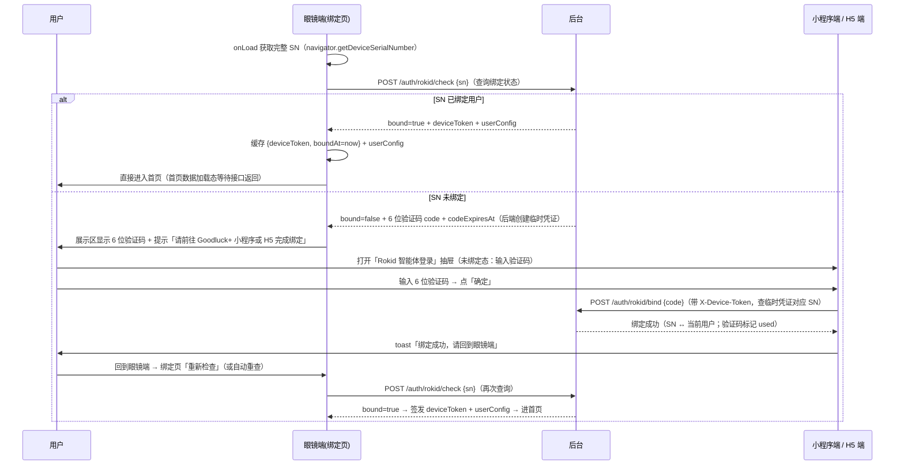
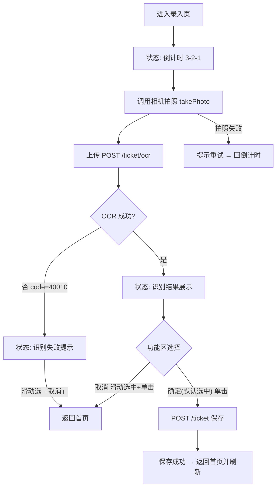
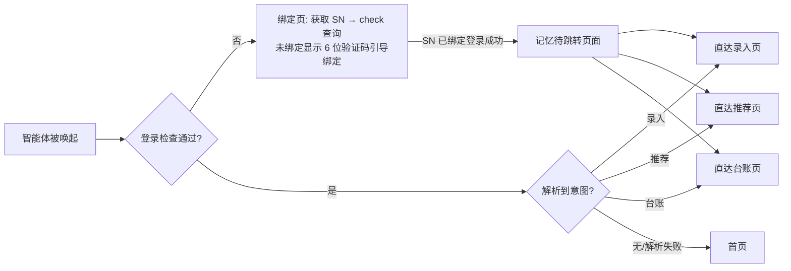

# 彩票小助手 · Rokid 眼镜端功能需求说明书

> 文档版本：V1.4
> 编制日期：2026-08-21（V1.0）→ 2026-08-26（V1.3 / V1.3.1 / V1.4）
> 编制目的：用于 Rokid 眼镜端（AIUI 平台）智能体的需求定义、技术设计与开发参考
> 运行载体：Rokid Glasses 1 / Rokid Glasses 2（单绿色显示，沉浸式 AIUI）
> 产品定位：彩票小助手的**子触点端**。眼镜端不做独立注册，用户完整功能仍在小程序端；眼镜端通过**SN 查询 + 6 位验证码授权绑定**与小程序账号打通，提供免手操作（拍照录入 / 查看推荐 / 查看台账）的轻量服务
> 关系：小程序为**主板产品**（完整能力 + 完整交互），眼镜端为**主板能力的裁剪与快捷入口**。后台共用同一套服务（`https://lottery.memorymap.cn/api`，2026-10-30 由 `api` 子域迁入），任一端的写入（录入彩票、修改配置）在其他端可见

> **V1.4 修订说明（2026-08-26）**：**绑定方案第三次优化（验证码授权式）**——① 眼镜端绑定页获取**完整 SN** → 调 `POST /auth/rokid/check {sn}` 查询绑定状态；② **已绑定 → 直接签发 token 跳首页**（首页数据加载态等待接口返回），无需手动确认；③ **未绑定 → 后端基于 SN 创建 6 位一次性验证码**（TTL 10 分钟），绑定页展示验证码并引导去 **Goodluck+ 小程序 / H5** 输入；④ 小程序/H5 抽屉输入验证码 → `POST /auth/rokid/bind {code}` 反查对应 SN 并绑定到当前用户（验证码标记已使用）；⑤ **已绑定态**：小程序/H5 打开抽屉显示**完整 SN + 「解绑」按钮**（弹窗二次确认后 `POST /auth/rokid/unbind` 解绑，该设备 token 一并失效）。**用户端全程只输入 6 位验证码，不接触 SN**。接口变更：`/auth/rokid/check`（新，替代原 login/shortSn 查询）、`/auth/rokid/bind`（语义改为验证码→SN 绑定）、`/auth/rokid/unbind`（新）、`/auth/rokid/bindings`（新，已绑定列表）。24h 免登录缓存保留。视觉规范、录入/推荐/台账、意图直达等其余内容与 V1.3.x 一致。

> **V1.3 修订说明（2026-08-26）**：**登录绑定方案变更**——原「口令 + AI 快捷指令」方案废弃（官方确认 AI 快捷指令的**文本无法透传**到智能体），改为**设备码绑定**方案：① 眼镜端绑定页通过 `navigator.getDeviceSerialNumber()` 获取并展示本机 SN；② 绑定页提示用户前往**小程序端 / H5 端**绑定；③ 用户单击「进入」→ 后台查询该 SN 是否已与账号绑定（`POST /auth/rokid/login {sn}`）；④ 已绑定 → 签发 token 进入首页；未绑定 → 提示前往小程序/H5 绑定。小程序端登录抽屉由「六位验证码 + 复制口令」改为「**输入设备 SN + 确认**」。24h 免登录缓存机制保留（窗口自 SN 登录成功起算）。接口变更：废弃 `/auth/rokid/passcode`，新增小程序端 `/auth/rokid/bind {sn}`（绑定 SN）与眼镜端 `/auth/rokid/login {sn}`（SN 登录）。视觉规范、录入/推荐/台账功能、意图直达等其余内容与 V1.2 保持一致。

> **V1.3.1 修订说明（2026-08-26）**：**绑定标识符简化为设备码（SN 后 8 位）**——为避免用户去官方 App 复制完整序列号，眼镜端运行时读取完整 SN 后仅截取**后 8 位**（去分隔符 → 取后 8 位 → 大写）作为「设备码」在绑定页展示；用户在小程序/H5 端只需输入这 8 位设备码即可绑定，**全程不暴露完整 SN**。接口字段由 `{sn}` 统一改为 `{shortSn}`（8 位），后台校验正则 `^[A-Z0-9]{8}$`；`rokid_device_bindings` 表键由 `sn` 改为 `short_sn`。撞号概率（8 位字母数字空间 ≈ 2.8×10¹²）在个人设备基数下可忽略，见 §11 R5。

> **V1.1 修订说明（2026-08-23）**：本版依据《Rokid 眼镜端交互设计稿 V2（官方规范版）》定稿（已通过走查）全面订正视觉与交互口径——画布宽度 448px→**480px**（官方 `--app-width`）、亮度阶梯迁移至官方 beta 规范 **6 级（100/72/48/24/12/6%）**、圆角改为**控件 4px / 面板 6px**、边框统一 **1px 结构线**、选中态改为 **12% 填充 + 1px 72% 描边**、标题字重上限 **500**、错误态采用 **▲ 符号 + 虚线边界双通道**；新增**顶栏三栏**（页面名 | Goodluck+ | 用户名）与**功能区两字按钮**规范；首页重构为**三态 Hero + 双栏细线卡**；推荐页功能区改为**「返回」固定左 + 四情景横向滚动**；台账页图例/▼本周/月份图例按最终布局对齐。功能逻辑、接口契约、状态机与 V1.0 保持一致。

> **V1.2 修订说明（2026-08-23）**：依据官方 `aiui-dev` Skill 能力走查结果修订三处关键实现口径——① **相机 API 按官方最新示例**：`wx.media.createCameraContext().takePhoto()` 返回 **`{data: ArrayBuffer}`**（不再依赖未明确的返回结构，图片直接转 Blob 组装 FormData，原 R2 风险消除，见 §6.3.4）；② **按键默认行为拦截**：本应用全部页面为**单屏无滚动**设计，`ArrowUp/ArrowDown/Enter/Backspace` 必须在页面级 `onKeyUp` 中 `event.preventDefault()` 拦截官方默认滚动/返回行为，**滑动触控板统一定位为「功能区选中项切换」**，返回键统一定位为「返回上一级」（见 §3.3/§4.2.4）；③ **亮度映射按官方 beta 规范**：6 级亮度阶梯 ↔ 语义 token 映射表（`--color-primary` / primary-72 / -48 / -24 / -12 / -06），开发实现一律走 token，不硬编码透明度（见 §4.1.2）。同时补充：字体策略（系统字体回退为主 + app.json fonts 声明）、Motion/Loading 约束、内置组件映射（`<error-state>` / `<scroll-view>`）、台账 Grid 实现建议、语音唤醒 keyword 真机确认项。

---

## 目录

- [1 文档说明](#1-文档说明)
- [2 产品定位与总体架构](#2-产品定位与总体架构)
- [3 运行环境与能力基线](#3-运行环境与能力基线)
- [4 全局交互与视觉规范](#4-全局交互与视觉规范)
- [5 页面结构与导航设计](#5-页面结构与导航设计)
- [6 功能需求详述](#6-功能需求详述)
- [7 数据与接口需求](#7-数据与接口需求)
- [8 状态机与异常处理](#8-状态机与异常处理)
- [9 非功能需求](#9-非功能需求)
- [10 开发里程碑与验收](#10-开发里程碑与验收)
- [11 风险与待确认项](#11-风险与待确认项)

---

## 1 文档说明

### 1.1 需求来源

本需求基于以下材料整理：

- 用户口述的 7 条眼镜端功能需求（登录打通 / SN+验证码绑定 / 单绿首页 / 二级导航 / 录入 / 推荐 / 台账）；
- 《Rokid-AIUI-文档整理.md》（AIUI 平台能力、Open Agent Format、单色 Monochrome 规范、交互方式）；
- 官方 `aiui-dev` Skill 的 `design-system-green.md`（**beta 版视觉规范，本版唯一视觉基准**）；
- 《Rokid 眼镜端交互设计稿 V2（官方规范版）》（Ardot 设计稿，**页面视觉与交互的定稿依据**，本版据此订正）；
- 《微信小程序需求规格文档_V1.0.md》（主板产品功能与接口口径，眼镜端功能展示数据参考此文档）；
- 《服务端后台开发技术文档_V1.2.md》（后台 API 契约 §8，眼镜端直接复用后台能力）。

### 1.2 范围界定

| 内容 | 范围 |
|---|---|
| 本期实现 | 眼镜端 5 个页面（登录 / 首页 / 录入 / 推荐 / 台账）的沉浸式 AIUI 智能体 |
| 复用能力 | 后台全部现有 API（OCR / 开奖 / 兑奖 / 统计 / 推荐 / 热力图 / 农历），**零后端业务改造即可跑通核心链路** |
| 需新增 | 后台「SN 查询 + 验证码绑定」接口（check/bind/unbind/bindings，详见《现有小程序前后台改造说明.md》）；小程序端「Rokid 智能体登录抽屉」改造（6 位验证码输入 + 确定 / 已绑定态 SN + 解绑） |
| 不在本期 | 多轮语音对话式导航（本期仅实现"意图→直达子页面"单轮路由，见 §6.6）、扫码录入、多语言、账号注销/多眼镜设备管理 |

> ⚠️ 本文档中所有「数据展示口径」均与小程序主板保持一致（金额单位分→格式化显示、号码两位字符串、期号"第 x 期"格式等），字段合同以《服务端后台开发技术文档_V1.2.md》§8 为唯一来源。

---

## 2 产品定位与总体架构

### 2.1 触点关系

```mermaid
flowchart TB
    subgraph MP[小程序端 - 主板]
        MPF[完整功能：配置/兑奖/录入/推荐/台账]
        MPP[验证码绑定抽屉 - 新增<br/>6 位验证码输入+确定 / 已绑定态 SN+解绑]
    end
    subgraph RK[眼镜端 - 子触点]
        RKLOGIN[绑定页<br/>完整 SN 查询 → 已绑定直达 / 未绑定显验证码]
        RKHOME[单绿首页]
        RKREC[录入 - 拍照OCR]
        RKRECO[推荐 - 四情景]
        RKLED[台账 - 单色热力图]
    end
    subgraph BE[后台 - 共用]
        API[17 个既有接口]
        BIND[绑定服务 - 新增<br/>check 查询+验证码 / bind 绑定 / unbind 解绑 / bindings 列表]
    end
    MPP -->|POST bind {code} / unbind| BIND
    RKLOGIN -->|POST check {sn}| BIND
    BIND --> API
    RKHOME & RKREC & RKRECO & RKLED --> API
    MPF --> API
```

### 2.2 设计原则

1. **瘦客户端、重服务**：眼镜端只保留硬件强相关能力（拍照、ASR/TTS、AR 渲染、本地缓存）与页面编排；OCR / 开奖 / 兑奖 / 统计 / 推荐 / 农历全部上云复用后台。
2. **零学习成本**：所有交互只用两种手势——**滑动**（选择 / 切换）与**单击**（确认 / 触发），与 Rokid 镜腿触摸交互天然对应。
3. **单绿色一色表达**：纯黑背景 + 单绿色通道，用**亮度（透明度）阶梯 / 1px 结构线 / 圆角 / 字重**表达层级（遵循官方 beta 规范，见 §4.1）。
4. **顶栏 + 展示区 + 功能区**：每个页面固定「顶栏（单行三栏）+ 上方展示区（只读信息）+ 底部功能区（入口/操作菜单）」结构，功能区用 12% 填充 + 1px 描边指示选中态。

---

## 3 运行环境与能力基线

### 3.1 运行环境

| 项 | 说明 |
|---|---|
| 设备 | Rokid Glasses 1 / Rokid Glasses 2 |
| 平台 | AIUI（沉浸式 AIUI，独立界面承载完整交互） |
| 显示 | **单绿色单色显示**（纯黑背景 + 单一绿色发光通道），画布宽**严格 `480px`**（官方 `--app-width`），高 `120~352px`（全屏参考 **480×352**），超高超滚动 |
| 输入 | 镜腿触摸（滑动 = ArrowUp/ArrowDown、单击 = Enter）、返回键（Backspace）、语音（可选） |
| 网络 | HTTPS（`fetch` / `wx.request`），生产域名 `https://lottery.memorymap.cn/api` |
| 存储 | `localStorage`（按智能体隔离），用于缓存 deviceToken 与用户配置 |
| 相机 | `wx.createCameraContext()` + `takePhoto()`（AIUI 微信兼容接口） |

### 3.2 平台能力映射

| 能力 | API | 眼镜端用途 |
|---|---|---|
| 页面生命周期 | `onLoad(query)` / `onShow` / `onReady` | 页面初始化、直达参数解析 |
| 全局生命周期 | `onLaunch(options)` / `onShow` / `onHide` | 启动参数（直达意图）解析 |
| 按键事件 | `onKeyDown` / `onKeyUp`（`ArrowUp`/`ArrowDown`/`Enter`/`Backspace`） | 滑动/单击/返回交互 |
| 语音唤醒 | `onVoiceWakeup` | 语音唤起智能体并进入意图解析链路 |
| **设备标识** | **`navigator.getDeviceSerialNumber()`**（同步返回完整 SN 字符串） | 绑定页读取完整 SN 用于「查询绑定状态」（`POST /auth/rokid/check`）；**SN 不在眼镜端界面展示**，界面展示 6 位验证码（§6.1） |
| 相机 | `wx.media.createCameraContext().takePhoto()`（官方最新示例，返回 `{data: ArrayBuffer}`） | 拍照录入 |
| 网络 | `fetch` / `wx.request`（HTTPS） | 后台 API 调用 |
| 存储 | `localStorage.setItem/getItem/removeItem` | 登录态缓存、配置缓存 |
| 语音播报 | `speechSynthesis.speak(utterance)` | 结果播报（可选增强） |
| 语音识别 | `SpeechRecognition` | （可选）语音指令输入 |
| 大模型 | `LanguageModel`（`tools` 声明 + `toolcall` 事件） | **意图直达路由**：识别用户语音意图 → 调用 `open_page` 工具跳转子页面 |

### 3.3 交互映射约定

| 用户动作 | 设备信号 | 应用语义 | 典型场景 |
|---|---|---|---|
| 镜腿**滑动** | `ArrowUp` / `ArrowDown` | **切换功能区选中项**（本应用全部页面单屏无滚动，滑动键一律拦截为选中切换） | 功能区菜单移动、四情景切换、返回/进入/取消/确定切换 |
| 镜腿**单击/轻拍** | `Enter` | 确认 / 激活选中项 | 进入子功能、触发拍照、保存/取消 |
| 镜腿**返回** | `Backspace` | 返回上一级（拦截官方默认"返回/关应用"行为） | 子页面返回首页（与功能区"返回"等价） |
| 语音 | `onVoiceWakeup` + ASR | 语音唤起与意图直达 | （可选）"乐奇，帮我拍照保存彩票" |

**按键默认行为拦截（必须实现）**：

官方 AIUI 的键位默认行为与本应用的交互定义不同，**必须页面级统一拦截**，否则按键会触发宿主默认动作（滚动/导航/关应用）而非本应用语义：

1. `ArrowUp` / `ArrowDown` 官方默认 = **滚动当前根容器**——本应用全部页面为单屏无滚动设计，须在 `onKeyUp` 中 `event.preventDefault()` 拦截，并将按键转换为**功能区选中项上移/下移**（选中态循环）；
2. `Enter` 官方默认 = "进入导航模式/激活焦点"——须拦截并统一为「确认当前选中项」（拍照、保存、进入子页面等）；
3. `Backspace` 官方默认 = "导航返回或**请求关闭应用**"——须拦截并统一为「返回上一级」（子页面回首页）；**仅当在首页且无上级页面时才允许放行关应用**；
4. 拦截点在 `onKeyUp(event)`（官方文档明确：键位默认行为在 keyup 阶段评估，只有 `onKeyUp` 中 `preventDefault()` 才生效）；
5. 全应用维护一份统一的 `handleKeyUp(event)` 调度（按页面态分发：功能区焦点移动 / 全局返回 / 模态确认），避免各页重复实现。

> 需求中的"滑动触控区选择 → 单击触控区确认"，在 AIUI 中即 `ArrowUp/ArrowDown` 导航 + `Enter` 确认。**所有可交互元素必须同时支持按键事件与视觉选中反馈**（功能区选中项 12% 填充 + 1px 72% 描边，明暗区分）。

---

## 4 全局交互与视觉规范

### 4.1 单色显示规范（Monochrome Green · 官方 beta）

> 本节为 V2 设计稿采用的**官方 `design-system-green.md`（beta）规范**，与旧版（448px 时代）的 4 级阶梯/12px 圆角/2px 边框/40% 高亮体系有系统性差异，开发以本节为准。

**4.1.1 亮度阶梯（6 级，全应用统一）**

| 亮度 | 官方语义 token（实现必用，不硬编码透明度） | 用途 |
|---|---|---|
| **100%** | `--color-primary` / `ink` | 主强调、标题、关键数据、选中项文字、「▸」前缀 |
| **72%** | `--color-primary-72` / `ink-primary` / `line-strong` | 正文文字、选中按钮描边、状态徽标文字 |
| **48%** | `--color-primary-48` / `ink-secondary` / `line-default` | 次级文字、未选中按钮描边、分隔说明 |
| **24%** | `--color-primary-24` / `line-muted` / `ink-disabled` | 顶栏分隔线、卡内分隔线、细线卡描边（结构线） |
| **12%** | `--color-primary-12` / `surface-active` | 功能区选中项局部填充（**最大局部填充上限**） |
| **6%** | `--color-primary-06` / `surface-subtle` | 内容面板背景（Hero 卡、推荐号码卡、识别结果面板） |

> ① **实现一律引用上述 token**（官方 `--color-*` 语义变量），不得直接硬编码 `#40ff5e` + 透明度（官方 SKILL §6.2 "Theme First"）；自定义局部变量语义化命名。② 官方 SKILL 主文档 token 表中的 `--color-primary-60 / -40` 为**旧 alpha 兼容命名**（映射关系见 beta §11：60→72/48 分档、40→48/24 分档），**新实现一律使用 6 档新 token**。③ 视觉基线：纯黑背景（`--color-background`）+ 单一绿色通道，**零第二颜色**；**禁止大面积纯色块**（任何局部填充 ≤ 12%）；**禁止 emoji**（`▸`/`▼`/`»`/`▲` 为功能性几何符号，允许）；禁止模糊阴影与 hover 依赖。

**4.1.2 圆角 / 边框**

| 项 | 规范值 |
|---|---|
| 控件圆角 | **4px**（按钮、输入框、状态徽标） |
| 面板圆角 | **6px**（内容卡、Hero 区、提示面板） |
| 圆形标记 | `9999`（号码球、loading 点、倒计时圆环） |
| 默认边框 | **1px 结构线**（未选中按钮 48%、细线卡/面板 24%） |
| 选中边框 | 1px @ 72%（2px 仅用于强焦点，本期不使用） |
| 错误边界 | 1px @ 72% + **虚线**（`dash` 4/3） |

**4.1.3 排版（500 字重为标题上限）**

| 档位 | 字号 / 字重 | 用途 |
|---|---|---|
| Display | 22 / 600 | 主金额、验证码、大号数字（倒计时 44px 特例） |
| Heading | 16 / 600 | 顶栏页面名、Hero 主提示（"还没有购彩记录"、"开奖时间"） |
| Body | 14 / 400 | 居中提示态主文案 |
| Body-sm | 12 / 400（数据 600） | 双栏卡正文、"中奖 ¥3,004"等强调数据 |
| Data | 13 / 600 | 错误面板主文案 |
| Label | 12 / 600（选中）/ 400 | 功能区按钮文字 |
| Caption | 10 / 400 | 辅助说明、日期、角标、hint |
| Mono | 11 / 400~600 | 数字、倒计时、验证码、金额（JetBrains Mono） |

- **标题字重上限 500**（中文用 Semi Bold 600 近似，**禁用 700**）；正文 400。
- **字体策略（按官方 beta §3）**：优先使用系统字体回退链——中文/UI 文字 `sans-serif`，数字/验证码/金额/倒计时 `monospace`；**不要求品牌字体文件**（设计稿中的 Sarasa Gothic SC / JetBrains Mono 为画布渲染近似，真机以系统字体渲染为准）；若确需品牌字体，必须在 `app.json` 的 `fonts` 字段声明并随 assets 打包，且 `font-family` 保留通用回退（如 `'Bundled Font', sans-serif`）；
- 单屏 ≤ 3 个类型层级（主值 / 正文 / caption）；**禁用 700 字重标题**（500 为上限，中文用 Semi Bold 600 近似）。

**4.1.4 状态双通道（单色下错误必须冗余编码）**

所有错误/警告状态（设备未绑定、识别失败、验算超时）必须同时具备**三种信号**：

1. **几何符号**：`▲` 前缀（error 标记）；
2. **虚线边界**：1px @ 72% 虚线框（`strokeDashArray: [4,3]`）+ 6% 填充；
3. **文字说明**：主文案 + 原因 caption。

> 实现提示：官方内置 **`<error-state>`** 组件（icon + message，`--error-state-*` tokens：虚线强边界 + 三角图标）与本规范完全同构——可直接使用该组件，或按本规范自绘，二者视觉必须一致（▲ + 虚线 + 文字三信号缺一不可）。

### 4.2 顶栏与双区页面布局（全页面统一）

**4.2.1 顶栏（单行三栏）**

> 安全区（官方 app-canvas）：**水平 inset 16px、垂直 inset 12px**——内容有效宽度 448px（480−2×16），所有页面内容不得超出安全区。

```
[ 首页 ]        [ Goodluck+ ]        [ 杜春生 ]
```

| 位置 | 内容 | 样式 |
|---|---|---|
| 左侧 | 页面中文名（首页/录入/推荐/台账/账号绑定/未绑定） | Heading 16/600，100% 全亮 |
| 中间 | 应用名 **Goodluck+**（严格水平居中，`layoutGrow` 撑满） | Mono 11/400，48% 透明度（品牌弱化不抢主信息） |
| 右侧 | 用户姓名（`userConfig.name`，如"杜春生"） | Body-sm 12/400，48% 透明度 |
| 登录态 | 右侧显示「**未绑定**」 | Body-sm 12/400，48% 透明度 |

顶栏下方为 1px @ 24% 分隔线。

**4.2.2 页面结构（顶栏 + 展示区 + 分隔线 + 功能区）**

```
┌──────────────────────────────────┐
│ [首页]      [Goodluck+]    [杜春生] │ ← 顶栏三栏（单行）
├──────────────────────────────────┤
│                                  │
│         展示区（只读信息）           │ ← 垂直居中；数据态=卡片/面板，
│   （中奖提示 / 双栏 / 号码 / 台历    │    提示态=无卡片居中直显
│    或 提示文案居中）                │
│                                  │
├──────────────────────────────────┤
│   功能区（底部入口/操作菜单，单行）    │ ← 与展示区间 1px 分隔线，垂直间距 8px
│   [选项1] [选项2] ... · 说明文字    │
└──────────────────────────────────┘
```

**功能区选中态规则（全应用统一）**：

- 选中项：**12% 填充 + 1px @ 72% 描边** + 「▸」前缀 + 文字 600 字重全亮；
- 未选中项：黑底 + 1px @ 48% 描边 + 文字 48% 透明度；
- 按钮统一：**两字文案**（录入 / 推荐 / 台账 / 取消 / 确定 / 重试 / 返回 / 进入 / 退出）、Label 12px、4px 圆角、32px 高（行高 16 + 上下内边距 8）；
- 功能区内侧可带 10px caption 说明文字（如「滑动切换 · 单击进入」「重试 = 重新倒计时拍照」）；
- 默认选中项见各功能节定义（首页默认"录入"、录入确认页默认"确定"等）。

**4.2.3 展示区两种形态**

| 形态 | 适用页面 | 样式 |
|---|---|---|
| **数据态（面板/卡片）** | 首页 Hero、首页双栏卡、识别结果面板、推荐号码/分析卡、台账热力图 | 6% 氛围填充（Hero/结果/号码卡）或黑底+1px@24% 细线（双栏卡/分析卡），6px 圆角，卡内分隔线 1px@24% |
| **提示态（无卡片居中直显）** | 账号绑定引导、设备未绑定、倒计时、OCR 中、保存中、验算中、验算超时 | 无填充无描边，文字垂直水平居中；错误类（设备未绑定/识别失败/验算超时）套 ▲+虚线面板 |

**4.2.4 Motion 与 Loading（按官方 beta §8/§10）**

- 时长节奏：快速反馈 120ms、常规过渡 200ms、结构过渡 320ms（进入/退出缓动曲线按官方）；
- **Loading 表达**：优先「行进点 / 短线扫描 / 标记旋转」等有方向的动效，**避免大号通用 spinner**；本应用 loading 三点（100/48/24%）统一为**左侧亮点 → 右侧暗点循环行进**动画；
- **单活跃动画**：任一时刻全屏最多一个主导动画（如 OCR 中三点行进），其余元素保持静态；页面静止时动画停止或弱化；
- 禁止持续装饰动画（呼吸/辉光循环）、全屏视差、多个独立 ambient 循环；禁止布局抖动（动画期间尺寸不变）；
- 状态切换（选中态变化、错误态出现）用 120~200ms 过渡，选中态**不得放大组件**（仅描边/填充/文字亮度变化）。

### 4.3 语音播报（可选增强）

- 关键状态切换（OCR 完成、推荐就绪、保存成功）可播报一句短提示；
- 播报文本控制在一次听清的长度（≤ 20 字），`speechSynthesis.speak(utterance, 'enqueue')`。

---

## 5 页面结构与导航设计

### 5.1 页面清单

| 页面 | 路径 | 说明 | 是否需要登录态 |
|---|---|---|---|
| 登录/绑定页 | `pages/login/login` | **SN 查询绑定**：获取完整 SN → 已绑定直接登录 / 未绑定展示 6 位验证码引导去小程序/H5 绑定（无有效登录态时进入） | 否 |
| 首页 | `pages/home/home` | 展示区 + 功能区（录入/推荐/台账入口） | 是 |
| 录入页 | `pages/record/record` | 倒计时→拍照→OCR→确认 | 是 |
| 推荐页 | `pages/recommend/recommend` | 四情景推荐 + 分析文本 | 是 |
| 台账页 | `pages/ledger/ledger` | 单色亮度购彩台历 | 是 |

> 现有骨架（`rokid眼镜端/pages/*`）已有 `home/init/record/recommend/ledger` 五个页面，本期开发建议**以本文档为准重构**：`init` 页废弃（无独立注册），新增 `login` 页；`record/recommend/ledger` 按「顶栏 + 展示区 + 功能区」结构改造。
> **代码组织**：应用注册与页面逻辑按官方 **ES Module** 格式——`app.js` 与各 `.ink` 的 `<script setup>` 均 `export default` 导出配置对象（`data` / 生命周期 / 自定义方法）；页面级按键与语音事件（`onKeyDown` / `onKeyUp` / `onVoiceWakeup`）直接定义在导出的页面对象上（见 §3.3 拦截约定）。

### 5.2 导航流程（含意图直达）

```mermaid
flowchart TD
    A[智能体被唤起] --> A1[统一登录态检查]
    subgraph AUTH[登录检查: SN 查询 / 24h 缓存 / 验证码绑定引导]
        A1 --> B{本地 token 有效<br/>且 24h 内?}
        B -- 是 --> E[免登录直接进首页/直达页]
        B -- 否 --> H[绑定页: 获取完整 SN<br/>POST /auth/rokid/check {sn}]
        H --> H1{check 返回?}
        H1 -- bound=true --> E[缓存 token + boundAt<br/>直接进入首页/直达页]
        H1 -- bound=false --> V[绑定页显示 6 位验证码<br/>引导前往小程序/H5 绑定]
        V --> V1{用户去小程序绑定后<br/>回眼镜端「刷新验证码」}
        V1 --> H
    end
    E --> A2{本次唤起携带意图?<br/>直达子功能}
    A2 -- 无意图 --> F[home 首页]
    A2 -- 意图: 录入 --> G[record 录入页]
    A2 -- 意图: 推荐 --> H2R[recommend 推荐页]
    A2 -- 意图: 台账 --> I[ledger 台账页]
    F -->|滑动+单击: 录入| G
    F -->|滑动+单击: 推荐| H2R
    F -->|滑动+单击: 台账| I
    G & H2R & I -->|返回/Backspace| F
```

> 登录检查规则见 §6.1.5；意图直达（AI 语音意图 / 启动参数）的解析与路由见 §5.3 与 §6.6。

### 5.3 意图直达路由（子功能直接服务）

AI 除直接唤起进入首页外，还会**根据用户意图直达子功能页面**（如"帮我拍照保存彩票"→ 录入、"有没有推荐号码"→ 推荐、"最近买了多少彩票"→ 台账）。**前提与首页一致：必须先通过登录绑定（SN 已绑定 check 登录成功，或 24h 免登录缓存有效）。**

| 意图示例（语音） | 目标页面 | 直达行为 |
|---|---|---|
| 「乐奇，这是我这期买的彩票，帮我拍照保存」 | 录入页 | 进入后直接开始 3 秒倒计时 → 拍照 → OCR → 确认（跳过首页） |
| 「乐奇，我要买彩票，有没有推荐号码」 | 推荐页 | 进入后直接按默认情景加载推荐（无缓存时显示"验算中"） |
| 「乐奇，看一下我最近买了多少彩票」 | 台账页 | 进入后直接加载并展示单色购彩台历 |
| （无明确子功能意图） | 首页 | 常规入口 |

**意图来源（两种，均需实现）**：

| 来源 | 说明 | 实现 |
|---|---|---|
| A. 启动参数透传 | 宿主/AI 唤起时以 query 携带目标页面（如 `page=record`） | `app.js onLaunch(options)` / 页面 `onLoad(query)` 读取并路由 |
| B. 语音意图解析（沉浸式 AIUI 内） | 语音唤醒词"乐奇"唤醒后，LLM 理解用户语句 → 触发页面跳转 | `onVoiceWakeup` + `LanguageModel`（tools 声明 `open_page`，参数 `page: 'record'\|'recommend'\|'ledger'\|'home'`）→ 页面层执行 `wx.navigateTo` 跳转 |

**路由约束**：

1. **登录优先**：意图直达**必须先过登录检查**（§6.1.5）——无有效登录态时先进入绑定页（check 查询），SN 已绑定登录成功后再**续接原意图**自动跳转目标子页面（记忆"待跳转页面"）；未绑定不进入任何子功能；
2. **兜底回首页**：意图解析失败（非可识别子功能意图）→ 按无意图处理，进入首页；
3. **返回行为不变**：从直达的子页面按功能区「返回」/ Backspace 返回首页（不回到绑定页）；直达页面的展示区/功能区与手动进入完全一致；
4. **权限一致**：直达入口不绕过任何鉴权与数据加载逻辑，仅改变首屏页面。

---

## 6 功能需求详述

### 6.1 功能一：登录与账号打通（SN 查询 + 验证码授权绑定）

> **方案变更说明（V1.4）**：原「口令 + AI 快捷指令」方案**废弃**（官方确认 AI 快捷指令文本无法透传）；「设备码（SN 后 8 位）直接输入」方案**再优化**——眼镜端绑定页获取**完整 SN** 后调用后端**按 SN 查询绑定状态**：① 已绑定 → 直接签发 token 进首页（首页数据加载态等待）；② 未绑定 → 后端基于该 SN 创建**6 位一次性验证码**，绑定页展示验证码并引导用户去 **Goodluck+ 小程序 / H5** 输入；③ 小程序/H5 抽屉输入验证码 → 后端反查对应 SN → 绑定到当前用户（验证码标记已使用）；④ 已绑定状态下小程序/H5 抽屉显示**完整 SN + 「解绑」按钮**（二次确认后解绑）。**全程用户端只输入 6 位验证码，不接触 SN**。

#### 6.1.1 需求描述

眼镜端**不提供独立注册**，用户账号的唯一真源在小程序端（微信 openid 用户）。眼镜端通过**完整 SN 查询 + 6 位验证码授权**完成账号打通：

> 绑定链路 = 眼镜端完整 SN（`navigator.getDeviceSerialNumber()`）作为设备标识 → 后端维护「SN ↔ 用户」绑定关系；未绑定时由后端为 SN 生成 **6 位数字一次性验证码**作为授权凭证，用户在另一端输入验证码完成绑定。

**机制特性**：

- **SN 即设备标识**：每台眼镜的 SN 唯一且固定，绑定关系存储于后台（SN ↔ 用户），**长期有效**；换机需重新绑定新机 SN；
- **验证码桥接，用户端不接触 SN**：未绑定设备的授权动作由 **6 位一次性验证码**完成（后端基于 SN 创建，TTL 10 分钟），用户只需在另一端输入验证码；
- **已绑定即直达**：SN 已绑定账号时，眼镜端查询即登录（自动签发 token 直接进首页），无需任何手动确认；
- **支持解绑**：小程序/H5 端可查看已绑定设备（显示完整 SN）并解绑（二次确认），解绑后该设备重新走验证码流程；
- **24 小时免登录缓存**：登录成功后眼镜端本地缓存 token，AI 直接唤起（无任何外部凭证）时靠缓存免登录进入（见 6.1.5）。

#### 6.1.2 设备 SN 获取

| 项 | 值 |
|---|---|
| API | `navigator.getDeviceSerialNumber()`（AIUI 运行时，同步返回完整 SN 字符串） |
| 语义 | 返回当前设备的唯一序列号（SN）；眼镜端仅用于「查询绑定状态」请求，**不在界面展示 SN**（界面展示 6 位验证码） |
| 隐私 | SN 为设备唯一标识，仅在后端与小程序/H5 已绑定态展示（用户自己的设备）；传输走 HTTPS |
| 获取时机 | 绑定页 `onLoad` 获取；获取失败（API 不可用）→ 展示「无法获取设备 SN，请重试」错误态 |

```javascript
// 绑定页获取完整 SN 示例
const sn = navigator.getDeviceSerialNumber();
console.log('SN:', sn);
```

#### 6.1.3 绑定流程（验证码授权式）



> **绑定关系**：后台按 SN 唯一存储（一机一号一用户，`rokid_device_bindings.sn` 唯一）；同一 SN 被不同账号重复绑定 = 覆盖到新账号（换绑）；同一用户可绑定多台设备。绑定后眼镜端查询即登录，**无需再次绑定**，除非解绑/换绑或后台清库。

#### 6.1.4 绑定页（登录/绑定页）交互

| 区块 | 内容 | 说明 |
|---|---|---|
| 展示区-验证码卡（未绑定态） | 标题「绑定验证码」+ **6 位数字验证码**（Display 22 全亮居中，**3+3 分组**如 `483 920`）+ caption「剩余有效时间 mm:ss」 | 由 `POST /auth/rokid/check` 未绑定分支返回；过期自动重新获取新验证码 |
| 展示区-提示文案（未绑定态） | 「**请前往 Goodluck+ 小程序或 H5 完成绑定**」+ caption「打开小程序 → Rokid 智能体登录 → 输入上方 6 位验证码并确定」 | 引导用户去绑定 |
| 绑定状态行 | 进入绑定页自动执行 check：已绑定 → 直接跳首页（无手动确认）；未绑定 → 显示验证码 | 见 6.1.5 |
| 功能区（未绑定态） | **[退出] [▸ 刷新验证码]**：**默认选中「刷新验证码」** | 刷新 = 重新 check 取新验证码（用户在小程序绑定后回来也用它触发"重新检查"）；退出 = 关闭智能体 |
| 已绑定态 | （无绑定页停留）直接进入首页，**首页数据加载态（骨架/loading）等待接口返回** | 需求第 3 点：跳转首页后由首页加载态承接 |

#### 6.1.5 登录态缓存与 24 小时免登录

**缓存结构**（localStorage）：

| 存储键 | 内容 | 说明 |
|---|---|---|
| `deviceToken` | check 已绑定分支下发的 token | 所有 API 请求头 `X-Device-Token` |
| `boundAt` | 最近一次 check 登录成功时间戳（ms） | 24h 免登录窗口起点，每次 check 已绑定刷新 |
| `userConfig` | `{lotteryType, divinationSystem, name, ...}` | 首页默认彩种、推荐默认情景来源、**顶栏右侧用户姓名** |
| `userId` | 绑定用户 ID | 用于展示"已绑定账号" |

**唤起分流逻辑**（每次智能体启动执行）：

```mermaid
flowchart TD
    A[智能体被唤起] --> F{本地有 token<br/>且距今 < 24h?}
    F -- 是 --> G[免登录直接进入首页/直达页]
    F -- 否（无缓存或超 24h） --> H[绑定页: 获取完整 SN<br/>POST /auth/rokid/check {sn}]
    H --> H1{check 返回?}
    H1 -- bound=true --> D[缓存 token + boundAt=now<br/>直接进入首页/直达页<br/>首页数据加载态等待返回]
    H1 -- bound=false --> V[绑定页显示 6 位验证码<br/>引导前往小程序/H5 绑定]
    V --> V1{用户去小程序绑定后<br/>回眼镜端「刷新验证码」}
    V1 --> H
```

**规则明细**：

1. **24h 免登录窗口**：自最近一次 check 登录成功时刻起算 24 小时；窗口内 AI 直接唤起（无任何外部凭证）也可免登录使用全部功能；
2. **窗口刷新**：绑定页每次 check 返回已绑定即刷新窗口与 token；窗口过期后重新走绑定页（SN 已绑定 → check 直接登录，无需再验证码）；
3. **未绑定处理**（check 返回 `bound=false`）：绑定页展示后端下发的 6 位验证码 + 剩余有效期，引导去小程序/H5 输入；用户完成绑定后回眼镜端单击「刷新验证码」（重新 check）即登录；
4. **验证码过期**：验证码 TTL 10 分钟；过期后绑定页自动（或用户手动刷新）重新请求新验证码；用户端输入的旧验证码将提示「验证码无效或已过期」；
5. **业务请求 40100**：后台判定 token 失效（如后台清库）→ 清除本地缓存，进入绑定页；因绑定关系仍在，check 直接登录恢复（无需再验证码）；
6. **退出登录**：清除本地缓存（token / boundAt / userConfig）回绑定页，入口放台账页功能区扩展项（本期可选）。

#### 6.1.6 绑定页异常态

| 场景 | 展示 |
|---|---|
| 获取 SN 失败（`navigator.getDeviceSerialNumber` 异常） | ▲ + 虚线面板「无法获取设备 SN，请重试」+ 功能区 [退出] [▸ 重试] |
| check 请求失败 / 网络异常 | ▲ + 虚线面板「绑定状态查询失败，请重试」+ 功能区 [退出] [▸ 重试] |
| 验证码过期（check 返回的新 code 已替换旧码，或倒计时归零） | 自动重新 check 获取新验证码；提示「验证码已刷新」 |
| 用户端输入错误验证码（bind 失败） | 小程序/H5 端 toast「验证码无效或已过期，请确认眼镜端显示的验证码」 |

### 6.2 功能二：首页（单绿色首页）

#### 6.2.1 页面结构（Hero 三态 + 双栏）

首页 Hero 区随数据状态呈现三种形态（参照小程序 hero-card 状态机），双栏与功能区恒定：

```
┌────────────────────────────────────────┐
│ [首页]        [Goodluck+]        [杜春生] │
├────────────────────────────────────────┤
│ ▸ 待兑奖 / 待开奖 / 去录入   · 共 N 笔     │ ← Hero 区（6% 填充、无边框、圆角 6）
│ 主信息（¥3,000 / 开奖时间 / 引导语）       │     Display 22 或 Heading 16
│ 副信息（期号 · 截止日期 · 渠道）           │
├────────────────────────────────────────┤
│ ┌ 本期开奖信息 ────┐ ┌ 购彩统计 ──────┐  │ ← 双栏细线卡（1px@24% 描边、
│ │ 期号/奖池/倒计时   │ │ 三项统计        │     6px 圆角，各 218px）
│ └────────────────┘ └───────────────┘  │
├────────────────────────────────────────┤
│ [▸ 录入] [推荐] [台账] · 滑动切换 · 单击进入 │ ← 功能区（默认选中录入）
└────────────────────────────────────────┘
```

#### 6.2.2 Hero 三态

| 状态 | 触发条件 | Hero 内容 | 顶部行 |
|---|---|---|---|
| **待兑奖** | 存在未兑奖记录 | 「¥3,000」Display 22/600 + 「剩 12 天」Label 12/600 | 「▸ 待兑奖」+ 角标「共 2 笔」 |
| **待开奖** | 无待兑奖 + 本期已购 | 「开奖时间 08-22 21:30」Heading 16/600 + 「距开奖 2 天」 | 「▸ 待开奖」+ 「已购 1 注」 |
| **待录入** | 无任何购彩记录 | 「还没有购彩记录」Heading 16/600 + 「拍下彩票即可开始记账 · 兑奖提醒与趣味推荐」 | 「▸ 去录入」+ 「无购彩记录」 |

- Hero 区统一：**6% 氛围填充、无描边、6px 圆角、内边距 10**；三态视觉完全一致（仅内容差异）；
- Hero 下方 1px@24% 分隔线，再下为双栏。

#### 6.2.3 双栏（数据展示，只读）

| 栏 | 数据来源 | 内容 |
|---|---|---|
| 本期开奖信息 | `GET /lottery/status?type=<彩种>` | 标题 caption + 「双色球 第2026096期」+「奖池 ¥20.1 亿」+「距停售 09:40:02」（Mono） |
| 购彩统计 | `GET /statistics` | 标题 caption + 「已购 12 期」+「本月花费 ¥24」+「中奖 ¥3,004」（**100% 全亮 + 600 强调**） |

- 双栏细线卡：黑底 + **1px@24% 描边** + 6px 圆角 + 内边距 8，两卡间距 12，各宽 218px；
- 双栏卡与 Hero 区、Hero 区与顶栏之间均以 1px@24% 分隔线分层；
- 本期开奖信息**不展示开奖号码**（未开奖态，逻辑上无号码）；
- 默认展示用户配置彩种（`userConfig.lotteryType`），另一彩种数据仅缓存备用，眼镜端不做彩种切换交互。

**无下级功能**：Hero 与双栏均不可点击进入下级页面（与小程序端"查看详情"不同，眼镜端受单色 + 视野限制，仅做概要展示）。

#### 6.2.4 功能区（入口菜单）

- 三个入口：**录入** / **推荐** / **台账**（两字按钮）；
- 滑动切换选中项（选中 12% 填充 + 1px@72%，未选中 1px@48%），**默认选中「录入」**；
- 单击确认进入对应子功能；附 caption「滑动切换 · 单击进入」；
- 若存在待兑奖记录，进入首页时播报一句「您有 N 笔待兑奖，请及时兑付」（可选）。

#### 6.2.5 数据加载（含骨架态与失败态）

- 首页 `onShow` 并行请求 `redeem/pending`、`statistics`、`lottery/status(ssq)`、`lottery/status(dlt)`，展示区依次就绪（先到先渲染，不互相阻塞）；
- **骨架态**（加载中，与真实页**逐层同构**避免跳变）：Hero 区 6% 填充 + 骨架条（普通行 24%、重点行 48% 两级亮度）+ 双栏细线卡骨架条；
- 失败卡片显示「加载失败」弱提示（1px@48% 描边），不阻塞其他卡片。

### 6.3 功能三：录入（拍照 OCR 录入）

#### 6.3.1 页面状态机



#### 6.3.2 各状态展示与交互

| 状态 | 展示区 | 功能区 | 触发 |
|---|---|---|---|
| 倒计时 | 居中直显：**取景圆环**（108px，1px@24% 描边）+ 大号数字 **3→2→1**（Mono 44/600）+ 「即将自动拍照 · 请对准彩票」+ caption「倒计时 3-2-1 结束后自动拍照 · 免手操作」 | **[▸ 取消]** + 「单击返回首页 · 放弃本次录入」 | 进入页面即开始，每秒递减 |
| 拍照 | 相机取景（AIUI 相机组件） | [▸ 取消] | 倒计时结束自动 `takePhoto()` |
| OCR 识别中 | 居中直显：「正在对彩票进行 OCR 识别」+「请稍后…」+ loading 三点（6px，100/48/24%）+ caption「图片已上传 · 识别期间请勿移动头部」 | **[▸ 取消]** | 图片上传后，禁用交互防误触 |
| 识别结果 | **面板卡**（6% 填充 + 1px@24% 描边 + 6px 圆角）：顶部行「双色球」+「第2026096期 · 开奖 08-20」+「识别成功」徽标（1px@24% 胶囊）→ 分隔线 → hint「投注号码 · 共 5 注」+ 右侧「金额 ¥12」→ **5 注号码行**（红实心/蓝镂空 22px 球、「-」分隔、×倍数） | **[取消] [▸ 确定]**（默认选中确定）+ 「滑动切换 · 单击确认」 | OCR 返回后渲染 |
| 识别失败 | **▲ + 虚线面板**（6% 填充 + 1px@72% 虚线）：「识别失败，请重试」+「OCR 未识别出有效票面 · code 40010 · 可回小程序手动校对」 | **[取消] [▸ 重试]**（默认选中重试）+ 「重试 = 重新倒计时拍照」 | `code=40010` |
| 保存中 | 居中直显：「正在保存…」+ loading 三点 + caption「保存成功后自动返回首页 · 播报已录入」 | —（隐藏） | 单击确定后 |

#### 6.3.3 号码展示规则（5 注预留）

- **默认按 5 注容量设计**（用户常见购 5 注）：号码球 22px（红球 48% 填充 + 1px@72% 描边实心，蓝球黑底 + 1px@72% 描边镂空），行内间距 4px，球号 Mono 10/600；红蓝区以「-」分隔；每注行尾显示倍数（×2 / ×1）；
- 5 注行**左对齐**（与面板左侧对齐），hint 行两端对齐（左「投注号码 · 共 N 注」/ 右「金额 ¥X」）；
- 多于 5 注时按行扩展（超面板高度时面板内部滚动）；双色球 6 红 + 1 蓝；大乐透 5 前区 + 2 后区；`redBalls`/`blueBalls` 两位字符串数组。

#### 6.3.4 关键约束

1. **倒计时**：进入页面立即开始 3 秒倒计时，结束自动拍照，无需用户操作（免手场景）；
2. **相机与 OCR 上传（按官方最新 API）**：
   - 拍照：`const camera = wx.media.createCameraContext()`（官方命名空间），`const photo = await camera.takePhoto({ quality: 'high' })`——**返回 `{ data: ArrayBuffer }`**（`photo.data.byteLength` 取大小），不再依赖未知返回结构；
   - 上传：将 `photo.data`（ArrayBuffer）直接 `new Blob([photo.data], { type: 'image/jpeg' })` 组装 `FormData`，用 `fetch` + `multipart/form-data` 上传，字段名 `file`，单张 ≤ 2MB（⚠️ AIUI 微信兼容网络层**没有 `wx.uploadFile`**，只有 `wx.request` / WebSocket / EventSource / `fetch`）；
   - 图片仅用于即时 OCR，后台不落盘；
3. **默认选中「确定」**：用户无操作直接单击触控板 = 保存（符合"快捷"定位）；
4. **取消**：滑动选中「取消」后单击 → **清空本次识别结果**，返回首页，不留脏数据；
5. **保存后处理**：`POST /ticket` 返回 `{id, status}`（保存后自动开奖比对，可能多耗 1-3 秒），保存期间展示「正在保存…」；成功后播报「已录入」并返回首页。

### 6.4 功能四：推荐（四情景趣味推荐）

#### 6.4.1 页面结构

```
┌────────────────────────────────────────┐
│ [推荐]        [Goodluck+]        [杜春生] │
├────────────────────────────────────────┤
│ ┌ 双色球 · 星座占星 · 08-21 周五  红6 蓝1 ┐ │ ← 号码卡（6% 填充 + 1px@24% 描边）
│ │ 03 08 15 21 27 30 - 09                 │ │    22px 红实心/蓝镂空球
│ │ 推荐 1 注 · 单注 ¥2 · 当日已计算缓存秒回  │ │
│ ├───────────────────────────────────────┤ │
│ │ 分析 ANALYSIS         │  ← 垂直滚动条   │ │ ← 分析卡（黑底 1px@24% 细线）
│ │ 春生 · 2000-01-15 生 · 今日丙午年…      │ │    文本自动上下滚动
│ │ 自动滚动 · 上下 AUTO SCROLL V          │ │
│ └──────────────────────────────────────┘ │
├────────────────────────────────────────┤
│ [返回] [▸星座-双色球][星座-大乐透][五行-双色球][五行-大乐透»] │
└────────────────────────────────────────┘
```

#### 6.4.2 情景定义（对应后台 `/recommend` 参数）

| 功能区情景 | `system` | `lottery` | 说明 |
|---|---|---|---|
| 星座-双色球 | `astrology` | `ssq` | 星座占星 × 双色球 |
| 星座-大乐透 | `astrology` | `dlt` | 星座占星 × 大乐透 |
| 五行-双色球 | `iching` | `ssq` | 五行推命 × 双色球 |
| 五行-大乐透 | `iching` | `dlt` | 五行推命 × 大乐透 |

#### 6.4.3 展示区

| 区块 | 内容 | 渲染要求 |
|---|---|---|
| 推荐号码卡 | `redBalls` / `blueBalls`（来自 `/recommend` 响应） | 面板卡：**6% 填充 + 1px@24% 描边 + 6px 圆角**；标题行（彩种 · 体系 · 日期，Label 12/600 + 右角标「红6 蓝1」Mono 10/400）；号码行 22px 球（红实心 48% / 蓝镂空，「-」分隔，间距 4）；卡底 caption「推荐 1 注 · 单注 ¥2 · …」 |
| 分析文本卡 | `userText` + `summary`（后端已组装，前端直接拼接） | 黑底 1px@24% 细线卡：标题「分析 ANALYSIS」+ 正文两行（Body-sm 12/400）+ 底部「自动滚动 · 上下 AUTO SCROLL V」标签 + 卡右侧**垂直滚动条**（2px 轨道 24% + 滑块 72%）——文本**自动上下滚动播读** |

> 实现提示：功能区四情景横向滚动与分析卡纵向自动滚动均建议用官方 **`<scroll-view>`** 组件承载（横向 `scroll-x`、纵向 `scroll-y`），自动滚动用定时器逐步设置 `scrollTop` 实现（循环滚动，滚动动画遵循 §4.2.4 的单一活跃动画约束）；「»」滚动指示固定在滚动区右缘。

#### 6.4.4 当日推荐缓存逻辑

```
进入推荐页 → 读取 userConfig 得到默认情景（divinationSystem + lotteryType）
  → 调 POST /recommend {system, lottery}（不带 refresh）
     ├─ 后台当日已缓存 → 秒回，直接渲染号码 + 分析
     └─ 无缓存 → 后台触发 LLM 生成（约 5-8s）
           → 眼镜端展示区显示「系统正在验算中，请稍候…」（无卡片居中直显）
           → 返回后渲染结果
```

- **"当日已计算"判断**：后台 `/recommend` 按 `用户 + 日期 + 彩种 + 推演体系` 日级缓存。眼镜端首次请求即知缓存是否存在——响应延迟 > 1s 视为"正在验算中"，秒回视为"当日已计算"。若需更明确的"是否已计算"状态，可后续新增 `GET /recommend/status`（本期可选）。
- 默认情景 = 用户在小程序 `userConfig` 中配置的 `divinationSystem`（astrology/iching）+ `lotteryType`（ssq/dlt）；登录时随 `userConfig` 一并缓存，推荐页 `onShow` 时读取。
- 情景切换**纯本地**：进入页面后并行预取 4 个情景（与小程序端一致），切换即本地秒读，不再逐个请求；仅首次进入的默认情景可能需要等待 LLM。

#### 6.4.5 功能区（分组：返回固定 + 四情景横向滚动）

- **两组**：「**返回**」（固定最左侧，不参与滚动）+ 四情景组（**横向滚动**，容器宽 350px `clipsContent`，超宽项露边裁剪，行尾固定「»」滚动指示）；
- 两组之间 12px 间隔，选中态与全应用一致（12% 填充 + 1px@72%）；
- 进入页面时，默认选中项 = 用户配置对应的默认情景（非"返回"）；
- 滑动切换情景或返回，单击触发（切情景 → 本地切换展示区内容；返回 → 回首页）；
- 情景切换滚动仅作用于四情景组，**「返回」恒在左端**，保证任意滚动位置均可一键返回。

### 6.5 功能五：台账（单色购彩台历）

#### 6.5.1 页面结构

```
┌────────────────────────────────────────┐
│ [台账]        [Goodluck+]        [杜春生] │
├────────────────────────────────────────┤
│ ¥0 ■■■■■ ¥50+                        │ ← 亮度图例（左上角，与「周一」列左缘对齐）
│         ▼ 本周                         │ ← ▼ 指示第 12 列（本周）正上方
│ 周一  ■■■■■■■■■■■■  大乐透            │ ← 6 行：周几 + 12 列格子 + 彩种中文
│ 周二  ■■■■■■■■■■■■  双色球            │
│ 周三  ■■■■■■■■■■■■  大乐透            │
│ 周四  ■■■■■■■■■■■■  双色球            │
│ 周六  ■■■■■■■■■■■■  大乐透            │
│ 周日  ■■■■■■■■■■■■  双色球            │
│ 5月        6月        7月        8月   │ ← 月份图例（底部，与格子列对齐）
│ 亮度 5 阶 = 购彩金额 · 空心 = 待开奖/号码待同步 │
├────────────────────────────────────────┤
│ [▸ 返回] · 滑动切换 · 单击进入             │
└────────────────────────────────────────┘
```

#### 6.5.2 数据与渲染

| 项 | 说明 |
|---|---|
| 数据来源 | `GET /heatmap` → `{weeks: 12, amounts: {'YYYY-MM-DD': 0~4}, draws, legend}` |
| 行 = 开奖日 | 周一/三/六 = 大乐透，周二/四/日 = 双色球，周五不开奖跳过；用户配置变动时行数随之增减（只选双色球剩 3 行） |
| 列 = 周 | 默认 12 列（最近 12 周 ≈ 3 个月），一屏可视 |
| 每格 | 正方形 **18px + 4px 间距**，圆角 4~5px；12 列 + 行标签总宽 ≤ 480px |
| 实现建议 | 热力图区用 **Grid 布局**（`display: grid; grid-template-columns: repeat(12, 1fr)` + 行内 gap 4px），由 `amounts` 数据驱动格子亮度（6/24/48/72/100%）；如后续需要发光/辉光效果可改用 Canvas（API 为 `wx.createCanvasContext('id')`），两者视觉必须一致 |
| 行标签 | 周几（周一~周日）Label 12/600；行尾彩种**中文**（大乐透 / 双色球）Caption 10/400 |
| **亮度 5 阶** | `amounts` 值 0~4 → 绿色透明度阶梯 **6% / 24% / 48% / 72% / 100%**（对齐 6 级亮度体系的前 5 级）；用**亮度（透明度）**表达购彩金额，越亮金额越高 |
| 亮度图例 | **左上角**，与「周一」列左缘对齐：`¥0` + 5 个色块（12px，圆角 3）+ `¥50+`（Caption 10/400） |
| ▼ 本周 | 指示符行位于热力图顶部，**「▼ 本周」中心对准第 12 列正中心**（Label 11/600 @ 72%） |
| 月份图例 | **热力图底部**，参照小程序 `left = col × 列步长` 逻辑：`5月/6月/7月/8月` 分别精确落在 **第 1/5/9/12 列** 上方（Caption 10/400 @ 48%） |
| 状态 | 已过开奖日且无 `draws` key 的格子：显示为低亮度空心（"号码待同步"提示，本期仅提示不提供同步按钮，同步操作请回小程序执行）；待开奖格子同样空心表达 |
| 整体布局 | 热力图区（图例 + ▼本周 + 6 行 + 月份 + 说明）**整体水平垂直居中**于展示区 |

#### 6.5.3 功能区

- 仅一个选项：**[▸ 返回]**（默认且唯一选中态，带 ▸ 前缀与全应用选中样式一致）；
- 单击触控板直接返回首页；镜腿返回键（Backspace）等价；附 caption「滑动切换 · 单击进入」。

### 6.6 功能六：AI 意图直达子功能（子功能直接服务）

#### 6.6.1 需求描述

AI 平台除直接进入智能体首页外，还会**根据用户语音意图直接路由到子功能页面**，减少一次首页导航操作：

| 用户语音（示例，唤醒词"乐奇"） | 意图 | 直达页面 | 直达行为 |
|---|---|---|---|
| 「乐奇，这是我这期买的彩票，帮我拍照保存」 | 录入 | 录入页 | 直接开始 3 秒倒计时自动拍照 OCR（§6.3） |
| 「乐奇，我要买彩票，有没有推荐号码」 | 推荐 | 推荐页 | 直接按默认情景加载推荐（§6.4） |
| 「乐奇，看一下我最近买了多少彩票」 | 台账 | 台账页 | 直接加载并展示单色购彩台历（§6.5） |
| 其他/无明确意图 | 首页 | 首页 | 常规展示（§6.2） |

**前提**：与首页完全一致，**必须先通过登录绑定**（SN 已绑定 check 登录成功，或 24h 免登录缓存有效）；未绑定不进入任何子功能。

#### 6.6.2 意图解析与路由实现

| 方式 | 触发链 | 实现要点 |
|---|---|---|
| A. 启动参数透传 | 宿主唤起时 query 携带 `page=record/recommend/ledger` | `onLaunch(options)` / 首屏 `onLoad(query)` 读取 `query.page`，登录检查通过后 `wx.navigateTo` 直达 |
| B. 语音意图解析 | 语音唤醒"乐奇" → `onVoiceWakeup` → 页面内 `LanguageModel` 会话（`tools: [{name:'open_page', parameters:{page}}]`）→ `toolcall` 事件回调执行跳转 | 系统提示约束：仅在明确识别到"录入/拍照/保存彩票"、"推荐/号码"、"台账/买了多少"等意图时调用 `open_page`，其余返回 `home`；单次会话超时/失败回退首页 |

**路由状态机**：



#### 6.6.3 关键约束

1. **登录前置**：意图直达不能绕过登录检查——无有效登录态时先进入绑定页（check 查询），**SN 已绑定登录成功后自动续接原意图**跳转目标页面（本地记忆待跳转页面）；
2. **直达不改变页面能力**：直达进入的录入/推荐/台账页，其展示区、功能区（含"返回"）、数据加载逻辑与手动进入完全一致；
3. **兜底策略**：意图解析失败、LLM 会话异常或用户中途取消 → 一律回退首页，不阻塞使用；
4. **权限一致**：直达入口不新增任何鉴权旁路，所有数据接口仍带 `X-Device-Token`，40100 处理与全局异常矩阵一致（§8.1）。

---

## 7 数据与接口需求

### 7.1 复用后台接口（全部零改造复用）

| 接口 | 方法 | 使用页面 | 用途 |
|---|---|---|---|
| `/auth/rokid/check` | POST | login | **新增**：眼镜端 SN 查询绑定状态（body `{sn}`，无鉴权）→ 已绑定返回 `{bound:true, deviceToken, userConfig}` 直接登录；未绑定返回 `{bound:false, code, codeExpiresAt}` 并创建 6 位一次性验证码（见《改造说明》） |
| `/auth/rokid/bindings` | GET | （小程序/H5 端用，眼镜端不调） | **新增**：当前用户已绑定设备列表（含完整 SN），抽屉已绑定态展示用 |
| `/user/config` | GET | login / home / recommend | 用户配置（默认彩种/体系/姓名），登录后拉取缓存 |
| `/redeem/pending` | GET | home | 中奖提示 |
| `/statistics` | GET | home | 购彩统计 |
| `/lottery/status` | GET | home | 本期开奖信息 |
| `/ticket/ocr` | POST | record | 拍照 OCR（multipart `file`） |
| `/ticket` | POST | record | 保存票据 |
| `/recommend` | POST | recommend | 四情景推荐 |
| `/heatmap` | GET | ledger | 购彩台历 |
| `/lunar` | GET | （可选） | 推荐分析文本补充 |

> 鉴权统一：请求头 `X-Device-Token: <deviceToken>`（`/auth/rokid/check` 除外，SN 即凭证）；`code=40100` 时眼镜端清除缓存，进入绑定页重新 check。

### 7.2 金额与号码展示口径（与小程序一致）

| 项 | 口径 |
|---|---|
| 金额 | 后台返回分（`amount`/`totalSpent`/`totalWon`），眼镜端格式化为整数元 `¥3,000`（去角分），Display 22/600 展示 |
| 号码 | 两位字符串数组（`["03","08"]`），红区 48% 填充实心球 / 蓝区黑底镂空球（1px@72% 描边）区分 |
| 期号 | 后台已格式化 `"第 2026096 期"`，直接展示 |
| 奖池 | 后台已格式化 `"¥20.1 亿"`，直接展示 |
| 倒计时 | 后台已格式化 `"距停售 09:40:02"`，直接展示；如需实时跳动，用 `saleEndAt` 时间戳本地计算 |
| 用户名 | `userConfig.name` 用于顶栏右侧展示（如"杜春生"）；未绑定显示「未绑定」 |

---

## 8 状态机与异常处理

### 8.1 全局异常矩阵

| 场景 | 处理 |
|---|---|
| AI 直接唤起且无有效登录态（无缓存或超 24h） | 绑定页：获取完整 SN → `POST /auth/rokid/check {sn}` 自动查询；已绑定直接进首页（首页数据加载态）；未绑定显示 6 位验证码 + 引导「请前往 Goodluck+ 小程序或 H5 完成绑定」+ 功能区 [退出] [▸ 刷新验证码] |
| 未绑定（check 返回 `bound=false`） | 绑定页展示验证码态：6 位验证码（3+3 分组）+ 剩余有效期倒计时 + 引导文案；验证码过期自动重取 |
| 获取 SN 失败（`navigator.getDeviceSerialNumber` 不可用/异常） | 绑定页错误态：▲ 无法获取设备 SN，请重试；功能区 [退出] [▸ 重试] |
| check 请求失败 / 网络异常 | 绑定页错误态：▲ 绑定状态查询失败，请重试；功能区 [退出] [▸ 重试] |
| 意图直达时登录前置 | 无有效登录态 → 先进绑定页，check 登录成功后再跳目标子页面；未绑定不进入任何子功能 |
| 意图解析失败 / LLM 会话异常 | 回退首页，不阻塞使用 |
| token 失效（业务请求返回 40100） | 清除缓存 → 绑定页；绑定关系仍在，check 直接登录恢复（无需再验证码） |
| 网络异常 / 超时 | 展示区显示「网络异常」弱提示（1px@48% 描边），功能区仍可操作返回；请求超时 10s（`fetch` 用 `AbortController` 实现，`wx.request` 用 `timeout` 参数；OCR 上传放宽至 30s） |
| OCR 失败（40010） | 录入页进入「识别失败」态（**▲ + 虚线面板**），功能区 [取消] [▸ 重试]（本期不做眼镜端手动校对，校对请回小程序） |
| 推荐 LLM 未就绪 | 展示「系统正在验算中，请稍候…」（无卡片居中直显 + loading 点），5-8s 内返回；超过 15s 进入「验算超时」态（**▲ + 虚线面板**「验算超时，请重试」+「超过 15 秒未返回 · 滑动切换情景可重新发起」） |
| 开奖数据不存在（40401） | 开奖信息卡展示「待开奖」 |

### 8.2 页面级状态机

- **绑定页**：`loading`（获取 SN）→ `checking`（自动调 check）→ `bound_success`（缓存 token + 直接进首页/直达页，首页数据加载态承接）/ `unbound`（展示 6 位验证码 + 倒计时 + 引导）→ `refreshing`（用户单击「刷新验证码」重新 check）/ `sn_error`（获取 SN 失败）/ `check_error`（check 失败）；
- **录入页**：`countdown → camera → ocring → result → saving` / `failed`（详见 6.3.1）；
- **推荐页**：`loading(验算中) → ready` / `timeout(超时)`；
- **台账页**：`loading → ready` / `error`。

---

## 9 非功能需求

| 类别 | 要求 |
|---|---|
| 性能 | 首页并行加载 ≤ 2s（弱网 3s）；页面切换（滑动+单击）本地响应 < 100ms；OCR 上传与识别全流程 ≤ 10s |
| 网络 | 强制 HTTPS；生产域名 `https://lottery.memorymap.cn/api`；需在 AIUI 平台配置网络白名单/域名（迁域后须新增 `lottery.memorymap.cn`） |
| 缓存 | deviceToken / boundAt / userConfig 持久化于 localStorage；**24h 免登录窗口**自最近一次 check 登录成功起算；token 失效即清缓存 |
| 安全 | 绑定凭证 = 完整 SN（后台存储作设备标识键）；未绑定时以 **6 位一次性验证码**授权（TTL 10 分钟、一次性、`check` 创建时明文仅返回眼镜端、`bind` 校验后标记 used、失败限流 5 次/10 分钟）；SN 查询接口限流；免登录窗口仅 24h |
| 显示 | 严格单绿色；画布 480×352；6 级亮度阶梯（100/72/48/24/12/6%）；控件 4px / 面板 6px 圆角；1px 结构线；错误态 ▲ + 虚线双通道；禁 emoji / 大面积纯色块（填充 ≤ 12%）/ 700 字重标题；超 352px 滚动 |
| 可用性 | 全程免手操作闭环（倒计时自动拍照、默认选中即确认）；任何失败均有视觉反馈（▲+虚线+文字）且可返回首页；意图直达失败一律回退首页 |

---

## 10 开发里程碑与验收

| 阶段 | 内容 | 验收标准 |
|---|---|---|
| M1 登录链路 | login 页（SN 获取/check 查询/验证码展示/错误态）+ check 登录 + 24h 免登录缓存 + 意图直达路由 | 绑定页自动获取完整 SN 并调 check：**已绑定 → 直接进首页**（首页数据加载态等待）；未绑定 → 展示 6 位验证码 + 引导文案 + [退出][▸刷新验证码]；小程序输入验证码绑定后回眼镜端「刷新验证码」→ 登录成功进首页；24h 内 AI 直接唤起免登录；超 24h → 回绑定页 check；**语音意图直达三个子页面成功，且未绑定/绑定失败时不进入子功能** |
| M2 首页 | 顶栏三栏 + Hero 三态 + 双栏细线卡 + 骨架态 + 入口菜单 | 待兑奖/待开奖/待录入三态正确；双栏信息正确；滑动切换 + 单击进入子页；默认选中「录入」；加载骨架与真实页同构 |
| M3 录入 | 倒计时（圆环+大数字）→ 拍照 → OCR → 5 注结果/失败/保存 | 3 秒自动拍照；OCR 结果 5 注正确渲染（红实心/蓝镂空）；确定保存 / 取消清空均符合预期；失败态 ▲+虚线+[取消][▸重试] |
| M4 推荐 | 号码卡 + 垂直滚动分析卡 + 验算中/超时 + 功能区分组滚动 | 默认情景 = 用户配置；「返回」固定左 + 四情景可横向滚动切换；当日缓存秒回；无缓存显示验算中；超 15s 显示超时态 |
| M5 台账 | 单色热力图（图例左上 + ▼本周 + 月份图例底部）+ 返回 | 12 列 × 6 行布局正确且水平居中；亮度 5 阶与金额对应；▼ 本周对准第 12 列；月份对齐格子列；单击「▸ 返回」回首页 |
| M6 联调 | 与小程序同账号数据互通 | 眼镜端录入 → 小程序台账可见；小程序配置变更 → 眼镜端推荐默认情景与顶栏姓名同步 |

---

## 11 风险与待确认项

| 编号 | 项 | 影响 | 建议应对 |
|---|---|---|---|
| R1 | ~~AI 快捷指令口令透传~~ **已废弃**：官方确认 AI 快捷指令的文本无法透传 → 绑定方案改为 **SN 查询 + 6 位验证码授权**，**不依赖任何外部透传** | 登录链路实现方式 | 真机验证 `navigator.getDeviceSerialNumber()` 返回完整 SN（格式/长度），确保 check 请求携带的 SN 与 Rokid App 内设备信息一致 |
| R2 | 相机 API 已按官方确认：`wx.media.createCameraContext().takePhoto()` 返回 `{data: ArrayBuffer}`（§6.3.4）——上传链路已定型；剩余不确定性为 `quality` 参数档位与单张字节上限 | 录入功能 | 真机联调确认 `takePhoto({quality})` 各档位返回的 `byteLength`，与后台 `file` ≤ 2MB 上限对齐；必要时后端上调单张上限 |
| R3 | 推荐"是否已计算"状态判断依赖响应延迟，体验不够精确 | 推荐页提示 | 可选新增 `GET /recommend/status`；本期先用延迟感知 |
| R4 | 单色热力图信息密度（12×6 格子 + 标签） | 台账可读性 | 真机验证 18px 格子可读性；必要时缩减为 8 周或滚动 |
| R5 | **6 位验证码为授权凭证**：空间 10⁶，可被暴力尝试；且验证码明文展示在眼镜端（可能被旁人看到） | 账号安全 | 验证码一次性 + TTL 10 分钟 + `bind` 失败限流（5 次/10 分钟锁 10 分钟）；`check` 接口限流（防刷验证码）；个人自用可接受 |
| R6 | 24h 免登录仅由眼镜端本地时间戳控制（后台 token 本身不过期） | 安全 | 本期接受（个人自用）；后续可在后台为 rokid 类 token 增加 expiresAt 强校验，与眼镜端 24h 口径对齐 |
| R7 | 眼镜端无手动校对能力 | 录入容错 | OCR 失败引导回小程序校对；本期不做眼镜端校对 UI |
| R8 | 语音意图直达的解析链路（`onVoiceWakeup` + `LanguageModel` tools 跳转）依赖 AIUI 平台真机能力，文档未给出完整示例；**`onVoiceWakeup` 的 `event.keyword` 取值格式（中文"乐奇" / 拼音 "leqi" / 其他）需真机确认**（官方示例为 `event.keyword === 'leqi'`） | 意图直达功能 | 真机验证：语音唤醒后能否进入 LLM 会话并回调 `open_page`；确认 `event.keyword` 实际值后固化到唤醒词判断；若平台不支持页面内 LLM 跳转，回退为「启动参数透传」单路实现（宿主/AI 侧路由） |
| R9 | 用户输入验证码绑定后，需**回到眼镜端手动「刷新验证码」**（重新 check）才能登录 | 绑定体验 | 预期行为（无推送通道）；绑定页文案明确引导「绑定成功后回来刷新验证码」；后续可选：绑定页提供定时轮询自动检测绑定状态（每 3s 重试 check，本期不做） |
| R10 | **解绑语义**：小程序/H5 解绑后，眼镜端本地 24h 缓存内 token 是否立即失效 | 安全一致性 | 本期由后台在 `unbind` 时将该设备（该用户）`rokid_glasses` token 全部置失效；眼镜端下次业务请求 40100 → 回绑定页重新 check（此时 SN 未绑定 → 走验证码流程） |
| R11 | 官方 beta 视觉规范（480px / 6 级阶梯 / 4px·6px 圆角）与旧文档（448px / 4 级阶梯 / 12px 圆角）存在版本差异 | 显示与实现基准 | **以官方 `aiui-dev` Skill 的 `design-system-green.md` 与 V2 设计稿为唯一基准**；若真机渲染与设计稿有出入，以真机为准回写本文档与设计稿 |
